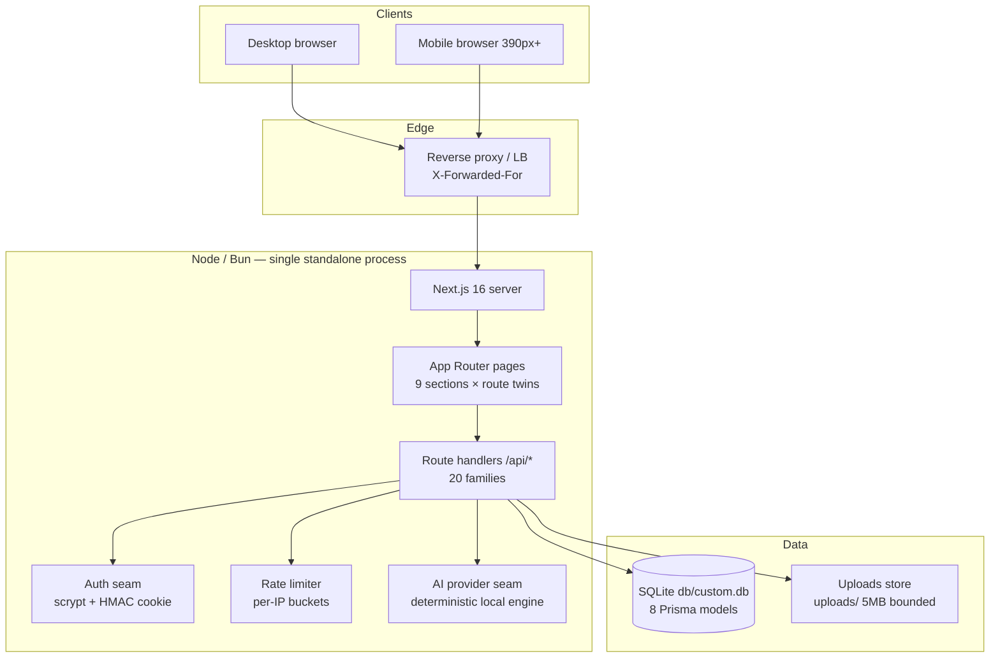

# WealthOS — Master Project Architecture Document (PAD) v2.0.0

**Classification:** Internal Engineering Reference
**Status:** DEFINITIVE, PRODUCTION-LOCKED BLUEPRINT
**Companion Document:** `docs/implementation-plan-session-199-wealthos.md` (the transformation plan)
**Last Updated:** 2026-11-12
**Audience:** Senior Engineers, Tech Leads, DevOps, and Onboarding Engineers
**Rule:** Every architectural decision in this document traces to a specific rationale.
Nothing is here "because it's popular."

---

#### Revision Block — v2.0.0 (Tracked Changes)

Every change is tagged with its source: `[RES]` = validated by web research,
`[SR]` = self-review, `[CA]` = critical analysis, `[SYN]` = synthesis,
`[SAN]` = sanitization pass, `[AUTH]` = auth alignment.

- [SR] v2.31.0 (session 234, R-31 — the in-flight-guard, OTP-restart,
  and logout-gate round): the fresh-eyes audit (three Mode-C passes —
  the R-30 cure surfaces driven by the session, the API/auth/security
  layer, and the UI/a11y/shell layer; 0 Critical / 0 High / 0 Medium /
  6 Low / 8 Informational raw, every material claim re-verified at
  file:line, R-30's nine pinned cures all verified holding; the cold
  baseline GREEN at HEAD — the v2.30.0 ship state reproduced exactly,
  no discovery; the standing layers re-verified: the reference STABLE
  on every drift layer incl. the TRUE-390 mobile menu with 9
  destinations, `bun audit` unchanged, neo-crm unchanged, the SEO
  surface green, the .env contract and the vitest/playwright configs
  standing). The cures: THE SETTINGS-FETCH TRI-STATE (F-234a — the
  could-not-load guard flashed on every hard load under real latency:
  hydrate commits its loading drop BEFORE the settings await, so the
  guard read the in-flight window as failure; the store's settled
  flag flips in both arms of the fetch and resets on hydrate/logout,
  the page's reason line keys on it); THE IMPORT PARSE SEQUENCE GUARD
  (F-234b — a re-pick mid-parse let the slower extract's state land
  last (a wrong-review-committed path) and the extract button sat
  enabled inside the parse window (the retired re-parse reachable
  again); the page gains the monotonic parse token + the in-flight
  flag in the disabled set); THE FULL-CODE PASTE RESTART (F-234c — a
  whole-code paste into a later box distributed from the edited box,
  so the type-then-paste flow submitted a rotated code and burned an
  attempt; an exactly-full-length edit restarts at box 1, partial
  pastes keep the from-edited-box semantics, e2e-proven RED→GREEN via
  the stash round-trip); THE OTP PASTE E2E LEG (F-234d — the
  paste/autofill path gains its browser-level pin riding the existing
  signup budget: one digit typed, the whole code delivered into box
  2, the six distributed boxes + final-box focus + the signed-in
  landing asserted); THE UPLOADS CAPACITY-WALK GUARD (F-234e — a file
  vanishing between the directory read and the size read threw past
  the envelope at the pre-write call site; vanished entries skip both
  counters); THE BUDGET-ADD BUSY GUARD (F-234f — the mutation
  family's last unguarded trigger, mirroring the sibling delete
  control); THE LOGOUT GATE REORDER (F-234g — the route burned the
  SHARED writes bucket before the content-type gate, the pre-parse
  burn genus's seventh surface at broader scope; the gate moves above
  the bucket: logout reads no body, the gate is its CSRF defense);
  the low tail (F-234h the delete-glyph aria-hidden wrap; F-234i the
  cascade-dead ink-token retirement from the gradient KPI class
  string; F-234j the dead-export retirement — the expenses dialog and
  the theme resolver; F-234k the two e2e status-role comment
  re-attributions). Recorded, not cured: F-234l (the verify success
  write's unconditional form — benign, self-healing), F-234m (the
  un-memoized-derivation genus beyond the Dashboard — folds into the
  recorded finding), F-234n (the footer copyright's hardcoded year —
  parity-constrained). The recursive F-229d genus caught ONCE more —
  the restart cure's own comment coined a hyphenated distribution
  description that parsed as a scale utility (reworded; the
  cure-comment edition, catch six). Verification: lint 0/0 · tsc 0 ·
  1302 unit (82 files, +20: +17 parity-234 + 3 verification-code) ·
  build · smoke 15/15 · 140 e2e (the paste leg extends the existing
  test) · all six parity drift gates CLEAN at 0-event margin · census
  MATCH; the captures 143-145 verified in-DOM with the census
  tripwire.
- [SR] v2.30.0 (session 233, R-30 — the OTP-paste, live-region, and
  dependency-hygiene round): the fresh-eyes audit (three Mode-C passes —
  the R-29 cure surfaces driven by the session, the API/auth/security
  layer, and the UI/a11y/shell layer; 0 Critical / 0 High / 1 Medium /
  5 Low / 10 Informational raw, every material claim re-verified at
  file:line, R-29's nine pinned cures all verified holding; the cold
  baseline GREEN at HEAD — the v2.29.0 ship state reproduced exactly,
  no discovery; ONE audit-brief location attribution corrected against
  the plan's own row — the F-232h revoke deferral lives in the
  analytics page, not the format seam). The cures: THE OTP
  PASTE/AUTOFILL DISTRIBUTION (F-233a Medium — the six-box code entry
  kept only the LAST digit of a multi-digit input, so the one-time-code
  autofill and every whole-code paste collapsed to a single digit and
  the length guard blocked the submit; the pure applyCodeInput seam in
  src/lib/verification.ts distributes multi-digit edits across the
  boxes from the edited one with focus landing after the last filled —
  single-digit typing and the backspace walk byte-identical, behavioral
  pins over the full/partial/junk/overflow/mid-box paste family, NO
  maxLength on the boxes — a browser cap truncates a paste before the
  handler sees it); THE ORPHANED LABEL-PRIMITIVE DEPENDENCY RETIREMENT
  (F-233b — the F-232a file deletion left @radix-ui/react-label riding
  the manifest with zero importers, the dead-stock genus dependency
  edition; removed through the package manager with the lockfile
  regenerated, import+manifest+lockfile pins); THE LOGIN INFO-CALLOUT
  LIVE REGION (F-233c — the resend-confirmation banner mounted its
  status role with its content, the F-218h genus on the last uncurated
  surface; the sr-only region now pre-exists in the verify view, empty
  when idle, the callout is the visual only; the F-219v pin re-anchored
  to the new seam); THE SETTINGS SAVE GUARD (F-233d — a silently
  failed settings fetch left the form offering hard-coded defaults a
  Save would persist over stored preferences; Save disables with the
  amber reason line while the slice is missing — closes the overwrite
  path where it bites without muddying the dashboard's error
  semantics); THE IMPORT DOUBLE-PARSE RETIREMENT (F-233e — the extract
  button re-parsed an already-parsed file on every flow-through; the
  button is the retry affordance now, disabled once the review stands —
  the eager-parse-at-selection UX stays); THE RESET-TOKEN URL STRIP
  (F-233f — the one-time token rode the address bar for its 60-minute
  life; the screen captures it once at mount and history.replaceState
  clears the query, the OAuth-callback hygiene form, e2e-proven
  RED→GREEN via the stash round-trip with the round-trip leg's URL
  assertion recalibrated in the same commit); THE UPLOAD BREACH-UNLINK
  ISOLATION (F-233g — a faulting unlink on the TOCTOU breach path
  answered 500 instead of the honest 507; the unlink rides its own
  try/catch, log-and-continue); THE AUTH-FACE SUSPENSE BOUNDARIES
  (F-233h — login/signup wrap their search-params reader in the
  boundary the reset-password twin already carries, defusing the
  force-dynamic coupling); the low tail (F-233i the F-232j count
  correction to fourteen; F-233j the amber-arm comment scope with the
  F-226m-registered white-ink exception cited; F-233k the select.tsx
  checkbox narration). Recorded, not cured: F-233l (the pre-parse
  rate-bucket burn — the correct anti-brute-force order kept, the
  browser-originated burn face documented beside F-224k/F-218t),
  F-233m (the data-reset posture — no UI consumer, an e2e/operator
  utility adding no capability a session-holder lacks), F-233n (the
  theme pathname effect's one-paint residual), F-233o (the audit-brief
  attribution record). The recursive F-229d genus caught TWICE more
  this round, in two NEW domains: the plan's own F-232j correction
  note spelled the mis-recorded word and tripped the correction's own
  pin (reworded), and the Suspense-boundary comments named the hook
  the route-case URL-state scan greps for (reworded — the discipline
  binds test-source scans, not just the Tailwind content scan).
  Verification: lint 0/0 · tsc 0 · 1282 unit (81 files, +28: +18
  parity-233 + 10 verification-code) · build · smoke 15/15 · 140 e2e
  (+1 — the strip leg) · all six parity drift gates CLEAN at 0-event
  margin · census MATCH; the captures 140-142 verified in-DOM with
  the census tripwire.
- [SR] v2.29.0 (session 232, R-29 — the dead-stock retirement,
  carrier-net repair, and dialog-focus round): the fresh-eyes audit
  (three Mode-C passes — the R-28 cure surfaces driven by the
  session, the API/auth/security layer, and the UI/a11y/shell
  layer; 0 Critical / 0 High / 0 Medium / 13 Low / 9 Informational
  raw, every material claim re-verified at file:line, R-28's
  twelve pinned cures all verified holding — the F-231b guards
  StrictMode-idempotent, the F-231h family intact, the token
  system mechanically airtight, no adjudications — every claim
  confirmed as-found; the cold baseline GREEN at HEAD — the
  v2.28.0 ship state reproduced exactly, no discovery this
  round; the reference STABLE on all standing layers with the
  TRUE-390 mobile menu re-verified by probe:ref; `bun audit`
  unchanged; neo-crm upstream unchanged). THE VENDORED
  DEAD-STOCK RETIREMENT (F-232a Low): card.tsx, table.tsx,
  label.tsx, and input.tsx — four zero-consumer shadcn-stock
  files with no KEEP register entry — retired per the F-231h
  Avatar precedent, with their page-layout riders (the input
  base map, the dialog textarea, the checkbox kit) and the
  surviving Event/Activity citation; the F-230f pin retired
  with its subject file, the parity-228 carriers list
  recalibrated. THE CARRIER-NET REPAIR (F-232b Low): the
  tabs.tsx border-primary citation reworded per F-229d AND the
  parity-229 PROSE_ALLOWLIST compound entry that hid the dead
  utility behind its live sibling REMOVED — the allowlist is
  not a carrier sanctuary; the globals.css danger-soft hover
  citation reworded to the token-naming form. THE EXPENSES
  DIALOG STEP-SWAP FOCUS (F-232c Low): the F-231b genus on the
  app's highest-traffic dialog — the value-guarded prevStepRef
  effect lands focus on the description input (quick→form, the
  prefilled chip path, edit-mode opens) and the Quick Select
  heading (form→quick, tabIndex -1); the initial create-mode
  open keeps Radix's natural focus; e2e-proven RED→GREEN (the
  honest Expected-focused/Received-inactive failure at the
  pre-cure build). THE HAMBURGER ARIA-CONTROLS (F-232d Low):
  the drawer sheet gains id="mobile-nav-drawer" and the
  trigger aria-controls — the expenses-filters precedent. THE
  ALWAYS-MOUNTED LOADING LIVE REGION (F-232e Low): the F-218h
  genus — the region pre-exists in the a11y tree OUTSIDE main
  (the census-safe placement, the toast viewport precedent),
  empty when idle, the label swapping in on the loading flip;
  LoadingBlock becomes the sighted-user visual only; the
  parity-224 F-224aa pin re-anchored to the new seam. THE
  STALE AMBER ARM RETIREMENT (F-232f Low): the bg-amber-500
  axe sanction arm retires per the F-220p precedent — every
  live amber fill carries stone-900 ink since F-219a. THE
  UPLOAD CAPACITY POST-WRITE RE-CHECK (F-232g Low): the TOCTOU
  cure — each writer re-reads the settled capacity after the
  write and unlinks its own just-written file on breach
  (STORAGE_FULL). The low tail (F-232h): the unused CURRENCIES
  import, the BrandMark collapse arm, the SHELL_LAYOUT.sidebar
  consumption (the sidebar's duplicate literal retired), the
  icon/bare page-layout member retirements, the exportCsv
  revoke defer. THE LINE-STRONG REGISTRATION (F-232i): the
  strongest-hairline token joins the F-224t reserved register
  with its citation — pinned, flipped, deliberately unwired.
  Verification: lint 0/0 · tsc 0 · 1254 unit (79 files, +19)
  · build · smoke 15/15 · 139 e2e (the focus assertions extend
  the +$10 quick-add leg) · all six parity drift gates CLEAN
  at 0-event margin · census MATCH; the whole-tree carrier
  invariant caught the round's own recursive genus twice more
  (the retirement comments named the retired identifiers).
  Recorded, not cured: the whole-store subscription idiom
  (F-232j — a dedicated round), the import replay guard
  (F-232k), the first-admin count race (F-232l — role is
  inert), the CSP posture (F-232m), the login-card logo
  narration (F-232n), the between-footer comment (F-232o).
- [SR] v2.28.0 (session 231, R-28 — the a11y-tail,
  logging-grain, and dead-family round): the fresh-eyes audit
  (three Mode-C passes — the R-27 cure surfaces driven by the
  session, the API/auth/security layer, and the UI/a11y/shell
  layer; 0 Critical / 0 High / 0 Medium / 8 Low / 12
  Informational raw, every material claim re-verified at
  file:line, ONE claim adjudicated by live probes plus a bundle
  grep — the Analytics "Spending by Day of Week" card is OUR
  OWN SUPERSET (probe-231/b/c walked the reference's four
  Analytics tabs at its standing zero demo data: no day-of-week
  card on any tab, and the reference's 1.4 MB JS bundle carries
  no such string — the amber fill was never reference parity
  but our own palette mis-assignment); the two Pass-B "Lows"
  were adjudicated as AUDIT-BRIEF CONTRACT-TEXT ERRORS (the
  uploads GET is public capability-URL serving per its own
  docblock + the recorded F-225i/F-217g posture, and
  forgot-password is 10/15 per the F-222n ledger — the code
  matches the repo's documented contracts; the brief misstated
  both); the cold baseline GREEN at HEAD — the v2.27.0 ship
  state reproduced exactly, no discovery this round; the
  reference STABLE on all standing layers with the TRUE-390
  mobile menu re-verified by probe:ref; `bun audit` unchanged;
  neo-crm upstream unchanged). THE EXPENSES DIALOG GLYPH
  HIDING (F-231a Low): the amber "$" tile in the Add/Edit
  Expense title carried no aria-hidden — the F-225k family's
  one miss; screen readers announced a stray "dollar sign"
  before every dialog title. THE AUTH-CARD VIEW-SWAP FOCUS
  (F-231b Low): four of five in-place view transitions dropped
  focus to body with no announcement (the verify view's box-1
  focus proved the pattern in-tree); every transition now lands
  focus on the new view's heading via the value-comparison
  guard — the first boolean mountedRef design fell to the dev
  server's StrictMode double-invoke (live-caught by the
  captures face: the second invoke saw the flag set and fired
  the focus on the INITIAL load; the production-build e2e
  passed — a dev-only failure class now in AGENTS). THE
  DROPDOWNCONTENT Z-PIN (F-231c Low): the dead vendored
  Popover family's content re-pinned from the skip-link's
  dedicated 60-level to the menu family's 50-level — and the
  re-pin orphaned two comments citing the old token as live
  code, caught by the parity-229 whole-tree carrier invariant
  (the recursive genus a third time). THE ICONS.TSX RETIREMENT
  (F-231d Low): the CRM-era hand-rolled FilterPolygon glyph —
  zero consumers, a "Used by the dashboard Filter, leads
  Filters and contacts Filters" citation naming surfaces that
  do not exist in WealthOS, and no polygon glyph in the
  reference's bundle — retired per the F-229f re-entry rule;
  the N-89c6 lucide-injection note relocated to the KpiCard
  delta icons. THE DAY-OF-WEEK FILL (F-231e Low): the bar rides
  CHART_COLORS.expenses (the spending rose) per the palette
  doctrine — drift-inert by construction (the sweep baselines
  are zero-data; the card renders its EmptyState at zero
  data). THE UPLOAD MULTIPART LOG (F-231f Low): the formData
  catch swallowed the parse error — the one F-226c-genus site
  outside the logging retrofit; it logs before the 400 now. THE
  UPLOADS GET ENOENT GATE (F-231g Low): a 404 on a capability
  URL is the normal miss, not a server fault — ENOENT stays
  out of the error log; real I/O failures still log. THE
  CRM-ERA DEAD-FAMILY RETIREMENT (F-231h Low): the wide-footer
  component + the wide geometry arm + the wide footer constant
  + the initials-avatar family (five zero-consumer CRM-era
  constructs in live files) retire; the two "Event/Activity"
  citations reworded to the historical record; the shadcn-stock
  arms (button variants/sizes, the Dialog primitive
  re-exports) stay registered per the F-227f doctrine. The low
  tail: the TrendingDown aria-hidden symmetry + the N-89c6
  note's new home (F-231i); the expenses memo on the stable
  store identity (F-231j); the vestigial peer class retired
  (F-231k); the trailing docblock rot folded (F-231l). The
  counts: 1218→1235 / 77→78 / 138→139 e2e / the badge
  1356→1374 / the pins row 49→50 with parity-231.
- [SR] v2.27.0 (session 230, R-27 — the register-and-hygiene
  round): the fresh-eyes audit (three Mode-C passes — the R-26
  cure surfaces driven by the session, the API/auth/security
  layer, and the UI/a11y/shell layer; 0 Critical / 0 High /
  2 Medium / 4 Low / 5 Informational raw, every material claim
  re-verified at file:line, TWO claims adjudicated by live
  reference probes — the StatCard genus CONFIRMED (probe-230c:
  the reference's own /Analytics Avg Monthly tiles carry the
  identical saturated 500→600 gradients, minus-100 label inks
  rgb(209,250,229)/rgb(254,226,226)/rgb(219,234,254), and
  white bold values, at its standing zero demo data) and the
  Cash Flow zero-data claim INVERTED (probe-230: the
  reference's own dashboard card renders FOUR recharts surfaces
  unconditionally at zero data — our unconditional render IS
  the genus; the presence-predicate recommendation would have
  deviated from parity); the Pass B findings re-derived the
  recorded tail (F-217m in-band delivery, F-215m inert role,
  F-218t XFF default, F-224k bucket lockout) without new
  information; the cold baseline GREEN at HEAD — the v2.26.0
  ship state reproduced exactly, no discovery this round; the
  reference STABLE on all standing layers with the TRUE-390
  mobile menu re-verified by probe:ref; `bun audit` unchanged;
  neo-crm upstream unchanged). THE STATCARD REGISTER ENTRY
  (F-230a Medium): the analytics Avg Monthly tiles' sub-AA ink
  arms join the F-224y WCAG exemption register at their own
  surface — measured emerald-100 on emerald-500 = 2.24:1,
  red-100 on red-500 = 3.08:1, blue-100 on blue-500 = 3.01:1,
  the white text-2xl values 2.54:1 at the emerald-500 side
  (passing on the 600 side); the genus citation confirmed live;
  the register is the record, never a recolor (the audit's
  darken recommendation rejected — parity wins, the F-226i
  lesson). THE LASTSYNCEDAT TODATE TIDY (F-230c): the sole raw
  new Date() at a display seam (accounts:171) routes through
  toDate — behavior-identical (the true-timestamp
  fall-through), the doctrine's grep clean again. THE
  PHANTOM-BREAKPOINT COMMENT REWORDS (F-230d): the two
  F-207a-history quotes reworded to prose; the parity-229
  whole-tree carrier invariant holds (18/18). THE AI-COACH
  MESSAGE-ID KEYS (F-230e): the CoachMessage model gains an id;
  a module-level counter mints at the three construction sites
  (a ref counter trips react-hooks/refs — the greeting consumes
  the mint DURING render; the module form is the sanctioned
  mint); the list keys by message.id; the import preview rows
  and the OTP boxes documented as index-identity by design. THE
  CARD_TITLE_OVERRIDE TRUTH (F-230f): the docblock names the
  real per-call className mechanism. The counts: 1211→1218 /
  76→77 / 138 e2e unchanged / the badge 1349→1356 / the pins
  row 48→49 with parity-230.
- [SR] v2.26.0 (session 229, R-26 — the empty-state repair and
  dead-carrier retirement round): the fresh-eyes audit (three Mode-C
  passes — the R-25 cure surfaces driven by the session, the
  API/auth/security layer, and the UI/a11y/shell layer; 0 Critical /
  0 High / 1 Medium / 6 Low / 5 Informational raw, every material
  claim re-verified at file:line, two claims ADJUDICATED INVERTED by
  live reference probes — the dialog-title alignment and the analytics
  captions; the cold baseline GREEN at HEAD, the v2.25.0 ship state
  reproduced exactly, no discovery this round; the reference STABLE on
  all standing layers with the TRUE-390 mobile menu re-verified by
  probe:ref; `bun audit` unchanged; neo-crm upstream unchanged).
  THE INCOME-TAB EMPTY-STATE REPAIR (F-229a Medium): the F-219r gate's
  birth defect — categoryTrend unconditionally returns one zero point
  per month, so the Income tab's length===0 gate NEVER fired and a
  zero-income viewer saw a flat all-zero chart; the gate now rides an
  income-presence predicate, e2e-proven on a pre-corpus range. THE
  BUDGETS P2002 RACE ARM (F-229b): the one unique-keyed mutation
  surface missing the settings family's concurrent-create arm — the
  catch now retries the upsert once (last-writer-wins, the honest
  semantics). THE SEED UTC-MIDNIGHT STAGING (F-229c): the seed was the
  sole writer of local-noon calendar instants (a viewer 12h+ ahead of
  the seeding server read every seeded date one day late); every
  seeded calendar date now stages as a UTC midnight (the dateField
  identity). THE DEAD-CARRIER RETIREMENT (F-229d): THIRTY
  comment-only class-shaped tokens emitted dead utilities across 16
  files (the audit's fixed-list found nine; the whole-tree
  built-CSS × live-code diff found thirty); ~28 comment sites
  reworded, a WHOLE-TREE carrier invariant joined the pins (every
  class-shaped comment token must be live or prose-allowlisted — the
  fixed-list form retired), and the CSS sentinel probe proved all 30
  selectors leave the built stylesheet (103,673 → 100,431 bytes) with
  the live forms staying. THE DIALOG DOCBLOCK TRUTH (F-229e): the
  S15-P3 "centers below sm" claim live-probed FALSE (the reference's
  own Add-Expense title is left-aligned at 390); our constant already
  carried the genus. THE DEAD-API RETIREMENT (F-229f): the unread
  presetCategory prop, two zero-consumer constant maps, five unused
  format helpers with their nonexistent-test citation, the empty nav
  array, and the pill Tabs variant + cols + the GRID_COLS map (the
  driving session's own finding — zero consumers; the N-66b
  grid-cols claim was factually wrong); the underline variant stays
  as the documented default genus. The low tail (F-229h the search
  Postgres case-folding note, F-229j the hygiene pass). The counts:
  1192→1211 / 75→76 / 137→138 / the badge 1329→1349 / the pins row
  47→48 with parity-229; two legitimate pin recalibrations (the
  parity-226 pill arm retires with the constant, and the docs-counts
  constants).
- [SR] v2.25.0 (session 228, R-25 — the second holdings surface and
  hygiene round): the fresh-eyes audit (three parallel Mode-C passes
  — the R-24 cure surfaces, the API/auth/security layer, and the
  UI/a11y/shell layer; 0 Critical / 0 High / 0 Medium / 7 Low / 10
  Informational raw, every material claim re-verified at file:line —
  the cold baseline GREEN at HEAD, the v2.24.0 ship state reproduced
  exactly, no discovery this round; the reference STABLE on all
  standing layers with the TRUE-390 mobile menu re-verified by
  probe:ref; `bun audit` unchanged; neo-crm upstream unchanged).
  THE SECOND HOLDINGS SURFACE (F-228a Low): the Analytics "Holdings
  Performance" chart still keyed its bar data and Cells by SYMBOL —
  the F-227b duplicate-symbol genus surviving in its last surface
  (two same-symbol lots: duplicate React keys AND two bars
  overlapping at one X category); a `gainBySymbol(holdings)` fold
  joined the finance seams (one row per symbol, gains summed,
  round2 at the boundary, first-appearance order) and the chart
  rides it — e2e-verified: the seeded 6 symbols + the folded pair
  render 7 bars, pre-cure 8. THE TIMING-EQUALIZER FAMILY
  COMPLETION (F-228e Low): verify/resend answered their
  unknown-email/no-pending-code miss branches IMMEDIATELY while the
  known branches burned scrypt (~50–100 ms) — latency leaked the
  pending-verification state the byte-identical banners hide; both
  miss branches now burn the equalizer (verify:
  `verifyVerificationCode(code, timingEqualizerHash())`; resend:
  `hashVerificationCode(generateVerifyCode())` — the login S72-C
  pattern; the DB-write residual documented, the forgot-password
  posture). THE UPLOAD CAPACITY CEILING (F-228f Low + F-228i): the
  write-only uploads surface (zero UI consumers; nothing in src/
  ever deletes a file) grows unbounded over time (20×5MB/15min/IP ≈
  9.6 GB/day); the seam gains `MAX_UPLOADS_TOTAL_BYTES` (256 MB) +
  `MAX_UPLOAD_FILES` (4096) + an `uploadsCapacity(dir)` walk, the
  POST route refuses past either ceiling with the new
  `ERR.STORAGE_FULL()` (507 — the envelope's first 507), and the
  repo-root anchor memoizes per process; the owner-tag/retention
  design (files are anonymous UUIDs — per-user cleanup needs a
  schema change) recorded in the ledger. THE SCHEMA ROUND (F-228g
  Low + F-227h folded): `@@index([accountId])` on Transaction (the
  `onDelete: SetNull` cascade full-scanned the table per deleted
  account row — SQLite does not auto-index FKs) and
  `@@index([resetToken])` on User (the recorded
  next-schema-round item — the public reset lookup). THE LOW TAIL:
  F-228b the eight dead @theme tokens retire (brand, subtle, and
  the six zero-consumer F-214e members — several compiled into the
  production CSS ONLY because comment strings named their
  utilities, the F-224v violation; eleven comment carriers reworded
  including two in button.tsx the audit pass missed; the built CSS
  proven to shrink 104,409 → 103,673 bytes by the before/after
  sentinel probe with the live utilities staying); F-228c the
  Analytics CSV export's Date column string-slices the stored form
  (`t.date.slice(0, 10)`) — the one place a raw parse was a
  UTC-midnight identity and a toDate "tidy" would have shifted
  every UTC+ export a day early; F-228d `upcomingAlerts` carries
  the transaction id and the dashboard Upcoming list keys by it
  (the recentActivity pattern); F-228h `getSessionUser` selects its
  eight consumed fields (no passwordHash/resetToken/
  verificationCodeHash in scope on the hot path); F-228j budgets
  DELETE answers NOT_FOUND on count===0 (the [id] doctrine
  uniform); F-228k the Expenses filters trigger/panel id-link via
  aria-controls; F-228l the two stale docblocks corrected
  (spendingByDayOfWeek is day-of-WEEK; the badge comment's
  pre-rebrand #2563eb citation → the amber #f59e0b). The
  verification: lint 0/0 · tsc 0 · 1211 unit (76 files) · build ·
  smoke 15/15 · 138 e2e · ALL SIX parity drift gates CLEAN · census
  MATCH · `bun audit` unchanged; the capture set 125-127 (the
  aggregated one-bar-per-symbol chart with two same-symbol lots,
  the mobile drawer at 390 with the 9 destinations, the Expenses
  filters popover with the aria-controls link); docs lockstep
  everywhere (the counts 1162→1192 / 74→75 / 136→137 / the badge
  1298→1329 / the pins row 46→47 with parity-228; two legitimate
  pin recalibrations: the palette-pins F-214e row and the
  dark-tokens subtle-flip assertion — contracts that legitimately
  shrank).
- [SR] v2.24.0 (session 227, R-24 — the build-gate repair and
  wrong-row identity round): the fresh-eyes audit (three parallel
  Mode-C passes — the R-23 cure surfaces, the API/auth/security
  layer, the UI/a11y/shell layer; 0 Critical / 1 High / 1 Medium /
  6 Low / 8 Informational raw, every material claim re-verified at
  file:line — the High was the driving session's own cold-baseline
  discovery: the owner's post-226 session-log commit created
  `docs/worklog.md` as a relative symlink targeting `worklog.md`,
  which resolves from docs/ to ITSELF — an infinite loop — and
  `bun run build` FAILED at HEAD (Turbopack's DirAssetReference
  walked the loop through the upload routes' file tracing); the
  Medium — the investments holdings table resolving rows by SYMBOL —
  was live-reproduced (two same-symbol lots: duplicate React keys;
  Edit on the second lot's row opened the FIRST lot's record — and
  Delete silently removed the wrong row). THE SYMLINK-LOOP BUILD
  REPAIR (F-227a High): the alias repointed to `../worklog.md` (the
  owner's intent preserved — legacy docs/worklog.md references
  resolve to the canonical root log); pinned by a
  resolves-and-matches test (parity-227). THE HOLDINGS IDENTITY CURE
  (F-227b Medium): the portfolioStats seam carries each holding's id
  onto its stats row (id-less pure-math inputs answer ""); the
  holdings table keys and resolves by row.id — an id-less row's
  action buttons go inert (strictly better than acting on the wrong
  record); e2e-verified: Edit on the second same-symbol lot prefills
  the SECOND record. THE CONDITIONAL-MUTATION REFACTOR (F-227c Low +
  F-227l): all ten [id] PUT/DELETE sites across the five resource
  families (transactions, accounts, income-sources, investments,
  goals) moved to the atomic conditional form — updateMany/deleteMany
  with ownerId in the WHERE (the reset-password precedent), count===0
  answering NOT_FOUND, a fresh re-read feeding the PUT envelope —
  closing the guard-then-mutate TOCTOU; the transactions account-link
  FK race answers BAD_REQUEST via the new isForeignKeyViolation P2003
  seam in db.ts (never an anonymous 500). THE LOW TAIL: F-227d
  wealth-os_SKILL.md joins the outputFileTracingExcludes list (the
  F-170a gap); F-227e the investments Edit button gains the
  row-context sr-only tail (the F-226k miss — its own Delete already
  carried it); F-227f the Button/Badge destructive variants gain
  measured-value contrast citations (the F-225l/F-226m register —
  both are latent sub-AA arms with zero live consumers); F-227m the
  Analytics range filter routes its three parses through toDate
  (behavior-identical, doctrine-uniform at the seam); F-227n the
  three dead radius tokens retire from @theme. The verification:
  lint 0/0 · tsc 0 · 1162 unit (74 files) · build · smoke 15/15 ·
  136 e2e · ALL SIX parity drift gates CLEAN · census MATCH ·
  `bun audit` unchanged; the capture set 122-124 (the duplicate-
  symbol identity dialog, the mobile drawer at 390 with the 9
  destinations, the row-context Edit buttons on the seeded corpus);
  docs lockstep everywhere (the counts 1136→1162 / 73→74 /
  135→136 / the badge 1271→1298 / the pins row 45→46 with
  parity-227).
- [SR] v2.23.0 (session 226, R-23 — the escape-family completion and
  per-casing metadata round): the fresh-eyes audit (three parallel
  Mode-C passes — the R-22 cure surfaces, the API/auth/security
  layer, the UI/a11y/shell layer; 0 Critical / 0 High / 4 Medium /
  8 Low / 8 Informational raw, every material claim re-verified at
  file:line — the csv escapes live-probed under TZ switching across
  three zones, the dark menu surface live-probed on BOTH apps, the
  ring-offset claim ADJUDICATED INVERTED by live probe, the V8
  design probes run BEFORE implementation). THE DESIGNATED-TAIL
  ESCAPE COMPLETION (F-226a Medium): seven regex-shape families the
  R-22 taxonomy missed still staged the VIEWER's calendar —
  case-insensitive utc/gmt, the leading weekday (RFC-822 "Thu, 01
  Jan 2026 00:00:00 GMT" staged 2025-12-31 in New York — wrong day
  AND year), separator lenience, the meridiem before the designator,
  V8's named zones ("Dec 31, 2026 8:00 PM EST" staged 2027-01-01),
  the compound UTC±/GMT± tails, and the month-year family WITH a
  tail ("Nov 2026 UTC" — the invented day AND the zone shift; "Nov
  2026 15 UTC" staged Nov 14 where 15 was written). Every designated
  tail now routes to the written-literal staging doctrine (the `i`
  flag, the named-zone set, the compound suffixes, the weekday
  prefix, the meridiem, the lenient separators, the name-year-day
  arm); the rejection family carries the designated NAMED tail —
  never the bare offset (the "2026-11-01" hazard: a bare-offset tail
  on the numeric partial would null every ISO date). THE PER-CASING
  METADATA (F-226b Medium): the eight lowercase section routes served
  the ROOT head (title "WealthOS", canonical "/") while the reference
  serves per-casing canonicals at both casings — eight pass-through
  segment layouts now export pageMetadata at their own route;
  /Dashboard keeps the ROOT head (the reference's own posture). THE
  API ERROR LOGGING (F-226c Medium): the logApiError seam + every
  catch site (31 routes + the session guard) logs the scope + error
  before the envelope — production failures are diagnosable. THE
  TRANSACTION COMPOUND INDEX (F-226d): @@index([ownerId, date]) —
  the heavy read family's sort is index-backed. THE LOW TAIL:
  the uploads GET 429 joins the ERR.RATE_LIMITED family (F-226e);
  captures-225 joins the pin family (F-226f); the spawn-liveness
  check (F-226g); the bucket-exhaustion record (F-226h); the
  TABS_SEGMENTED ring-offset ADD — the audit's retirement claim was
  INVERTED, the reference itself carries the class (F-226i); the
  quick-adder group role (F-226j); the row-context sr-only tail on
  four surfaces (F-226k); MenuContent joins the token family — the
  reference's dark panel measures rgb(10,10,10)/rgb(38,38,38)
  (F-226l); the gradient-contrast exemption register, the F-224y
  pattern (F-226m); the ±HH comment truth (F-226n); the 24:00 edge
  pin (F-226o); the bucket-window pin extension (F-226p); the
  verify/resend email format (F-226r). Gate at ship: lint 0/0 ·
  tsc 0 · 1162 unit (74 files) · build · smoke 15/15 · 136 e2e ·
  six drift gates CLEAN · census MATCH · bun audit unchanged.
- [SR] v2.22.0 (session 225, R-22 — the designated-tail completion and
  tooling-hygiene round): the numeric year-month partials joined the
  null family (F-225a) and every designated tail now stages the
  WRITTEN calendar (F-225b — the space-before-offset and the UTC/GMT
  named tails on the ISO arm; the named/day-first/numeric
  locale-designated arms, 4-digit years, round-trip-guarded; the
  two-digit designated numerics skip per the remap doctrine); the
  verify/resend email-keyed buckets mirror F-222n (F-225c); the
  focused skip link paints above the mobile header (F-225d —
  focus:z-[60], a 390 topmost e2e leg); the capture family rides
  db/captures.db with a census tripwire (F-225e — the scratch-user
  census break, live-confirmed); the hygiene tail (F-225f–m: the
  search docblock's delivered truth, the two-digit rolled residual
  pin, the route-level search leg, the uploads bucket, the
  global-error <main>, the six aria-hidden icons, the
  destructive-ink citation, the shell re-indent). Gate at ship:
  lint 0/0 · tsc 0 · 1088 unit (72 files) · build · smoke 15/15 ·
  126 e2e · six drift gates CLEAN · census MATCH.
- [SR] v2.21.0 (session 224, R-21 — the date-guard completion and
  resilience-surface round): the fresh-eyes audit (three parallel
  Mode-C passes — the R-20 cure surfaces, the API/auth/security layer,
  the UI/a11y/shell layer; 0 Critical / 0 High / 2 Medium / 11 Low /
  14 Informational raw, every material claim re-verified at file:line,
  the two Mediums live-reproduced: the YMD-slash rollover bypass
  staged "2026/02/30" as Mar 2 under probes on all three zones, the
  verify oracle's numeric tell read off the post-increment ladder).
  THE DATE-GUARD COMPLETION (F-224a Medium): `localeRollover`'s
  year-length gate read the MDY year position only (`c.length !== 4`
  gates the DAY for YMD) — the shape-aware year gate resolves
  YMD-vs-MDY first (`Number(a) >= 1000`), the round-trip comparison
  now fires for the shapes it exists to check; the month-year family
  (F-224c): the rejection family became form-precise (separator
  class `[\s.-]`, an optional TIME tail, the reversed twin
  `^\d{4}[\s.-]+[A-Za-z]{3,9}(time)?$`) so the day-carrying forms
  ("Nov 2026 15", "2026 Nov 15 10:00") keep staging while the no-day
  forms ("2026 Nov 10:00", "Nov 2026 10:00") skip — the F-223d
  lesson (a bare lookahead would reject the day-carrying forms) held.
  THE VERIFY ORACLE (F-224b Medium): the no-pending branch answered
  "5 attempts remaining" — a value the genuine ladder can never
  produce (post-increment yields 4…1, then 429); it now answers the
  first rung 4, the single-probe reply byte-identical to a fresh
  pending code's (the residual two-probe differential documented in
  the route docblock — full closure needs per-email state on a
  stateless branch: rejected). THE LOGOUT HONESTY PAIR (F-224d/e):
  the revocation's first behavioral pin (mint → logout → replay the
  pre-logout cookie → `data:null`) — the leg rides a SCRATCH user
  (the F-223k bump is USER-level; a demo-account logout in any leg
  evicts the shared storageState for every later spec — the
  order-poisoning lesson, caught when the fixed leg poisoned the
  e2e run); the store's `logout()` now checks the `call()` result,
  surfaces failure through the store-error banner, and returns a
  boolean both signOut helpers gate navigation on. THE RESILIENCE
  SURFACES (F-224p/aa): global-error takes the error.tsx dark genus
  (world-robust under either activation reading), LoadingBlock gains
  `role="status" aria-live="polite"`, error.tsx regains its `<main>`
  landmark; the skip-to-content link (F-224s) — the shell's first
  child, sr-only until the first Tab reveals it, `href="#main-content"`
  with the main scroller carrying `id` + `tabIndex -1` (placement
  outside `main` keeps every drift gate green). The password set-time
  bound (F-224h: `passwordSchema.max(200)` — the reset flow's own
  contract unified; login stays unbounded, compare-only); the search
  LIKE strip (F-224j: `sanitizeSearchQuery` — a literal `%`/`_` no
  longer acts as a wildcard); the `@source not` family (F-224v —
  prose carriers can no longer emit production CSS, the built CSS
  shrank 48%, verified by before/after sentinel probes); the nine
  phone×dark a11y legs (F-224r) + the smoke leg 15 (rounded-full's
  infinity-form radius); the vendored-stock KEEP precedent (F-224q —
  N-56e respected, the dead import retired, `--color-danger-soft`
  flips in `.dark`); the demo-seed register row + the production
  warning (F-224i — §10 + DEPLOYMENT). Gate at ship: lint 0/0 ·
  tsc 0 · 1060 unit / 71 files · build · smoke 15/15 · 122 e2e ·
  all six parity drift gates CLEAN · census MATCH; the captures
  111-116 (six faces, each asserted in-DOM before commit).
- [SR] v2.20.0 (session 223, R-20 — the dead-signout and
  dark-surface completion round): the fresh-eyes audit (three
  parallel Mode-C passes — the R-19 cure surfaces, the API/auth/
  security layer, the UI/a11y/shell layer; 0 Critical / 2 High /
  6 Medium / 4 Low raw, every material claim re-verified at
  file:line — the two csv claims live-reproduced under
  TZ-switching probes on all three zones, the contrast claims
  computed to two decimals; the audit's two top security ratings
  adjudicated as RE-DISCOVERIES of the standing F-217m
  owner-decision record — not reopened). THE DEAD SIGNOUT
  (F-223a High): the desktop sidebar's Sign Out called bare
  `logout()` while the navigating `signOut` helper sat dead beside
  it — the store cleared to `hydrated:false, loading:true` and
  nothing re-rendered the server layout, so the desktop sign-out
  dead-ended on the "Loading your workspace…" gate until a manual
  reload (the mobile drawer's own signOut worked; the e2e battery
  covered the drawer path and only the desktop menu's ITEM
  VISIBILITY — the dead variable survived because no-unused-vars
  is off); the cure wires the MenuItem to `signOut()` + the
  desktop sign-out e2e leg. THE R-19 DARK-ARM REGRESSION (F-223b
  High): the round's own stone-50 dark ink on error.tsx's
  Try-again painted 2.06:1 on the UNFLIPPED amber fill (the light
  arm computes 8.14:1); every other amber CTA correctly carries no
  dark ink arm — the F-219a genus restored (stone-900 in both
  modes) with the parity pin recalibrated to the NEGATIVE form.
  THE MISSED-TOOLTIP PAIR (F-223c Medium): the dashboard
  Expense-Breakdown and investments Asset-Allocation donuts — the
  only two bare Tooltip sites repo-wide — joined the isDark
  family; the per-page pins become SITE COUNTS (every `<Tooltip`
  occurrence carries `contentStyle={tooltipStyle}`). THE CSV
  GUARD COMPLETION (F-223d Medium / F-223e Low): the F-222d
  rollover guard's `$`-anchored NUMERIC_LOCALE could not match a
  trailing time, so the common US bank-datetime shape staged the
  rolled day silently ("02/30/2026 10:00" → Mar 2,
  "02/29/2026 12:00 AM" → Mar 1 — live, TZ-independent; the
  date-only forms null) — the `(?!\d)` prefix anchor; month-only
  named forms ("Nov 2026") invented day 1 — the MONTH_ONLY
  rejection joins the PARTIAL_ISO doctrine. THE DARK-SURFACE
  FAMILY (F-223f/g/i Medium): the desktop synced pill's green-700
  light arm computed 3.49:1 on the ALWAYS-DARK sidebar gradient
  (the F-207h measurement rode the mobile topbar's light wash) —
  the unconditional green-400 pairing, the mobile twin keeps its
  arms; the investments type chips' 600/700 text inks computed
  2.02:1 over dark cards (the F-218k cure measured light cards
  only) — the `textDark` 400-level steps selected via isDark; the
  income/expenses pastel icon tiles rendered bright light chips on
  dark cards — the isDark alpha-tint ternaries (light rendering
  byte-identical; all six parity drift gates stayed CLEAN). THE
  FOCUS-RING TAIL (F-223h Medium): the sent view's Back, the
  AI-coach suggested-question chips + Send, and the
  reset-password Back-to-login joined the house/amber ring genus
  (the F-222g family's four missed controls). THE LOW TAIL
  (F-223j/k/l): the import error alert's light ink red-600 on
  red-50 = 4.41:1 → red-700; LOGOUT NOW REVOKES — the
  tokenVersion bump (the machinery the reset flow already rides)
  makes "sign out" mean revoke, an exfiltrated cookie no longer
  survives it for its 7-day TTL (the e2e sign-out legs re-mint
  the shared storageState the per-USER eviction kills); the
  verify route's no-pending branch returns the remaining-message
  form — the two 400 bodies are identical (no pending-state
  enumeration oracle). The suite: 1029 unit (68 files, +24) ·
  111 e2e (+1: the desktop sign-out leg) · smoke 14/14 · all six
  parity drift gates CLEAN · census MATCH.
- [SR] v2.19.0 (session 222, R-19 — the zone-designator completion
  and focus-affordance round): the fresh-eyes audit found the R-18
  form-branch carrying its target class twice more — the
  `UTC_DESIGNATED` regex was CASE-SENSITIVE, so RFC-3339-legal
  lowercase `z` fell into the locale branch and staged one day off
  on both zone edges (live-reproduced: New York
  "2026-11-01T01:30:00z" → 2026-10-31; Tokyo
  "2026-11-01T18:30:00z" → Nov 2; the year boundary → 2027-01-01),
  and it recognized only ±00:00, so NON-UTC offsets staged the
  VIEWER's calendar date — the identical file imported different
  books for different users ("+09:00" in New York → Oct 31;
  "-05:00" in Tokyo → Nov 2, the year boundary → 2027-01-01, all
  live). THE ZONE-DESIGNATOR CURE (F-222a/b Medium): the designated
  branch widens to every zone-designated ISO datetime (`[Zz]`,
  ±HH:MM/±HHMM) and stages the WRITTEN date literal — the offset's
  own wall-clock date, never the viewer's (for the Z/±00:00 forms
  observationally identical to the R-18 cure, so those pins stand);
  the partial-ISO rejection (F-222c: "2026"/"2026-11" → null — V8
  parses them as UTC day-1, and a skip beats an invented day); the
  rollover guard extends to every literal-staging branch (F-222d:
  "02/30/2026" rolled to Mar 2 while the bare branch nulled — now
  the locale numeric forms round-trip the MDY/YMD read of their
  digits). THE FOCUS-AFFORDANCE FAMILY (F-222g Medium): the
  hand-rolled interactives (PeriodSegment, the toast ✕, the
  app-shell Try-again, the auth face's Google/footer/back/resend
  buttons, the Expenses chips) carried no house focus ring — the UA
  default outline (≈3:1 under the globals tint) was their only
  affordance; the shared constants now carry the ring (the amber
  genus on the auth face). THE PERCEIVABLE TAIL (F-222e/f/h/i/j/k):
  the import-preview income ink's dark arm (3.15:1 → emerald-400);
  the 404 + segment-error DARK ARMS — the theme seam resolves DARK
  for any non-auth path, so the fresh-visitor 404 rendered light
  under html.dark (the reference's SPA serves its 404 inside the
  dark shell — dark arms are the parity-correct genus); DIALOG_CLOSE's
  dark hover mirror; the recharts tooltips joined the isDark family
  on all three chart pages; the accounts red pair; the tabs/badge
  latent arms (+ the `--color-neutral-800` pin — the v4 inert-token
  trap closed at the source). THE SECURITY HARDENING (F-222n/o):
  email-keyed per-account secondary buckets on login (30/15) and
  forgot-password (20/15) — the default proxy posture (unset
  NEO_PROXY_HOPS) keys clientKey on client-suppliable
  XFF/x-real-ip, so a header-rotating caller voided every per-IP
  cap on a direct-exposure deploy; the caps sit ABOVE the IP caps
  (10/15) so the smoke ladder, the e2e battery, and the capture
  toolchain never trip them first (a rotating-XFF e2e leg proves
  the bound); the P2025 seam — a record that vanishes between the
  ownership findFirst and the mutation answers NOT_FOUND, never
  INTERNAL, across all five `[id]` families. THE INTERACTION TAIL
  (F-222l/m): the F-221q busy rider's last two surfaces (the
  Expenses row-delete; the Settings budget-delete, which also
  discarded its result — it now toasts) and the import skip copy.
  The suite: 1005 unit (67 files, +44) · 110 e2e (+2: the dark-404
  leg, the rotating-header bound) · smoke 14/14; all six parity
  drift gates CLEAN; census MATCH; audit unchanged (the standing
  minimatch moderate, dev-chain).
- [SR] v2.18.0 (session 221, R-18 — the date-staging correctness
  and perceivable-controls round): the fresh-eyes audit's headline
  was the R-17 seam reintroducing its own target class —
  `stageCsvDate` read LOCAL accessors off every parse, so the bare
  `yyyy-mm-dd` bank-CSV form staged one day EARLY west of UTC
  (live-reproduced: New York "2026-11-01" → 2026-10-31) and the
  Z-suffixed form one day LATE east of UTC (Tokyo year boundary →
  2027-01-01). THE FORM-BRANCH CURE (F-221a/c High/Medium): bare
  ISO → `Date.UTC` of the literal groups (the `dateField` identity),
  UTC-designated forms → UTC accessors, locale forms keep the local
  accessors — with per-assertion TZ-switching behavioral pins (the
  F-220a doctrine applied to the seam it missed). THE DARK SELECT
  WASH (F-221b High): the `SelectItem` focus pair
  `focus:bg-line-soft focus:text-neutral-900` carried no dark arms —
  the highlighted option computed 1.18:1 (neutral-900 on line-soft's
  #262626 flip), live-verified on the dark-mode Income combobox;
  the MENU_ITEM precedent's arms landed (stone-100 on stone-800,
  13.9:1) + a dark-mode e2e highlight leg. THE PERCEIVABLE-TAIL:
  the Settings Export CTA ink → white on blue-600 (F-221e —
  stone-900 measured 3.38:1, live + axe; the F-219a genus was
  measured on amber, never on this saturated blue); the a11y
  two-gate now SCROLLS before every `axe.run()` (F-221f — live A/B:
  0 violations unscrolled vs the 3.38:1 failure scrolled into
  view; the below-the-fold class was structurally invisible to
  every gate); the null-clear UI rider (F-221d — seven page forms
  stopped collapsing emptied optional fields; date fields send
  explicit null on edit, string fields ride the raw value); the
  low tail (the reset-password read-path 503s — the F-220k sibling
  the R-17 round missed; the `shares` update cap — unbounded
  shares × the currentValue cap overflowed to Infinity inside
  portfolioStats; the cross-user `[id]` 404 behavioral legs in the
  multi-user spec; the ExpenseDialog htmlFor/id associations; the
  goals Paused light arm stone-600; the DIALOG_CLOSE ink; the toast
  variant icons' one-step-darker light arms; the switch-track
  stone-500 boundary; the reset-submit pending affordance; the
  OS-flip listener's auth-face gate; the card-level busy-disable on
  four pages (income/accounts/goals/investments); auth/logout
  joining the writes family; the GDPR export's settings row +
  photoUrl/createdAt; the hygiene tail — the dead `ERR.FORBIDDEN`
  403 arm retired, the budgets static import, the boot warning
  naming the `x-real-ip` fallback, the import skip-counter covering
  every dropped-row class, the unused underline tab's AA steps, the
  health route's unthrottled posture documented).
- [SR] v2.16.0 (session 219, R-16 — the parity-default and
  perceivability round): the owner's explicit parity directive drove
  the round. THE DEFAULT-THEME PARITY (F-219c High): the reference's
  authenticated shell renders DARK for fresh visitors (html.dark,
  body #0a0a0a — live-measured with the toggle round-trip; no
  localStorage key; the choice persists SERVER-SIDE per user); ours
  defaulted system/light. The cure: `src/lib/theme-default.ts` (the
  pure seam — stored choice wins on app routes, otherwise DARK; the
  auth faces FORCE light, closing the F-219t stranded-ink state),
  mirrored inline by the no-FOUC bootstrap + re-applied by the
  ThemeProvider's pathname effect (the client-nav holes). F-205a's
  "not reopening" deferral superseded by the directive. THE CTA
  GENUS (F-219a/b High): the reference's amber CTAs compute
  stone-900 ink rgb(28,25,23) (the a11y register's "white-on-amber"
  citation was STALE — white measured 2.15:1); the per-page gradient
  families measured (emerald→teal+white Income/Investments,
  rose→red+white Expenses, amber+stone-900
  Dashboard/Accounts/Goals/Settings) — `CTA` constants in
  page-layout.ts, `--color-primary-foreground: #1c1917`, the stale
  register arm retired. THE MOBILE DRAWER SCROLL (F-219h): Sign Out
  was UNREACHABLE below ~800px viewport height (live-measured at
  390×667/844×390; the reference clips too — the cure is the
  functional superset): `overflow-y-auto` on the sheet's inner
  column. THE DATE-SEAM COMPLETION (F-219d/e/f/g): the investments
  purchaseDate prefill (the FIFTH raw-parse site — per-edit date
  walk-back), the analytics mixed-mode regression (the refs vs the
  toDate rows), the goals card + income labels. THE RATE BUCKETS
  (F-219l/m): the `reset:` key collision split (`data-reset:` vs
  `pw-reset:`); the sessioned-CRUD writes family bucketed (60/15) +
  export 240/15 + search 60/15 — with the per-navigation dashboard
  aggregate DELIBERATELY unbucketed (the maiden census trip decoded
  the design: every hydrate fires it; the toolchain legitimately
  exceeds any cap). THE PERCEIVABILITY TAIL: the dark metadata
  family (dark:text-stone-500 3.16–4.13:1 → stone-400, ~30 sites),
  EMPTY_STATE/FOOTER/KpiCard constants, the AI coach's polite live
  region + sr-only thinking text, the display-text cluster (Quick
  Actions h2, HealthGauge ink, error h1s, import emerald-700), the
  ring leftovers, InfoCallout role=status, the analytics empty-state
  gates, moneyField 2dp normalization, the nullable-clear semantics,
  the dead BUTTONS.outline/ghost retired. The four sweep class
  tables + the fullpage tables + the interior-census allowances
  RE-DERIVED in-commit (every page's diff moved DOWN — the
  convergence). The unit-count lockstep moved 817 → 869 / 62 → 64
  files with the R-16 pin family (36 → 38: theme-default,
  parity-219); e2e 97 → 99 (+2: the fresh-visitor dark default, the
  drawer scroll at 390×667).
- [SR] v2.15.0 (session 218, R-15 — the recovery-loop and
  perceivability round): two families the gates structurally cannot
  drive, cured. The RECOVERY LOOPS: the signin 403
  VERIFICATION_REQUIRED now lands the verify view (F-218a High — the
  Resend was unreachable from the signin arm, so an expired-code
  account was locked out of the very recovery path R-14 built
  server-side; the e2e recovery journey proves the loop end-to-end);
  the Expenses filters trigger toggles again (F-218b High — the R-14
  popover cure removed the bare expanded-button guard without landing
  the trigger-scoped replacement its comment claimed; the toggle
  flicker-reopened, live-reproduced — now a filtersTriggerRef with the
  positive pin + the toggle e2e leg); /api/export carries
  Cache-Control: no-store (F-218c — the GDPR dump rode a raw response
  past the envelope's F-217g claim); the UTC-midnight calendar
  normalization (F-218d — toDate re-anchors stored UTC-midnight ISO
  strings to local midnight of the same calendar date; 1st-of-month
  rows rendered as the prior day/month for every UTC-negative user,
  and the edit prefill re-stored the wrong day — the sandbox's UTC
  posture is why every gate was blind; the TZ-switching pins run
  America/New_York for real). The PERCEIVABILITY cluster: the toast
  viewport is the polite live region (F-218h — per-card role="status"
  arriving WITH its content is unannounced); the focus-indicator
  family (F-218i — --color-ring never flipped in .dark, input-base's
  dark focus ring was invisible, the F-217c token class on the ring
  token; the light-surface amber-400 rings computed 1.67:1 against
  SC 1.4.11's 3:1 — now ring-ring, the token working both modes; the
  three ring-1 sites became ring-2 for SC 2.4.11); red-500 small text
  darkened to red-600 (F-218j); the investment badges ride dark-step
  text over their tints (F-218k); HealthGauge role="img" (F-218m);
  the sidebar avatar's luminance seam (F-218n); F-217s promoted — the
  Expenses tabs' four aria-controls resolve (F-218o, the active panel
  carries the content); the low tail (the updateSettings token guard
  F-218e; the upload chunked-stream bound F-218f; the heavy-endpoint
  rate buckets import/coach/reset F-218g; the muted/subtle dark flips
  F-218l; the logout content-type gate F-218p; the forgot/reset
  fallthrough F-218q; the signup P2002 arm F-218r; the AI cap 1MB vs
  the control-char worst case F-218s; F-217u executed — the
  NEO_PROXY_HOPS boot warning + the DEPLOYMENT row F-218t; the label
  associations + the checkbox accent F-218u; the UNAUTHORIZED
  message-stability pin F-218v). F-218w records the amber register's
  breadth. The unit-count lockstep moved 767 → 817 / 60 → 62 files
  with the R-15 pin family (34 → 36: login-recovery, parity-218); e2e
  95 → 97 (7 specs; +2: the signin→verify→resend recovery journey,
  the filters-trigger toggle).
- [SR] v2.14.0 (session 217, R-14 — the parity-completion round): the
  dark-mode token set COMPLETED (the `.dark` block flips the seven
  app-native tokens — surface #0a0a0a / foreground #fafafa / ink
  #f5f5f4 / muted-ink #a8a29e / line #262626 / line-soft #262626 /
  line-strong #404040, the reference's own measured dark family —
  F-217c High: every dialog, the Select listbox, and the sidebar
  user-menu had rendered white panels with light text, 1.09:1/1.00:1,
  invisible to every gate because the sweeps capture settled pages
  and the a11y two-gate ran light-mode only; the toast/button
  explicit-light tails ride the flips; the a11y gate gained the DARK
  leg — whose maiden run caught the destructive red-600 buttons'
  3.3:1 on the dark cards, cured with dark:red-400/300 arms); the
  Expenses filters popover's outside-close guard spares the PORTALED
  Radix surfaces (F-217a Medium — the F-216i listener unmounted the
  popover mid-pick on any Select option pointerdown; mouse users
  could not apply a category filter, live-reproduced); the AI coach
  route rides MAX_AI_BODY_BYTES = 256KB (F-217b — the F-216a
  schema-vs-cap class, one route left behind); the verification gate
  keys on the hash, not the TTL (F-217d Medium — an unverified
  account used to sign in once the code expired while the resend
  no-opped, locking it out of recovery); the mobile drawer's focus
  contract (F-217e — focus moves in on open, Tab cycles the modal
  surface, focus returns to the trigger); the sitemap lists the
  Capital metadata-rich twins (F-217f — the reference's own casing;
  the lowercase locs self-canonicalized to the homepage); the
  envelope carries Cache-Control: no-store (F-217g) + the global
  frame-ancestors 'self' (F-217h); the low tail (SearchResults
  retired + /api/search pinned F-217i; dateField's two sanctioned
  forms F-217j; hydrate's error hygiene F-217k; the mutation
  actions' entry-time write-token capture F-217l). F-217m (the
  in-band delivery default posture) recorded as the owner-decision
  item. The unit-count lockstep moved 719 → 767 / 55 → 60 files with
  the R-14 pin family (29 → 34 pins: ai-body-cap, expenses-popover,
  dark-tokens, mobile-navigation-focus, parity-217); e2e 88 → 95
  (7 specs; +7: the popover mouse-pick + outside-close legs, the
  three drawer-focus legs, the two dark a11y legs); the four sweep
  class tables + the fullpage tables re-derived (every page's diff
  moved DOWN — the dark convergence; phone dashboard 16.5 → 14.47).
- [SR] v2.13.0 (session 216, R-13 — the verification-gap convergence
  round): the bounded reader PARAMETERIZED (readBoundedJson/parseBody/
  isBodyTooLarge take maxBytes; the import route rides its own
  MAX_IMPORT_BODY_BYTES = 4MB — the 16KB auth-family default had
  silently capped the 5000-row Import contract at ~140 rows, F-216a);
  the formula-injection guard's behavioral pin recreated
  (tests/csv-formula-guard.test.ts — the phantom-reference cure,
  F-216b); the client data layer's faces wired (the AppShell loading
  gate + the store-error alert banner with retry; refreshAll's failure
  branch; the Refresh toasts — LoadingBlock had been dead code,
  F-216c/d); the QuickAction single-anchor a11y cure (F-216e — the
  reference's own <a><button/></a> nesting deliberately diverged from;
  the dashboard's interior-census standing allowances re-derived per
  the R-7.5 doctrine: 254/270/259/254); dateField calendar-true
  (F-216h); the OTP log gated behind the in-app branch (F-216g); the
  Expenses popover Escape/outside close (F-216i); the dead exports
  retired (F-216j) + the F-215h doc tail cured (SKILL's PDF row,
  PAD's "JSON/PDF", DEPLOYMENT's seed wording, install_packages.sh
  deleted). The unit-count lockstep moved 676 → 719 / 51 → 55 files
  with the verification-gap pin family (25 → 29: import-body-cap,
  csv-formula-guard, loading-states, parity-216); e2e 85 → 88
  (6 → 7 specs).
- `[SYN]` v2.0.0 — Full rewrite for the WealthOS transformation (session
  199): the product domain changed from NEO CRM to personal finance; every
  section re-derived from the live tree (schema, API family, shell, tests).
  The v1.x CRM-era PAD is superseded; the infrastructure chapters (auth,
  db-path, gate, Tailwind v4 pins) carried forward where the code kept them.
- `[SR]` v2.12.0 (session 215, R-12 — the live-seam convergence round):
  the Import page's live parser converged onto the shared `csv.ts` seam
  (F-215a High: the F-214h cure had landed in a production-dead module
  while the live parser kept the bare-quote bug + no BOM strip); the
  analytics export rebuilt through `toCsv` + `csvFilename` (F-215b:
  the S48-P1 formula-injection guard live on the only export surface);
  the seed scoped to the demo owner — demo upsert first, then seven
  `ownerId`-scoped wipes (F-215e); the settings lazy-create race
  cured (P2002 catch + re-read, F-215i); the AI break-even verdict its
  own neutral line (F-215j); the users PATCH docblock corrected to the
  name-only truth (F-215g); the dead PDF tail retired (`jspdf` +
  `html2canvas-pro` removed — zero consumers; the honest data-export
  story in the doc set); the F-215d upgrade procedure documented
  (DEPLOYMENT.md §5.1); `prisma-env.ts` took the exact-basename guard
  (F-215l); the smoke db legs made loud-on-fail (F-215o); the PAD
  diagram's uploads node corrected to 5MB (F-215k). The R-10 pins
  strengthened (`ownerId: guard.user.id` exact) + the behavioral
  two-user e2e isolation spec (`tests/e2e/multi-user.spec.ts`,
  F-215c). The unit-count lockstep moved 657 → 676 / 47 → 51 files
  with the live-seam pin family (21 → 25: import-seam,
  analytics-export-seam, seed-scoping, script-guards); e2e 84 → 85
  (5 → 6 specs).
- `[SR]` v2.11.0 (session 214, R-10 + R-11): the tenancy gap CLOSED —
  `Budget` and `Setting` gained `ownerId` (the §4 ER finally true),
  `/api/reset` wipes only the caller's data, and `GET /api/users` answers
  the session record (the CRM-era owners list retired); the Tailwind v4
  palette completed — 23 (family, step) pairs re-pinned to v3 values and
  the 7 shadcn neutral semantic tokens + `.dark` flips pinned (the
  A-209 inert-class tail), both under the complete-enumeration guard
  (`tests/palette-pins.test.ts`); the boot gate warns on in-app
  OTP/reset delivery enabled in production (F-214f); eslint re-enabled
  `react-hooks/exhaustive-deps` + the three dead-branch rules (F-214k,
  tree verified clean); the unit-count lockstep moved 630 → 657 / 45 →
  47 files with the owner-scoping + palette-pins pins (family 19 → 21).
- `[SR]` The census contract re-derived: transactions are BOUNDS-pinned
  (54..108) — the generator never seeds future-dated rows, so the total is
  legitimately date-dependent.
- `[SR]` v2.8.0 (session 211, R-4.5): the `gate:full` parity chain
  RE-ACTIVATED — dormant (since the session-201 honesty fix D-201b) →
  active, green end-to-end from cold. §2 ADR-006, §7, §9.2, §10 carry the
  live state; the unit-count lockstep moved 614 → 616 with the F-211a
  package-identity pin (`tests/gate-script.test.ts`); the pre-push
  doctrine: `bun run gate` before every push, `gate:full` when parity
  surfaces changed or per the standing cadence (the sweep legs need the
  live reference — the offline bar stays `gate`).
- `[SR]` v2.9.0 (session 212, R-8 — the dependency round): the advisory
  census moved 10 → 2 — eight dev-toolchain advisories cured by the
  lockfile re-resolution within existing semver ranges (vite 8.3.6 out of
  the 8.3.0–8.3.2 window · source-map-js 1.2.2 · the nested
  eslint-plugin-react-hooks zod deduped onto 4.6.7), the F-212a
  lockfile-identity residue cured (the workspaces mirror re-keyed to
  wealth-os), the resolved-version columns of §2 re-anchored (next 16.4.5 ·
  tailwind 4.3.5 · vitest 5.1.0 · playwright 1.65.0 · axe 4.14.0 ·
  zustand 5.1.0 · html2canvas-pro 2.6.3), and the unit-count lockstep
  moved 616 → 620 with the dependency-floors pin
  (`tests/dependency-floors-212.test.ts`); the two range-unreachable
  advisories (minimatch, deepmerge-ts) stay §10's documented deferral.
- `[SR]` v2.10.0 (session 213, R-9 — the prisma 6→7 major migration): the
  ORM taken across the major — prisma / @prisma/client 6.19.3 → 7.10.1
  (the Rust-free `prisma-client` generator emitting into
  `src/generated/prisma`, postinstall-regenerated, git+eslint-ignored),
  the PrismaLibSql driver adapter replacing the removed `datasources`
  constructor option in both constructor sites (`src/lib/db.ts` +
  `prisma/seed.ts` — the db-path seam unchanged), `prisma.config.ts` (the
  CLI's config home, the URL routed through `resolveDatabaseUrl` so a
  relative `file:` reference can never ride the v7 CWD rule out of the
  repo), the e2e global-setup re-pinned (the removed generate-skip flag
  gone; the e2e db pinned by absolute url), and the serverExternalPackages
  chain for the native/wasm runtime. The decode worth recording: bun
  HARD-BLOCKS better-sqlite3 (oven-sh/bun#4290) — the upgrade guide's
  named SQLite adapter — so the runtime chain is @prisma/adapter-libsql +
  @libsql/client (the bun-compatible NAPI driver, verified live under
  bun, the standalone artifact, and the full gate). The advisory census
  moved 2 → 1 (the deepmerge-ts HIGH cured — @prisma/config 7.x carries
  8.0.2; every 6.x stable exact-pins the vulnerable 7.1.5); the
  unit-count lockstep moved 620 → 630 / 43 → 45 files with the
  dependency-floors-213 + prisma-7-contract pins.

### Table of Contents

1. [System Overview & Decisions](#1-system-overview--decisions)
2. [High-Level System Topology](#2-high-level-system-topology)
3. [Application Architecture](#3-application-architecture)
4. [Data Architecture](#4-data-architecture)
5. [Design System Reference](#5-design-system-reference)
6. [Security Architecture](#6-security-architecture)
7. [Testing Strategy](#7-testing-strategy)
8. [Build & Deployment](#8-build--deployment)
9. [Developer Handbook](#9-developer-handbook)
10. [Known Issues & Outstanding Tasks](#10-known-issues--outstanding-tasks)
11. [Key Files Reference](#11-key-files-reference)
12. [Glossary](#12-glossary)

---

## 1. System Overview & Decisions

### 1.1 Document Metadata & Purpose

WealthOS is a self-hostable premium personal-finance workspace — a single
Next.js application that unifies income, expenses, bank accounts,
investments, budgets, savings goals, CSV import, analytics, and an
AI financial coach. The product is a functional **superset** of the
original Base44 reference app at **visual parity** with it.

**How to use this document:** a new engineer reads §1–§3 for the mental
model, §9 to get running, and §10 to know the edges. A debugging engineer
jumps to §3.3 (code patterns), §4 (data), §6 (security). A reviewer of
technical choices reads §1.3 (ADRs) — every consequential decision and its
rejected alternatives live there.

### 1.2 Technology Stack Summary

| Layer | Technology | Version | Key Rationale |
|-------|-----------|---------|---------------|
| Web framework | Next.js (App Router) | 16.4.5 | Server components + route handlers in one artifact; standalone output for a single-node, no-Vercel deploy |
| UI runtime | React | 19.3.1 | Current React; no forwardRef ceremony |
| Language | TypeScript (strict) | 5.9.3 | Compile-time contract; `tsc --noEmit` is a gate |
| Styling | Tailwind CSS | 4.3.5 | CSS-first `@theme` (no config file); v3-re-pinned palette because v4's oklch re-derivation renders visibly different colors |
| UI primitives | Radix UI | dialog 1.3.1 · select 2.4.1 · dropdown 2.2.1 · popover 1.3.1 · label 2.1.17 · slot 1.5.0 | Accessible primitives the design wraps, not rebuilds |
| Icons | lucide-react | 0.525.0 | Consistent stroke family |
| Charts | recharts | 3.10.1 | Declarative SVG charts (area, donut, bars) |
| State | Zustand | 5.1.0 | Minimal client store without Context ceremony |
| ORM | Prisma (@prisma/client + adapter-libsql) | 7.10.1 | Typed queries + SQLite default; PostgreSQL-ready. R-9 (session 213): the prisma 7 major — Rust-free generated client (`src/generated/prisma`, postinstall-regenerated) + the PrismaLibSql driver adapter (bun hard-blocks better-sqlite3 — oven-sh/bun#4290) |
| Validation | Zod | 4.6.7 | Boundary parsing; message-carrying failures |
| Unit tests | Vitest + fast-check | 5.1.0 / 4.10.2 | Fast, ESM-native; property tests for money math |
| E2E tests | Playwright + axe-core | 1.65.0 / 4.14.0 | Real-browser journeys + a11y assertions |
| Toolchain | Bun | ≥1.3.14 | Fast installs/scripts; node-compatible build |

### 1.3 Architecture Decision Records (ADRs)

**ADR-001: Next.js App Router single-artifact deployment**

- **Context:** The app must be self-hostable on a single node (no platform
  lock-in), yet needs server-side session decisions, route handlers, and a
  polished client UI.
- **Decision:** Next.js 16 App Router with `output: "standalone"`; pages are
  server components by default, section pages are client components fed by
  the `/api/*` family.
- **Rationale:** One build artifact serves pages + API; the standalone
  output runs under plain `node`/`bun` with a traced dependency tree; the
  smoke ladder validates exactly what ships.
- **Consequences:** + simple deploys, one language. − the server/client
  boundary must be respected (see ADR-004's SSR trap).
- **Alternatives Rejected:** Vite SPA + separate API (two artifacts, double
  deploy surface); Remix (weaker standalone story at decision time).

**ADR-002: Prisma + SQLite default, PostgreSQL optional**

- **Context:** A personal-finance workspace must be trivially self-hostable
  (zero-config) yet able to grow.
- **Decision:** Prisma 6 with SQLite at `db/custom.db`; flip
  `provider` + `DATABASE_URL` for PostgreSQL. Relative `file:` URLs resolve
  against `prisma/schema.prisma` — implemented identically in CLI, build,
  and runtime by `src/lib/db-path.ts`.
- **Rationale:** Zero-config local story; typed queries; the path seam
  closes the classic "runtime opens a different db than the CLI" trap
  (bun additionally absolutizes `.env` `file:` URLs — the seam re-anchors).
- **Consequences:** + one-command setup. − SQLite's single-writer model
  bounds concurrent writes (acceptable for the workload).
- **Alternatives Rejected:** better-sqlite3 direct (no typed schema);
  Drizzle (fine, but Prisma's schema-as-document + seed ergonomics won).

**ADR-003: Hand-rolled HMAC cookie auth (no NextAuth, no JWT library)**

- **Context:** Session auth with revocation, no external identity provider,
  no library surface area beyond need.
- **Decision:** scrypt password hashes (`src/lib/password.ts`,
  node:crypto-only so the seed script can import it) + HMAC-SHA256 signed
  stateless cookie `neo_session` (7-day TTL) with a `tokenVersion`
  revocation dimension; production boots fail hard without a ≥16-char
  `AUTH_SECRET` (warn-once dev fallback).
- **Rationale:** ~150 auditable lines replace a framework; timing-safe
  comparisons; password reset kills all prior cookies by bumping the
  version column.
- **Consequences:** + zero auth deps, full control. − every session
  feature (rotation, MFA) is hand-rolled from here.
- **Alternatives Rejected:** NextAuth/Auth.js (adapter ceremony for a
  single-email app); JWTs (revocation requires a denylist anyway).

**ADR-004: The route twins — capital + lowercase — via `.jsx` bridges**

- **Context:** The reference serves `/Dashboard` AND `/dashboard`; a `.tsx`
  re-export of a client page trips TS1149 (a default export of a client
  component is not a valid page module when re-exported typed).
- **Decision:** Lowercase dirs hold the real pages; capital dirs contain a
  one-line `.jsx` re-export (`export { default } from "../dashboard/page"`).
- **Rationale:** TS1149 does not apply to `.jsx`; the twin resolves to the
  same component; URL casing is preserved.
- **Consequences:** + exact reference parity. − every new section must add
  both dirs; `tests/route-case.test.ts` polices the twins' equivalence.
- **Alternatives Rejected:** Redirects (changes the URL bar — the reference
  keeps its casing); middleware rewrites (opaque, breaks client nav state).

**ADR-005: Deterministic local AI coach (no LLM dependency)**

- **Context:** The reference has an "AI Coach" chat; production clones
  must not ship API keys or network dependencies.
- **Decision:** `src/lib/ai.ts` is a provider seam whose default provider
  computes insights from the user's real data locally (spending trends,
  budget adherence, savings rate) — deterministic, tested, offline.
- **Rationale:** The replicate-web-app AI-stub policy: an offline clone
  with a real, explainable engine beats a broken network call; the seam
  allows a future LLM provider via env without touching callers.
- **Consequences:** + works offline, testable. − the "AI" is rule-based
  (honest labeling in the UI).
- **Alternatives Rejected:** Hard-coded canned responses (not data-driven);
  mandatory OpenAI key (breaks self-hosting).

**ADR-006: The verification gate as the only CI**

- **Context:** No hosted CI runs on this repo; the local gate must prove
  everything.
- **Decision:** `bun run gate` = `eslint --max-warnings 0` → `tsc --noEmit`
  → vitest (1302) → `next build` → the 15-assertion smoke ladder on the
  standalone artifact → Playwright e2e (140) against a pinned `db/e2e.db`.
  `gate:full`'s extra legs (per-viewport drift sweeps + the fullpage
  axis + interior censuses) are **active** (re-activated v2.8.0 /
  R-4.5, session 211 — green end-to-end from cold): the sweep,
  drift-probe, and interior-census legs are WealthOS-native (session
  204's R-4.1 re-anchor + session
  205's R-4.2 theme-matched baselines + session 206's R-4.3 + session
  207's R-7.5 re-derivation (the parity convergence): the
  reference-stability probe — bundle fingerprint, sentinel demo
  census, functional mobile-menu check — and the interior census with
  its four-axis standing allowances at zero margin, proven live at all
  four widths with mutation-proof teeth); the fullpage leg re-anchored
  at session 210 (R-4.4). The sweep legs need the live reference, so
  the pre-push bar stays `bun run gate` (the offline gate);
  `gate:full` runs when parity surfaces changed or per the standing
  cadence.
- **Rationale:** Each leg catches a class the others miss: lint (smells),
  tsc (contracts), unit (logic), build (route/module graph), smoke (the
  shipped artifact + boot posture), e2e (journeys + a11y).
- **Consequences:** + a single command is the release bar. − long local
  runs; no PR-time enforcement (the wrapper refuses nothing — the
  discipline is documented in AGENTS.md/CLAUDE.md).
- **Alternatives Rejected:** GitHub Actions (the operator's push path is a
  deploy key; hosted CI was explicitly out of scope).

---

## 2. High-Level System Topology



**Runtime notes:** one process serves everything (pages + API + static
assets from `public/`); scaling is vertical. The rate limiter keys on the
client IP derived from `NEO_PROXY_HOPS` trust depth (fails closed). The
upload store is same-disk; the export path streams JSON from the db (the CSV export is client-side through the guarded toCsv seam).
No external services are called at runtime — fonts are the system stack,
the AI engine is local, analytics-free by design.

---

## 3. Application Architecture

### 3.1 The Layer Model

```
Layer 0: prisma/schema.prisma — the data contract. Every model change
         starts here; db:push applies, seed.ts provisions.
Layer 1: src/lib/* — the seams. Pure, tested modules: finance (domain
         math), ai (provider), schemas (Zod), api (envelope+guards),
         auth (sessions), db/db-path (persistence), site (metadata),
         page-layout (layout constants). NO React here (except types).
Layer 2: src/app/api/* — route handlers. Thin: guard → parse →
         db call → envelope. Business logic lives in Layer 1.
Layer 3: src/components/* — the shell + ui + shared page-parts.
         Client components; data arrives via fetch from Layer 2.
Layer 4: src/app/(app)/*/page.tsx + route twins — section pages.
         Compose Layer 3; own their fetch/loading/dialog state.
```

**The Golden Rule:** data flows DOWN the layers (page → api → seam → db);
types flow UP (a page may import a Layer-1 type; a seam never imports a
component). A route twin re-exports its lowercase sibling — never the
reverse.

### 3.2 Annotated Directory Structure

```
wealth-os/
├── prisma/
│   ├── schema.prisma            # 8 models; SQLite provider; relative file: URL
│   └── seed.ts                  # idempotent (deleteMany-first); deterministic corpus
├── db/                          # SQLite files (git-ignored; .gitkeep tracked)
├── src/
│   ├── instrumentation.ts       # boot-env check: no AUTH_SECRET in prod = refuse to serve
│   ├── app/
│   │   ├── layout.tsx           # root layout: fonts (system stack), theme script, metadata
│   │   ├── page.tsx             # root: sessioned → Dashboard; guest → login wall (server-side)
│   │   ├── globals.css          # Tailwind v4 @theme tokens (v3-re-pinned palette)
│   │   ├── login/ · signup/ · reset-password/
│   │   ├── (app)/               # auth-gated group; layout makes the session decision
│   │   │   ├── layout.tsx       # server: getSessionUser → AppShell | redirect
│   │   │   ├── dashboard/       # the flagship page (+ Dashboard/ twin)
│   │   │   ├── income/ expenses/ accounts/ investments/
│   │   │   ├── import/ analytics/ goals/ settings/
│   │   │   └── <Capital>/page.jsx  # one-line re-export twins (ADR-004)
│   │   ├── api/                 # 20 families: transactions, income-sources, accounts,
│   │   │   │                    # investments, goals, budgets, ai, import, dashboard,
│   │   │   │                    # analytics, auth/*, export, reset, search, settings,
│   │   │   │                    # users, health, upload(s)
│   │   └── manifest.json/ robots.txt/ sitemap.xml/   # SEO family (derive from site.ts)
│   ├── components/
│   │   ├── layout/              # app-shell, sidebar, mobile-nav (plain div, NOT Radix),
│   │   │                        # mobile-header, theme (+useIsDark hook), nav-config,
│   │   │                        # login-card, guest-login-redirect
│   │   ├── shared/              # page-parts.tsx (PageCard, KpiCard, EmptyState, …),
│   │   │                        # ai-coach.tsx (the coach dialog)
│   │   └── ui/                  # Radix-wrapped primitives: button, input, select,
│   │                            # tabs, dialog, dropdown, label, popover, textarea
│   ├── lib/                     # Layer 1 seams (see §3.1)
│   ├── stores/wealthos-store.ts # Zustand: theme + UI state
│   └── types/index.ts           # shared domain types (Transaction, AccountView, …)
├── tests/                       # 72 unit suites (incl. architecture pins) + e2e/ 7 specs
├── scripts/                     # smoke-test.sh, census.ts, sweep.ts, fullpage-sweep.ts,
│                                # interior-census.ts, drift-probe.ts, zero-data.ts, …
├── skills/                      # the skill library; skills-catalog.md is the index
├── docs/                        # plans, validation reports, SSH runbook, screenshots/
└── AGENTS.md · CLAUDE.md · README.md · wealth-os_SKILL.md · worklog.md
```

### 3.3 Critical Code Patterns

**Pattern 1 — The API envelope + guard + parse (every route handler)**

```typescript
// src/app/api/transactions/route.ts — the reference implementation.
import { db } from "@/lib/db";
import { ok, ERR, parseBody, isGuarded, requireSession } from "@/lib/api";
import { transactionCreateSchema } from "@/lib/schemas";

export async function POST(req: Request) {
  const guard = await requireSession();        // 1. session wall → 401 envelope
  if (isGuarded(guard)) return guard.response;
  const parsed = await parseBody(req, transactionCreateSchema);  // 2. Zod at the boundary
  if (!parsed.ok) return parsed.response;      //    → 400 with the field message
  const body = parsed.data;
  try {
    if (body.accountId) {                      // 3. ownership check → 404, never 403
      const account = await db.bankAccount.findFirst({
        where: { id: body.accountId, ownerId: guard.user.id },
      });
      if (!account) return ERR.BAD_REQUEST("Selected account does not exist");
    }
    const transaction = await db.transaction.create({ /* … */ });
    return ok(transaction);                    // 4. the { ok, data } envelope
  } catch {
    return ERR.INTERNAL();                     // 5. never leak stack traces
  }
}
```

*Why this pattern:* one shape for every endpoint (clients assert the
envelope, the smoke ladder greps `"ok":true`), validation before the db,
ownership as a 404 (no resource enumeration), and a single catch-all that
hides internals. ADR-006's unit + e2e suites pin this family.

**Pattern 2 — The db-path seam (runtime == CLI database)**

```typescript
// src/lib/db-path.ts (abridged) — the anchor ladder that defeats the
// CWD/bun-absolutization traps:
//  1. Next standalone output: server.js chdir's into .next/standalone,
//     whose traced schema copy would capture the relative rule —
//     recognize it and return the real repo two levels up.
//  2. This module's own repo root (validated: prisma/schema.prisma
//     exists on disk there).
//  3. process.cwd() as the last resort.
// Anchors 1–2 are VALIDATED, so the db folder is created on demand.
export function runtimeDatabaseUrl(): string { /* resolves file:../db/custom.db
  to <repo>/db/custom.db under next dev, next build, AND the standalone
  server, regardless of process CWD */ }
```

*Why this pattern:* the classic Prisma+Next failure is three different
databases opened by CLI, build, and server. The seam makes them agree by
construction; `tests/db-path.test.ts` pins it, and every census prints the
resolved URL (a count without its path is not evidence).

**Pattern 3 — The route twin bridge (ADR-004)**

```jsx
// src/app/(app)/Dashboard/page.jsx — the entire capital-route twin:
export { default } from "../dashboard/page";
```

*Why this pattern:* the reference serves `/Dashboard` and `/dashboard`
with URL casing intact. Redirects would rewrite the bar; middleware
rewrites hide the truth from client navigation. A `.jsx` re-export dodges
TS1149 (default-exporting a typed client page through a `.tsx` bridge is
not a valid page module); the twin resolves to the identical component.
`tests/route-case.test.ts` walks both casings.

**Pattern 4 — The SSR-safe theme read**

```tsx
// src/components/layout/theme.tsx (shape) — the hook that ended the
// "document is not defined" SSR crash:
function useIsDark(): boolean {
  const [dark, setDark] = React.useState(false);          // server: false (no window)
  React.useEffect(() => {                                  // client-only read
    setDark(document.documentElement.classList.contains("dark"));
  }, []);
  return dark;
}
```

*Why this pattern:* theme state lives in the DOM (class on `<html>`), so
module-scope or render-scope `document` access crashes server render. The
hook reads in an effect; hydration stays stable; the store persists the
choice.

**Pattern 5 — The deterministic AI engine**

```typescript
// src/lib/ai.ts (shape) — the provider seam:
export interface AiProvider { answer(q: string, ctx: AiContext): CoachAnswer }
export function getAiProvider(): AiProvider {
  // env-configurable provider; the default is the local engine that
  // derives insights (top movers, budget adherence, savings trend) from
  // ctx — the user's REAL transactions/accounts/goals.
}
```

*Why this pattern:* the coach must work offline, stay testable (property
tests over synthesized contexts), and never leak keys (ADR-005). The seam
keeps callers ignorant of the engine; a future LLM provider slots in via
env alone.

---

## 4. Data Architecture

### 4.1 Database Schema

```mermaid
erDiagram
  User ||--o{ Transaction : owns
  User ||--o{ IncomeSource : owns
  User ||--o{ BankAccount : owns
  User ||--o{ Investment : owns
  User ||--o{ Goal : owns
  User ||--o{ Budget : owns
  User ||--o| Setting : has
  BankAccount ||--o{ Transaction : "accountId (nullable)"
  Transaction {
    string id PK
    string ownerId FK
    string description
    float amount
    string type "income | expense"
    string category
    string budgetCategory "needs | wants | savings"
    datetime date
    boolean recurring
    datetime nextDate "nullable"
    string accountId FK "nullable"
  }
  IncomeSource { string id PK string ownerId FK string name string category float amount boolean active }
  BankAccount { string id PK string ownerId FK string name string institution string type float balance }
  Investment { string id PK string ownerId FK string symbol string name string type float investedAmount float currentValue }
  Goal { string id PK string ownerId FK string name float targetAmount float currentAmount string deadline }
  Budget { string id PK string ownerId FK string category float limit float spent }
  Setting { string id PK string ownerId FK json settings }
  User { string id PK string email unique string name string passwordHash int tokenVersion }
```

### 4.2 Data Models

Eight models, all owner-scoped (`ownerId` on every finance row — Budget
and Setting included since session-214's R-10; handlers filter by it).
`User.tokenVersion` is the session-revocation dimension
(ADR-003). Amounts are floats at the SQLite layer — money entering through
API boundaries is Zod-normalized (2-dp coercion) before persistence, and
all display math goes through `src/lib/finance.ts` (rounded, deterministic).

### 4.3 Persistence Strategy

- **Migrations:** `bun run db:push` (schema-first, dev velocity; the repo
  intentionally ships no migration journal — the seed is the provisioner).
- **Seeding:** idempotent (`deleteMany` per model, then createMany); the
  transaction generator is calendar-aware — it never emits future-dated
  rows and skips occasional rows by deterministic month parity, so its
  total varies with the seeding date (census pins bounds 54..108; static
  entities exact).
- **Connection:** one PrismaClient singleton (`src/lib/db`) per process;
  e2e and smoke run on dedicated scratch databases (`db/e2e.db`,
  `db/smoke.db`) pinned by their configs so the dev database is never
  touched by tests.

---

## 5. Design System Reference

### 5.1 Typographic System

Inter-first **system stack** (`-apple-system, BlinkMacSystemFont, "Segoe UI",
Inter, …`) — zero runtime font fetches (offline posture). Weights: 600 for
headings, 500 for emphasized labels, 400 body. Scale: `text-sm` base for
dense data surfaces, `text-3xl`/`text-4xl` page + KPI numerals.

### 5.2 Color Tokens

Measured from the reference (live computed styles + VLM probes); defined
as **literal hex in `@theme`** (`src/app/globals.css`):

| Token | Value | Usage | Contrast |
|-------|-------|-------|----------|
| `--color-primary` | `#f59e0b` amber-500 | Primary buttons (amber→yellow-600 gradient), active-nav chip | on white 2.2:1 — decorative fills; text uses stone-900 |
| `--color-primary-hover` | `#d97706` amber-600 | Hover | — |
| `--color-primary-navy` | `#0f1419` | The section-H1 navy (7 of 9 pages — `text-primary-navy`, live-computed on the reference, session 207) | 16.9:1 on white (AAA) |
| KPI tone gradients | `KPI_TONES` (page-layout.ts) | The reference's saturated stat tiles (session 208, F-208a): `from-emerald-500 via-teal-500 to-emerald-600` · rose/red · amber/yellow · purple/violet — `w-12 h-12 rounded-xl` + `text-white` icons; Investments renders them as FULL-CARD gradients (`GradientKpiCard`, shadow-2xl) | white-on-gradient (the icons ride the 500–600 band) |
| The four card families | `CARD`/`GLASS_CARD`/`STOCK_CARD`/`QUICK_ACTIONS_CARD` (page-layout.ts) | The per-surface card genera (session 209, F-209a): **warm-simple** `CARD.base` (`from-white/90 to-stone-50/90` gradient, amber-100/50 border, shadow-xl — Dashboard mid + Investments); **warm-hover** `CARD.kpi` (the KPI row: + `via-amber-50/20` + `card-hover` + `p-6` in-base + backdrop-blur-md); **glass** `GLASS_CARD` (Expenses/Income/Goals/Analytics + Dashboard's bottom row; + `card-hover` on Expenses' summary trio); **stock** `STOCK_CARD` (`border bg-card` — Accounts/Import); the Quick Actions one-off (`via-30`, rounded-2xl, amber-200 border). Padding is a flat `p-6` | card-foreground #0a0a0a on near-white gradients 17+:1 (AAA) |
| Card tokens + hover utility | `--color-card-foreground` / `--color-card` + `.card-hover` (globals.css) | The shadcn tokens behind the families (`#0a0a0a`/`#ffffff`, flipped `#fafafa`/`#0a0a0a` by the `.dark` runtime override — the reference's own mechanism; live-decoded session 209) + the reference's custom hover utility (`translateY(-2px)` + the xl shadow pair, CSSOM-verbatim) | #fafafa on stone-900/90 dark cards 15+:1 (AAA) |
| Analytics stat gradients | `STAT_GRADIENTS` (page-layout.ts) | The reference's three saturated `to-r` stat tiles under the Analytics header (session 209, F-209b): emerald (Avg Monthly Income, TrendingUp) · red (Avg Monthly Expenses, TrendingUp `rotate-180`) · blue (Avg Monthly Savings, Calendar) — `text-white` values + `text-X-100` labels over the tested `monthlyAverages()` | white-on-gradient (large text) |
| Settings glass genus | `SETTINGS_CARD` (page-layout.ts) | The settings page's OWN card family (F-205b's second half, session 208): `bg-white/80 dark:bg-gray-800/80 backdrop-blur-sm border-0 shadow-lg` + the shadcn CardHeader/CardTitle/CardContent anatomy + the blue GDPR box (`bg-blue-600` Export button) + the amber import box | blue-800 on blue-50 = 7.2:1 (AA) |
| `--color-background` | `#faf9f7` | Light page wash | — |
| `--color-foreground` | `#1c1917` stone-900 | Headings/body | 16.1:1 on background (AAA) |
| `--color-muted` | `#78716c` stone-500 | Secondary text | 4.7:1 on white (AA) |
| `--color-line` | `#e7e5e4` stone-200 | Card borders | decorative |
| emerald-700 | `#047857` | Positive deltas, income | 5.2:1 (AA) |
| red-600 | `#dc2626` | Negative deltas, destructive | 4.5:1 (AA) |

Dark theme re-maps the same token set via `.dark` (values in globals.css).
Inactive tab labels were deliberately darkened stone-500→stone-600 in
places where text-on-stone-100 needed AA (a11y spec pins it).

### 5.3 Component Primitives

Radix wrapped by `src/components/ui/*` (button/input/select/tabs/dialog/
dropdown/popover/label/textarea) styled with cva variants + the token
classes. Layout genus constants (dialog widths, table paddings, login
card metrics) live in `src/lib/page-layout.ts` so pages and tests share
one source.

### 5.4 Motion / Animation

`tw-animate-css` powers Radix `data-[state=open]` transitions (fade/zoom
on dialogs, slide on dropdowns). The mobile drawer animates via a CSS
transform class. No JS animation loop; `prefers-reduced-motion` respected
by the utility layer.

---

## 6. Security Architecture

### 6.1 Security Rules

| Rule | Enforcement |
|------|-------------|
| Every `/api/*` handler (except `/api/health`) requires a session | `requireSession()` guard; e2e 401 probe + smoke assertions 02/03 |
| All input parsed at the boundary | Zod schemas (`src/lib/schemas.ts`); `parseBody()` returns the 400 envelope |
| Ownership on every row access | `ownerId` in every `where`; lookups 404 (no enumeration) |
| Passwords never stored/ logged in clear | scrypt hashes (`src/lib/password.ts`); no PII in logs |
| Session cookies signed + timing-safe | HMAC-SHA256 + `timingSafeEqual` (`src/lib/auth.ts`) |
| Password reset revokes sessions | `tokenVersion` bump; cookie comparison fails |
| Login/signup/reset rate-limited | per-IP buckets (10/15min login+signup; 5 resend), `Retry-After` header, keyed on trusted-proxy-derived IP |
| Production boots without `AUTH_SECRET` refuse to serve | `src/instrumentation.ts` → boot-env fail-fast |
| Uploads bounded + path-guarded | 5 MB cap (the reference's own ceiling); `[name]` route validates against traversal |
| No secrets in the tree | `.gitignore` (`.env`, `db/*.db`, keys); smoke artifact-hygiene leg asserts the standalone output carries none of `.env/.git/db/skills/docs/uploads` |

### 6.2 Security Utilities

`src/lib/auth.ts` (sessions, cookie mint/teardown), `src/lib/password.ts`
(scrypt hash/verify — node:crypto-only, importable by the seed),
`src/lib/rate-limit.ts` (buckets + IP derivation from `NEO_PROXY_HOPS`),
`src/lib/boot-env.ts` (the boot gate), `src/lib/api.ts` (envelope + the
`ERR` family including `RATE_LIMITED` with `Retry-After`).

### 6.3 Authentication & Authorization

Single-role model: the session user. `/` and `(app)/*` pages make the
session decision **server-side** (the (app) layout redirects; the root
renders `GuestLoginRedirect` — a client shim that mirrors the reference's
`/login?from_url=` mechanism). API handlers re-verify per call. No RBAC
by design. **Session-214 (R-10) closed the tenancy gap**: the product is
multi-account-capable — every finance row (Budget and Setting included
since session 214) carries `ownerId`, every handler filters by it,
`/api/reset` wipes only the caller's data, and `GET /api/users` answers
the session user's own record (the CRM-era owners list is retired).

### 6.4 Threat Model

| Vector | Mitigation |
|--------|-----------|
| Cookie forgery | HMAC-SHA256 signature; timing-safe compare; ≥16-char secret enforced in prod |
| Credential stuffing | Rate limits + generic auth failures (no enumeration) |
| Account enumeration (signup/forgot) | Uniform 200 responses; in-app delivery kill-switches for real mail transports |
| SQL injection | Prisma parameterized queries only |
| XSS | React escaping; no `dangerouslySetInnerHTML`; Zod-normalized strings |
| Path traversal (uploads) | Slug validation in `/api/uploads/[name]` |
| Resource exhaustion | Upload size cap; rate buckets; bounded JSON bodies |
| Secret leakage via artifact | Standalone-output hygiene assertions in the smoke ladder |

---

## 7. Testing Strategy

### 7.1 Test Distribution

| Category | Files | Checks | Location | Framework |
|----------|-------|--------|----------|-----------|
| Unit | 82 | 1302 | `tests/*.test.ts` | Vitest 5 + fast-check |
| — domain seams | 4 | (finance, ai, schemas-finance, verification-code) | `tests/finance|ai|schemas-finance|verification-code.test.ts` | property + example based |
| — architecture pins | 53 | (gate-script, db-census, docs-counts, security-ledger, sweep-tool, route-case, nav-config, page-titles, metadata, pwa-metadata, drift-probe-tool, interior-census-tool, shell-parity, parity-208, parity-209, fullpage-sweep-tool, dependency-floors-212, dependency-floors-213, prisma-7-contract, owner-scoping, palette-pins, import-seam, analytics-export-seam, seed-scoping, script-guards, import-body-cap, csv-formula-guard, loading-states, parity-216, ai-body-cap, expenses-popover, dark-tokens, mobile-navigation-focus, parity-217, login-recovery, parity-218, theme-default, parity-219, parity-220, parity-221, parity-222, parity-223, parity-224, parity-225, parity-226, parity-227, parity-228, parity-229, parity-230, parity-231, parity-232, parity-233, parity-234) | `tests/` | source-scanning contracts |
| — infrastructure | 25 | auth, rate-limit, csv, uploads, headers, boot-env, search-query, store-logout, … | `tests/` | behavior |
| E2E | 7 | 140 | `tests/e2e/*.spec.ts` | Playwright (chromium) + axe-core |
| Smoke | 1 | 15 | `scripts/smoke-test.sh` | bash + curl on the standalone artifact |

*docs-counts pins are re-anchored when doc/test counts change — keep them
in lockstep with real counts.

### 7.2 Test Patterns

- **Envelope-first API tests**: assert `{ ok, error.code }` shapes, 401/404
  semantics, and Zod 400s — observable behavior, not internals.
- **Source-scanning architecture pins**: read the file, strip comments,
  assert the contract (e.g., the e2e port literal lives only in
  `e2e-port.ts`). When a contract legitimately changes, the pin updates in
  the same commit — never deleted to pass.
- **Journey e2e**: login once (storageState), then per-section assertions,
  the mobile drawer at 390×844, the Add-Expense two-step dialog, and the
  guest 401 probe that opts OUT of storageState (the config injects it
  into every project by default — the opt-out IS the test).
- **Property tests**: money math (rounding, rollups) over randomized
  transaction sets via fast-check.

### 7.3 Coverage Thresholds

No numeric coverage gate; the bar is structural: every API family has
schema tests, every seam has unit tests, every section has e2e presence,
a11y stays axe-clean. The gate failing ANY leg blocks the push.

### 7.4 Pre-Push Checklist

- [ ] `bun run lint` → 0 problems, 0 warnings
- [ ] `bun run typecheck` → 0 errors
- [ ] `bun run test` → 1302/1302 (counts re-pinned if tests added/removed)
- [ ] `bun run build` → green, routes listed
- [ ] `./scripts/smoke-test.sh` → 15/15 (incl. boot-gate + hygiene)
- [ ] `CI=1 bun run test:e2e` → 140/140
- [ ] No secrets staged; `git status` clean of scratch files
- [ ] Docs lockstep: README/PAD/AGENTS/CLAUDE/worklog updated with behavior changes

---

## 8. Build & Deployment

### 8.1 Production Build

```bash
bun run build
# next build → .next/standalone (traced tree) + static assets copied in;
# the build script also removes any .env from the artifact.
bun run start          # NODE_ENV=production, PORT configurable
```

### 8.2 Environment Variables

| Name | Required | Description | Default |
|------|----------|-------------|---------|
| `DATABASE_URL` | yes | `file:../db/custom.db` (SQLite, resolves against `prisma/schema.prisma`) or a PostgreSQL URL | — |
| `AUTH_SECRET` | prod | Session HMAC key, ≥16 chars; prod boot refuses without it | dev-only fallback + warning |
| `NEXT_PUBLIC_SITE_URL` | build | Canonical origin for metadata/OG/sitemap/manifest | `http://localhost:3000` |
| `NEO_PROXY_HOPS` | no | Trusted proxy depth for rate-limit IP keying (unparsable fails closed to 1) | `1` |
| `NEO_DISABLE_IN_APP_OTP` | no | `"1"` = don't return the signup code in responses | off |
| `NEO_DISABLE_IN_APP_RESET` | no | `"1"` = don't return the reset link in responses | off |

### 8.3 Docker Configuration

None shipped — the standalone artifact IS the deployment unit (run under
node/bun behind any reverse proxy). `docs/DEPLOYMENT.md` carries the
generic single-node procedure.

### 8.4 CI/CD Pipeline

No hosted CI (ADR-006). The pipeline is: local `bun run gate` →
conventional commit on main → push via
`python3 docs/ssh_git_wrapper_v3.py --key-file <key> --remote
git@github.com:nordeim/wealth-os.git` (the wrapper verifies the remote
ref equals local HEAD and syncs the tracking ref; runbook in
`docs/how-to-git-push-using-ssh-wrapper_SKILL.md`, including the paramiko
ssh shim for ssh-less sandboxes).

---

## 9. Developer Handbook

### 9.1 Local Setup

```bash
bun install
cp .env.example .env
bun run db:push && bun run db:seed
bun run dev                 # http://localhost:3000
# demo login: sepnetflix2023@outlook.com / $Abcd1234
bun run db:census           # expect "census: MATCH"
```

Full verification setup (what CI-less agents run before pushing):
`bun run gate` (~5–8 min: lint, tsc, unit, build, smoke, e2e).

### 9.2 Common Commands

| Command | Location | Purpose |
|---------|----------|---------|
| `bun run dev` | repo root | Dev server :3000, log teed to `dev.log` |
| `bun run test` / `CI=1 bun run test:e2e` | root | 1302 unit / 140 e2e |
| `bun run db:push` · `db:seed` · `db:census` | root | Schema apply · demo data · contract check |
| `bun run sweep -- --width 390 --height 844` | root | visual drift sweep at a viewport (WealthOS-native: R-4.1 re-anchor + R-4.2's theme match + derived baselines; `--fail-on-drift` gates against the class tables) |
| `bun run probe:ref` | root | live reference-stability probe (WealthOS-native, R-4.3: the bundle fingerprint + the sentinel demo census + the functional mobile-menu check) |
| `bun run gate` / `gate:full` | root | The chain / chain + the active parity sweeps — the sweep + fullpage + interior-census legs WealthOS-native (through R-4.4, baselines re-derived at R-7.5/R-7.9/R-7.10 + the session-210 fullpage maiden; `gate:full` green end-to-end from cold at v2.8.0/R-4.5 — run it when parity surfaces changed) |

### 9.3 Code Style Rules

Enforced by `eslint.config.mjs` (+ `--max-warnings 0`) and `tsconfig.json`
(strict). Conventions that matter: early returns; `unknown` over `any`;
seams stay React-free; route handlers stay thin; one component per file;
comments explain why.

### 9.4 Git Workflow

- **main only** — no branches (operator contract).
- Conventional Commits, atomic units, why-driven bodies.
- Push only through the SSH wrapper (§8.4); shred the key after.
- Never commit `.env`, `db/*.db`, logs, `test-results/`, scratch files.

---

## 10. Known Issues & Outstanding Tasks

| Priority | Issue | Impact | Status |
|----------|-------|--------|--------|
| MEDIUM | Dev-toolchain advisories census (`bun audit`, re-triaged session 213): 1 advisory: 0 high / 1 moderate — all dev-toolchain, zero runtime chains | Chain (the lone residue — fix UNREACHABLE within its parent's range): minimatch←typescript-estree pins `^10.2.2` while the GHSA-g3hv-75wg-m249 fix is 11.0.1. CURED at R-9 (session 213, the prisma 6→7 major): the deepmerge-ts HIGH (GHSA-ggr8-5vv4-36mx) — @prisma/config 7.x carries deepmerge-ts 8.0.2 while every 6.x stable exact-pins the vulnerable 7.1.5; the migration contract is pinned (`tests/prisma-7-contract.test.ts` + `tests/dependency-floors-213.test.ts`). The eight CURED at R-8 (session 212, within ranges): the vite/launch-editor six (vite 8.3.0→8.3.6) · source-map-js 1.2.1→1.2.2 · the nested eslint-plugin-react-hooks zod 4.6.5→deduped onto the runtime 4.6.7 (the RUNTIME `zod@^4.6.7` stays safe — floor-pinned against GHSA-mrhx-c7xc-m3w5, vulnerable range `zod < 4.6.6`) | Accepted (re-triaged session 213; cured floors pinned: `tests/security-ledger.test.ts` + `tests/dependency-floors-212.test.ts` + `tests/dependency-floors-213.test.ts`; Re-triage: re-run `bun audit` before every push — a parent-range bump that unlocks the fix is cured same-session) |
| LOW | Session cookie name is `neo_session` (scaffold legacy) | Cosmetic; smoke + specs grep it — a rename is a coordinated change | Accepted |
| LOW | No migration journal (db:push workflow) | Schema history lives in git, not SQL files — acceptable for the single-user product | Accepted |
| LOW | AI coach is rule-based (honest labeling) | No LLM answers offline; the provider seam exists for a future engine | By design (ADR-005) |
| INFO | `AUTH_SECRET` dev fallback exists (warn-once) | Dev-only; production fails hard | By design |
| INFO | Social login buttons render but explain (no OAuth client) | No dead clicks; wiring a provider is additive | Documented deviation |
| LOW | The seed upserts the publicly-documented demo owner (README-documented email + password) and DEPLOYMENT's production legs run `db:seed` (session-224, F-224i) | An internet-exposed deployment that seeds ships a guessable live account — bounded by owner-scoping (its rows only) but persistent on multi-user instances | Accepted posture: DO NOT seed on public deployments (skip `db:seed`, create the first account through signup); the DEPLOYMENT warning rides the seed step |

No CRITICAL or HIGH issues are open. The verification gate is green at
the time of writing (lint 0/0 · tsc 0 · 1302 unit · build · smoke 15/15 ·
140 e2e).

**Re-triage: re-run `bun audit` before every push.** A NEW runtime-chain
advisory is cured same-session, never deferred; dev-toolchain bumps stay
under the no-mid-rotation toolchain posture (bump them in a dedicated
dependency round, gate-verified). The census row above and the runtime-zod
floor are pinned in `tests/security-ledger.test.ts` — a stale ledger or a
vulnerable runtime resolution trips the unit gate.

---

## 11. Key Files Reference

| File | Lines | Purpose |
|------|-------|---------|
| `prisma/schema.prisma` | ~150 | The 8-model data contract |
| `prisma/seed.ts` | ~300 | Deterministic demo corpus (idempotent) |
| `src/lib/finance.ts` | ~400 | Domain math: rollups, 50/30/20, cashflow series |
| `src/lib/ai.ts` | ~350 | The AI provider seam + local insight engine |
| `src/lib/schemas.ts` | ~510 | Every Zod boundary schema |
| `src/lib/api.ts` | ~120 | The ok/ERR envelope + guards |
| `src/lib/auth.ts` | ~180 | HMAC cookie sessions, tokenVersion revocation |
| `src/lib/db-path.ts` | ~100 | The runtime==CLI database anchor |
| `src/lib/site.ts` | ~180 | Metadata factory (titles, OG, sitemap source) |
| `src/lib/page-layout.ts` | ~200 | Layout genus constants (dialogs, tables, login) |
| `src/components/layout/app-shell.tsx` | ~120 | The authenticated shell |
| `src/components/layout/mobile-nav.tsx` | ~110 | The plain-div mobile drawer (NOT Radix) |
| `src/components/shared/page-parts.tsx` | ~200 | Shared page building blocks |
| `src/app/(app)/dashboard/page.tsx` | ~400 | The flagship dashboard |
| `src/app/globals.css` | ~250 | Tailwind v4 @theme tokens (v3-pinned palette) |
| `scripts/smoke-test.sh` | ~160 | The 14-assertion artifact ladder |
| `tests/e2e/wealthos.spec.ts` | ~260 | The 26-journey section + CRUD spec |
| `docs/ssh_git_wrapper_v3.py` | ~300 | The verified SSH push wrapper |

## 12. Glossary

| Term | Meaning |
|------|---------|
| **Route twin** | The capital + lowercase page pair (`/Dashboard` + `/dashboard`) bridged by a `.jsx` re-export |
| **The envelope** | `{ ok: true, data } \| { ok: false, error: { code, message } }` — every API response |
| **Seam** | A pure, tested `src/lib/*` module that isolates one concern (finance math, AI, auth, db-path) |
| **The gate** | `bun run gate`: lint → typecheck → unit → build → smoke → e2e |
| **Drift sweep** | A viewport-rendered screenshot census compared against the standing genus (`sweep.ts`) |
| **Census** | A db count check bound to a printed resolved path (`scripts/census.ts`) |
| **tokenVersion** | The User column whose bump revokes all previously minted session cookies |
| **50/30/20** | The needs/wants/savings budget framework the Expenses tabs and Analytics use |
| **The wrapper** | `docs/ssh_git_wrapper_v3.py` — the key-materializing, ref-verifying push tool |
| **Standing genus** | The visual class of a page as pinned by captures/sweeps — parity's ground truth alongside computed styles |
