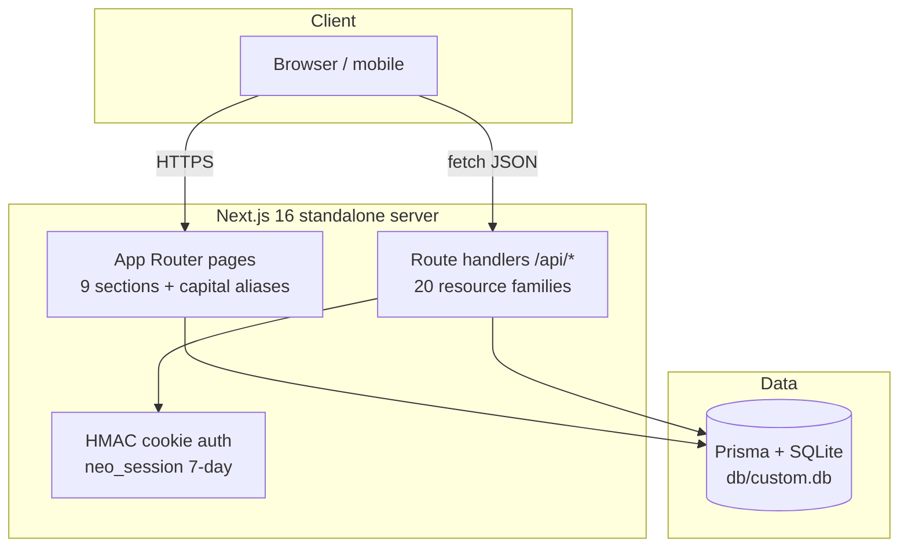

# WealthOS

[](https://nextjs.org/)
[](https://react.dev/)
[](https://www.typescriptlang.org/)
[](https://tailwindcss.com/)
[](https://www.prisma.io/)
[](#testing)
[](#license)

A self-hostable **premium personal-finance workspace** — income, expenses,
accounts, investments, budgets, goals, CSV import, analytics, and an
AI-powered financial coach in one polished dashboard. Functionally a
superset of the reference app, visually at parity with it.

## Overview

WealthOS answers one question: *where is my money actually going?* It
unifies scattered bank statements, subscription renewals, investment
holdings, and savings targets into a single dashboard with month-over-month
deltas, 50/30/20 budget shares, and cashflow trends — then adds an AI coach
that turns those numbers into concrete recommendations. It runs entirely on
your own infrastructure (SQLite by default, PostgreSQL optional) with
cookie-based auth, rate limiting, and a hardened production boot — no
third-party accounts required.

The demo corpus ships deterministic seed data (six months of realistic
transactions, three accounts, six holdings, five goals) so every chart is
alive from the first login.

## Key Features

| Feature | What it does |
|---|---|
| 📊 Financial Dashboard | Net balance, monthly income/expenses, savings-rate KPI cards with MoM deltas; cashflow area chart; category donut |
| 💰 Income & 💸 Expenses | Full CRUD on transactions and income sources; Needs/Wants/Savings tabs; search; recurring flags with next-date |
| 🏦 Accounts | Connected bank accounts with balances, institutions, and account types |
| 📈 Investments | Holdings table with cost basis, current value, and gain/loss per position |
| 📥 CSV Import | 3-step wizard (upload → smart column detection → review & commit), 10 MB cap, CSV/XLS/XLSX |
| 📊 Analytics | Overview / Expenses / Income / Investments tabs with client-side aggregations over the dashboard payload |
| 🎯 Savings Goals | Named targets with progress bars and contribution round-trips |
| 🏷️ Budgets | Budget-vs-actual by category with the 50/30/20 framework |
| 🤖 AI Coach | Deterministic local financial-intelligence engine (optional LLM provider via env) — no API key needed |
| 🌓 Theme System | Light + dark themes (DARK default on app routes — the reference's fresh-visitor posture), persisted, SSR-safe |
| 📱 Mobile Navigation | Non-modal drawer verified at 390×844 in the e2e battery |
| 📄 Export | Data export (GDPR-style "Export All Data" — JSON via `/api/export`) |
| ⌨️ Accessibility | WCAG 2.2 AA: axe-clean pages, labeled controls, focus-visible rings, heading-order normalization |

## Architecture

| Layer | Technology | Version | Purpose |
|---|---|---|---|
| Web framework | Next.js (App Router) | 16.4.5 | Server components, route handlers, standalone output |
| UI runtime | React | 19.3.1 | No `forwardRef`, function components everywhere |
| Language | TypeScript (strict) | 5.9.3 | `tsc --noEmit` gate; no `any` |
| Styling | Tailwind CSS (CSS-first `@theme`) | 4.3.5 | v3-re-pinned palette; no `tailwind.config.js` |
| UI primitives | Radix UI + lucide-react | 1.3–2.4 / 0.525 | Dialog, Select, Tabs, Dropdown, Popover, Label |
| Charts | recharts | 3.10.1 | Cashflow area, category donut, budget bars |
| State | Zustand | 5.1.0 | `src/stores/wealthos-store.ts` (UI state) |
| ORM | Prisma 7 + SQLite (PrismaLibSql adapter) | 7.10.1 | 8 models; `db/` at repo root, git-ignored; generated client in `src/generated/prisma` (postinstall) |
| Validation | Zod | 4.6.7 | Every API boundary parses before touching the db |
| Unit tests | Vitest + fast-check | 5.1.0 / 4.10.2 | 1814 checks incl. property tests |
| E2E tests | Playwright + axe-core | 1.65.0 / 4.14.0 | 152 checks; chromium; seeded `db/e2e.db` |
| Runtime | Bun (dev tooling) | ≥1.3 | `bun run` scripts; node-compatible build |



## File Hierarchy

```
wealth-os/
├── 📂 src/app/(app)/          # The 9 sections; each route has a capital + lowercase twin
│   └── 📂 dashboard/          # Financial Dashboard (the flagship page)
├── 📂 src/app/api/            # 20 route-handler families (transactions, ai, import, …)
├── 📂 src/components/
│   ├── 📂 layout/             # app-shell, sidebar, mobile-nav, mobile-header, theme
│   ├── 📂 shared/             # page-parts (shared page building blocks), ai-coach dialog
│   └── 📂 ui/                 # Radix-wrapped primitives (button, input, tabs, …)
├── 📂 src/lib/                # The seams: finance.ts, ai.ts, schemas.ts, api.ts, auth.ts,
│                              # db-path.ts, site.ts, page-layout.ts, rate-limit.ts
├── 📂 src/stores/             # wealthos-store.ts (Zustand)
├── 📂 prisma/                 # schema.prisma (8 models) + seed.ts (deterministic corpus)
├── 📂 db/                     # SQLite files (git-ignored; custom.db / e2e.db / smoke.db)
├── 📂 tests/                  # 114 unit suites + 📂 e2e/ 7 specs
├── 📂 scripts/                # smoke-test.sh, census.ts, sweep.ts, drift-probe.ts
├── 📂 skills/                 # The repo's skill library (skills-catalog.md)
├── 📂 docs/                   # Plans, validation reports, SSH push runbook, screenshots/
├── 📄 playwright.config.ts    # Port 3100; pinned e2e.db; authenticated storageState
├── 📄 vitest.config.ts        # Node environment, jsdom-free
└── 📄 AGENTS.md / CLAUDE.md / Project_Architecture_Document.md / wealth-os_SKILL.md / worklog.md
```

## Quick Start

Requires **Bun ≥ 1.3** (or Node ≥ 20 with npm — swap `bun run` for `npm run`).

1. **Clone and install**

   ```bash
   git clone https://github.com/nordeim/wealth-os.git
   cd wealth-os
   bun install        # also regenerates the prisma client into src/generated/prisma
   ```

2. **Configure environment**

   ```bash
   cp .env.example .env
   # .env ships ready for local dev:
   #   DATABASE_URL="file:../db/custom.db"   (db/ at the repo root)
   #   AUTH_SECRET=""                        (dev fallback; REQUIRED in production)
   ```

3. **Create the database + demo data**

   ```bash
   bun run db:push    # apply prisma/schema.prisma to db/custom.db
   bun run db:seed    # demo user + 6 months of deterministic finance data
   ```

4. **Start the dev server**

   ```bash
   bun run dev        # http://localhost:3000
   ```

**Verify setup:** log in with `sepnetflix2023@outlook.com` / `$Abcd1234`
(the seed's demo credentials) — the Financial Dashboard should render with
populated KPI cards and charts. Then `bun run db:census` should print
`census: MATCH`.

For production: `bun run build && bun run start` (standalone output on
`PORT`), with a real `AUTH_SECRET` (`openssl rand -hex 32`) — a missing or
short secret **fails the production boot by design**.

## Environment Variables

| Variable | Required | Purpose |
|---|---|---|
| `DATABASE_URL` | yes | `file:../db/custom.db` (SQLite, `db/` at repo root) or a PostgreSQL URL — resolved against `prisma/schema.prisma` in CLI, build, and runtime alike (`src/lib/db-path.ts`) |
| `AUTH_SECRET` | prod | HMAC key for the session cookie; ≥16 chars; the production boot refuses to serve without it |
| `NEXT_PUBLIC_SITE_URL` | build | Canonical origin for metadata, OG/Twitter cards, robots, sitemap, manifest — inlined at build time |
| `NEO_PROXY_HOPS` | no | Trusted proxy depth for rate-limit IP keying (default 1; fails closed) |
| `NEO_DISABLE_IN_APP_OTP` | no | `"1"` stops returning the signup verification code in the response (for real mail transports) |
| `NEO_DISABLE_IN_APP_RESET` | no | `"1"` stops returning the reset link in the forgot-password response |

## Testing

| Suite | Command | Count |
|---|---|---|
| Unit (Vitest) | `bun run test` | 1814 checks / 114 files |
| E2E (Playwright, chromium) | `CI=1 bun run test:e2e` | 152 checks / 7 specs — boots its own server on :3100 with `db/e2e.db` |
| Smoke ladder (standalone artifact) | `bun run smoke` | 15 assertions incl. boot-gate + artifact hygiene |
| Full gate | `bun run gate` | lint → typecheck → test → build → smoke → e2e |
| Parity sweeps | `bun run gate:full` | **active** (re-activated v2.8.0 / R-4.5): the standing gate + six WealthOS-native drift gates — the four sweep classes (1440×900 · 390×844 · 768×1024 · 1024×768, theme-matched zero-data baselines), the fullpage sweep (the 11-page below-the-fold axis with the zero-data sentinel), and the interior census (four-axis standing allowances at margin 0) — green end-to-end from cold at v2.8.0; run it when parity surfaces changed or per the standing cadence (the pre-push bar stays `bun run gate`; the sweep legs need the live reference, so `gate` remains the offline gate) |

Special prerequisites: none — the e2e suite pins its own `DATABASE_URL`
(`db/e2e.db`) and reseeds in global setup; the smoke ladder boots the
built standalone artifact on :3210 with a scratch `db/smoke.db`.

## API Reference

All handlers return the envelope `{ ok: true, data } | { ok: false, error: { code, message } }`
and require the session cookie unless marked public.

| Endpoint | Methods | Description |
|---|---|---|
| `/api/health` | GET | Public readiness probe (db round-trip) |
| `/api/auth/login` · `/logout` · `/me` | POST/GET | Session lifecycle; login rate-limited 10/IP/15min |
| `/api/auth/signup` · `/verify` · `/resend` | POST | Signup + OTP verification (in-app code by default) |
| `/api/auth/forgot-password` · `/reset-password` | POST | Reset funnel (rate-limited; no account enumeration) |
| `/api/transactions` · `/api/transactions/[id]` | GET/POST/PATCH/DELETE | Full CRUD; type + month filters |
| `/api/income-sources` · `/api/accounts` · `/api/investments` · `/api/goals` · `/api/budgets` | GET/POST/PATCH/DELETE | Resource CRUD (goals carry contribution round-trips) |
| `/api/dashboard` | GET | The dashboard's aggregate payload (KPIs, series, budgets, upcoming) |
| `/api/ai/coach` | POST | The coach: question → insights + answer |
| `/api/import` | POST | CSV commit (rows validated client-side through the 3-step wizard; GET returns the column-hint vocabulary) |
| `/api/export` · `/api/reset` · `/api/search` · `/api/settings` · `/api/users` | GET/POST | Data export, per-user demo reset, global search, per-user settings, own profile (session-scoped since session 214) |
| `/api/upload` · `/api/uploads/[name]` | POST/GET | Bounded file store (5 MB — the reference's own cap; path-traversal guarded) |

⚠️ `/api/reset` wipes the **calling user's** finance data — destructive
(session 214: every delete is owner-scoped; other accounts' rows survive).

## Design System

| Token | Value | Usage |
|---|---|---|
| `--color-primary` | `#f59e0b` (amber-500) | Primary buttons (amber→yellow gradient), brand |
| `--color-primary-hover` | `#d97706` (amber-600) | Hover state |
| `--color-background` | `#faf9f7` | Light page wash |
| `--color-foreground` / `--color-ink` | `#1c1917` (stone-900) | Headings, body |
| `--color-muted` | `#78716c` (stone-500) | Secondary text, inactive tabs |
| `--color-line` | `#e7e5e4` (stone-200) | Card borders, dividers |
| Emerald | `#059669` family | Positive deltas, income, success |
| Red | `#dc2626` family | Negative deltas, destructive |

Typography: Inter-first system stack (no runtime font fetch). Motion:
`tw-animate-css` for Radix open/close transitions; dark theme via a
`.dark` class toggle that re-maps the same token set.

## Project Status

| Phase | Status | Key Deliverables |
|---|---|---|
| WealthOS transformation (session 199) | ✅ Complete | Finance schema + seed, 20 API families, 9 sections + aliases, shell + drawer, theme, AI coach |
| Verification layer | ✅ Complete | 1814 unit · 152 e2e · 15 smoke · full gate green |
| Documentation set | ✅ Complete | README, AGENTS, CLAUDE, PAD, `wealth-os_SKILL.md` (the distilled engineering skill), worklog |
| Remediation program | 🔀 Active | `docs/remediation_plan_v2.md` — the versioned findings ledger + R-item program (session 262: **R-59 shipped — the description-length, muted-figure, and citation-completion round**: the fresh-eyes audit (three Mode-C passes — the R-58 cure surfaces all holding (the parity-261 battery re-run green 11/11) · the API/auth/security layer's fifteenth consecutive clean bill (all ten house contracts, 40 handlers / 24 route files, every candidate dismissed into a documented posture) · the UI/a11y/shell layer clean on every named contract with eight new findings — 0 Critical / 0 High / 0 Medium / 5 Low / 3 Informational NEW after dedup, every material claim re-verified at file:line by the driving session — whose whole-tree sweeps EXTENDED two genera beyond the audit's bounds (the description-length genus four→SIX carriers; the muted-figure genus one→TWO carriers) and whose second-engine WCAG recomputation confirmed every challenged figure); the round's genus — CITATION AND PROSE TRUTH: **F-262a the description-length citation genus** (six carriers citing a 405-char description the tree serves at 314 chars — the figure dates from the pre-rebrand mirror; the tree's own metadata pin asserts the served length) · **F-262b the muted-token flip's mis-cited figure** (the retired 2.9:1 reproduces on no dark surface; the true span 3.91–4.13:1, still under the text bar — the flip remains needed) · **F-262c the dialog-close figure's wrong surface** (the retired figure was the page-wash pairing; the dialog surface computes 2.59:1) · **F-262d the badge comment's mis-attributed figure** (the neutral-50 pair computes 3.61:1; the white family's 3.76:1 stays at its four correct carriers) · **F-262e the investment-chip range** (the true span 1.99–3.50:1 across the five colored types, the neutral fallback 4.25:1) · **F-262f the retired sitemap/robots file paths** (the seam's header names the three real route handlers) · **F-262g the false extractor mechanism claim** (build-probed: automatic detection does not scan stylesheets in the current toolchain; the class-free convention stays) · **F-262h the two loose soft figures** (the synced pill's dual-token attribution; the gradient register's rounding). Cures: the six description-length carriers trued to the measured 314; both muted-figure carriers trued to the computed span; the dialog-close figure trued to 2.59:1; the badge comment trued to its own pair's 3.61:1; the chip range trued to the per-type computation; the site seam's header names the sitemap/robots/manifest route handlers; the globals parenthetical reworded to the convention form; the pill's two figures named separately and the register trued; the parity-262 battery born honest RED (12 RED legs + 2 green-by-design riders, stash-re-proven) with ONE regression-contract catch (the parity-227 badge citation pin read the retired figure form — updated in the same commit with the rationale). Gate: lint 0/0 · tsc 0 · **1814 unit / 114 files** · build · smoke 15/15 · 152 e2e · census MATCH · captures 239-241 (THE SERVED META-DESCRIPTION FACE — the login page's description asserted live at exactly 314 chars; THE INVESTMENT-CHIP FACE — the six seeded holdings with their type chips asserted live; the standing mobile drawer at 390 with the 9-destination + Sign Out census and the aria-expanded close flip) + the two comparison captures at TRUE 390×844. Previous: (session 261: **R-58 shipped — the heading-prose, dead-brand, and citation-truing round**: the fresh-eyes audit (three Mode-C passes — the R-57 cure surfaces all holding (the parity-260 battery re-run green 10/10) · the API/auth/security layer's fourteenth consecutive clean bill (all ten house contracts, 45 handlers / 30 route files confirmed by grep census) · the UI/a11y/shell layer clean on every named contract with four new findings — 0 Critical / 0 High / 0 Medium / 3 Low / 1 Informational NEW after dedup, every material claim re-verified at file:line by the driving session — whose whole-tree sweeps bounded each genus (the h2 prose genus at exactly SEVEN carriers across three files; the 19-export constants census's only dead pair; the mis-cited figure at exactly two carriers; the vestigial-export sweep's two survivors) and whose code recomputation confirmed the citation defect (white against stone-300 computes 1.49:1; the cited 1.63:1 fails to reproduce on any surface pairing; the companion figures 1.48 and 4.75 check out)); the round's genus — PROSE AND DECLARATION TRUTH: **F-261a the auth-view heading prose genus** (seven carriers still describing an h2 the tree renders as h1 — the LOGIN_RESET_LAYOUT / LOGIN_SIGNUP_LAYOUT / LOGIN_VERIFY_LAYOUT title docblocks, the login-reset test's DOM comment, the login-views comment and test title; the h1 is the deliberate F-231b/R-28 heading-focus construction, one h1 per view with the shared titleRef) · **F-261b the never-consumed brand constants** (APP_NAME / APP_TAGLINE, the constants census's only dead pair; the literals live on at their three inline sites — the BrandMark wordmark + tagline, the mobile header wordmark, the footer copyright) · **F-261c the settings-switch comment's mis-cited figure** (the white-thumb-vs-stone-300 figure cited 1.63:1 where the computed value is 1.49:1 — the citation-math genus's one stale survivor, riding both the settings comment and the plan's F-221n register row) · **F-261d the vestigial-export genus's next two carriers** (BrandMark and DEFAULT_DATABASE_URL export for no external consumer). Cures: the seven prose carriers trued to the rendered h1; the brand pair retired; both 1.63 citations trued to the computed 1.49:1; both export keywords dropped (module-local); the parity-261 battery born honest RED (9 RED legs + 2 green-by-design riders) with TWO regression-contract catches (the census leg's own expect strings false-greened its walk — the self-mention trap, the leg now excludes itself; the parity-229 bare-word invariant caught the round's own single-word coinage in the constants retirement comment — the ninth catch of its genus, reworded per the F-229d discipline). Gate: lint 0/0 · tsc 0 · **1800 unit / 113 files** · build · smoke 15/15 · 152 e2e · census MATCH · captures 236-238 (THE AUTH-VIEW H1 FAMILY — the reset view's h1 asserted live with the swap focus landed on it and zero h2 in the card; THE SETTINGS FACE — the four notification switches asserted live; the standing mobile drawer at 390 with the 9-destination + Sign Out census and the aria-expanded close flip) + the two comparison captures at TRUE 390×844. Previous: (session 260: **R-57 shipped — the afternoon-label and register-truing round**: the fresh-eyes audit (three Mode-C passes — the R-56 cure surfaces all holding (the parity-259 battery re-run green 17/17) · the API/auth/security layer's thirteenth consecutive clean bill · the UI/a11y/shell layer clean on every named contract with ONE new finding — 0 Critical / 0 High / 1 Medium / 0 Low / 0 Informational NEW after dedup, every material claim re-verified at file:line by the driving session (whose whole-tree fixed-24h sweep bounded the genus at exactly one uncured site and whose two-zone arithmetic reproduction confirmed the defect live on ordinary, non-DST days — the morning-run gates the blindness: every pre-noon ref computes correctly)); the round's finding — **F-260a the relativeDays afternoon mislabel**: the visible day-label seam still divided a millisecond span by a fixed 24h and rounded, so any ref after local noon crossed the half-day threshold and mislabeled the whole one-day band on ORDINARY days (a today row rendered "Yesterday", a tomorrow row "Today", a yesterday row "2 days ago" — verified by code in both the UTC sandbox and America/New_York; three user-visible consumers: the dashboard's Upcoming label, the Recent Activity label, the income page's next-payment label; the R-56 cure's unmigrated sibling — that round retired the fixed-24h genus from the analytics end-pad and the Upcoming day count but left the VISIBLE-label seam; the calendar-correct sort key and the rendered label could disagree after noon; zero test coverage, no e2e leg asserts the labels) plus the **register truing** (the F-259c exoneration clause — assessing the label's rounding only for its plus-minus one hour DST behavior — was stale as written: ordinary afternoon time-of-day crosses the threshold daily). Cures: the day count derives through the R-56 calendarDaysBetween helper (the UTC-parts calendar-day difference — DST-free AND time-of-day-free by construction), the label formatting arms unchanged, the register clause trued; the parity-260 battery born honest RED 10/10 with one regression-contract catch (the truing note initially quoted the retired clause verbatim — the pin caught its own cure's prose, reworded per the describe-with-spaces discipline). Gate: lint 0/0 · tsc 0 · **1789 unit / 112 files** · build · smoke 15/15 · 152 e2e · census MATCH · captures 234-235 (THE AFTERNOON-LABEL LIVE PROOF — the Recent Activity labels asserted in-flight against the domain seam's own output under the live afternoon clock, the yesterday row rendering its calendar truth where the pre-cure span rounding read one day late; the Upcoming census; the standing mobile drawer at 390) + the two comparison captures at TRUE 390×844. Previous: session 259: **R-56 shipped — the bound-message, DST-day, and census-prose round**: the fresh-eyes audit (three Mode-C passes — the R-55 cure surfaces all holding (the parity-258 battery re-run green 18/18) · the API/auth/security layer's twelfth consecutive clean bill · the UI/a11y/shell layer with four new findings — 0 Critical / 0 High / 0 Medium / 1 Low / 3 Informational NEW after dedup, every material claim re-verified at file:line by the driving session (whose whole-tree sweeps bounded each genus — the bare-bounds census exactly six sites, the fixed-ms calendar genus exactly two code sites — and whose TZ-switched arithmetic verifications confirmed both DST defects live on three zones)); the round's genus pair — **the F-252j bound-message tail** (F-259a six bare Zod bounds surfacing the raw library copy through BAD_REQUEST: the signup name, the transaction account-link on both twins, the goal icon on both twins, the coach history array) and **the fixed-24h calendar** (F-259b the analytics range's end-of-day pad admits the day-after rows on every 23h DST spring-forward day — three zones verified by code, the F-218d family's millisecond edition; F-259c the Upcoming day field's fixed division reads one late through the fall-back window — the visible label rides the DST-safe round form, the consumer census trued the impact); F-259d the toast census prose vs its source twin. Cures: the six bounds messaged with the house vocabulary (the whole-file census leg retires the genus file-wide); the next-local-midnight helper (finance.ts, the domain-math seam) replacing the analytics pad; the calendar-day helper replacing the fixed division; the toast prose reworded to rendered liveness; the parity-259 battery born honest RED 17/17 (re-proven via stash; the parity-229 whole-tree invariant caught the round's own hyphenated comment coinage — reworded per the F-229d discipline). Gate: lint 0/0 · tsc 0 · **1779 unit / 111 files** · build · smoke 15/15 · 152 e2e · census MATCH · captures 231-233 (THE MESSAGE-COPY PROOF — the bound probe answering 400 with the house vocabulary through the live envelope; THE ANALYTICS RANGE FACE; the standing mobile drawer at 390) + the two comparison captures at TRUE 390×844. Previous: session 258: **R-55 shipped — the citation-math, input-flip, and render-cap round**: the fresh-eyes audit (three Mode-C passes — the R-54 cure surfaces all five holding (the parity-257 battery re-run green 7/7) · the API/auth/security layer's eleventh consecutive clean bill (one informational caution folded into the R-5 register: the ai-coach history field is client-supplied untrusted input when the LLM provider lands) · the UI/a11y/shell layer with six new findings — 0 Critical / 0 High / 0 Medium / 6 Low / 3 Informational NEW after dedup, every material claim re-verified at file:line, every contrast figure recomputed by code against the pinned palette — the driving session's whole-tree census of all ~50 ratio citations extended the audit's family with four more carriers, and its own §5 structure check caught the shipped v2.54.0 execution-history row mis-sorted one slot low plus a pre-existing v2.24/v2.23 tail swap); the round's genus — **measurement-truth drift**: F-258a the impossible 4.95:1 stone-500 citations at two carriers (WCAG math caps stone-500 at 4.80:1 on pure white) · F-258h the ratio-citation drift family (six more sites, all direction-safe) · F-258b the .dark .input-base dead arms (the F-252g genus; the border-color arm live) · F-258c the stale QUICK_PICK citation (a constant that never existed) · F-258d the import reassurance glyph on the pre-F-221m step · F-258e the expenses history renders unbounded while every sibling caps · F-258f the mobile-header transition notation · F-258g the avatar luma prose · F-258i the §5 ordering contract (cured with the parity-258 structural pin: head descending, tail ascending, no duplicates). Gate: lint 0/0 · tsc 0 · **1762 unit / 110 files** · build · smoke 15/15 · 152 e2e · census MATCH · captures 228-230 (the dark-input computed-style read proving the token flips alone carry the ink and placeholder; the render-cap face with the rider at 117 expenses) + the two comparison captures at TRUE 390×844) — the prior rounds' summary follows: (session 257: **R-54 shipped — the stale-consumer, dead-arm, and glyph-citation round**: the fresh-eyes audit (three Mode-C passes — the R-53 cure surfaces all six holding · the API/auth/security layer's tenth consecutive clean bill (one candidate withdrawn by the audit itself: the NaN-exp shape, proven unreachable) · the UI/a11y/shell layer with four new findings — 0 Critical / 0 High / 0 Medium / 5 Low / 2 Informational NEW after dedup, every material claim re-verified at file:line, the badge consumer history walked by git log -S — the driving session's verification caught the audit's own false premise); the round's genus — **stale consumer-truth and dead-arm prose**: F-257m the sidebar header's retired check-mark Synced-pill glyph vs the live wifi glyph (F-207h) · F-257n the login-card header's retired CSS-drawn logo claim vs the live image asset (session-208/F-208e) + the singular Google-button phrase vs the four social buttons · F-257o the toast description's stone-400 dark arm byte-equal to the flipped muted token since F-218l (the dead-arm genus's single carrier, whole-tree sweep confirmed) · F-257p the never-consumed BUTTON_BASE radius member (the F-229f re-entry rule's own violation) · F-257q the badge focus-frame comment's false-at-birth zero-consumers claim (the settings page's trust badges predate it by ~46 sessions) with the five focus arms' focus-visible swap as the rider; registered: F-257a (the signup count-then-create TOCTOU, display-only) and F-257r (the bootstrap regex's unreachable query alternative). Gate: lint 0/0 · tsc 0 · **1744 unit / 109 files** · build · smoke 15/15 · 152 e2e · census MATCH · captures 225-227 + the two comparison captures at TRUE 390×844) — the prior rounds' summary follows: (session 256: **R-53 shipped — the token-citation, header-block, and prose-truth round**: the fresh-eyes audit (three Mode-C passes — the R-52 cure surfaces all six holding · the API/auth/security layer's ninth consecutive clean bill (one charter correction recorded: the budgets family is category-keyed, no id route) · the UI/a11y/shell layer clean on every named contract — 0 Critical / 0 High / 0 Medium / 2 Low / 1 Informational NEW after dedup, every material claim re-verified at file:line, the live token values re-read from the palette); the round's genus — **the primitives' stale post-rebrand token citations** (the session-199 stone rebrand moved the palette one step off the CRM-era neutral pins and the older construction-claim header blocks — the Session-12/13/82 lineage — still cite the pre-rebrand geometry and values as present-tense truth: F-256a the Button header's one-pixel near-black ring vs the live two-pixel token-keyed stone pair · F-256b the Tabs Session-12 block's three falsified claims (the muted-ink track, the bare default shadow, the no-hover claim) · F-256c the Dialog title's inherited-neutral ink and the description's cross-app equality · F-256d four more the whole-tree sweep caught beyond the audit — the Select trio, the Select wash arm, the Dropdown line value); and the structural rider **F-256e the token-citation truth leg** (every color-token hex citation in src comments must match the palette derived from globals.css at test time — the next rebrand fails the gate instead of silently re-staling prose; born RED on the two token-class stale sites; capture 224 proves the reworded citations compute exactly on the cured components). Gate: lint 0/0 · tsc 0 · **1737 unit / 108 files** · build · smoke 15/15 · 152 e2e · census MATCH · captures 222-224 + the two comparison captures at TRUE 390×844) — the prior rounds' summary follows: (session 255: **R-52 shipped — the strict-parse, derived-truth, and docblock-precision round**: the fresh-eyes audit (three Mode-C passes — the R-51 cure surfaces all nine holding · the API/auth/security layer's eighth consecutive clean bill · the UI/a11y/shell layer's clean bill — 0 Critical / 0 High / 0 Medium / 2 Low / 4 Informational cured after dedup, every material claim re-verified at file:line, one false-corruption alarm dismissed by od — the F-215 display-pipeline lesson recurring on the driving session); the flagship **NEO_PROXY_HOPS strict parse** (F-255a — the depth parse accepted "2x" as 2 and "0x" as 0 while the docblock and boot warning promised fail-closed; the digits-only gate cures it — the first source-code cure since R-49 — with behavioral pins born RED and the discriminating volley proving last-hop keying live on the artifact, capture 221); the **derived-truth legs** (F-255b — the census ordinal, the burning-click count, the spatial claim, and the bare-call census now DERIVED from the tree: a future reorder fails the gate instead of silently re-staling the prose); the **total settings recovery** (F-255c — findUnique + one bounded create retry replaces the throwing finder on the vanished-row window); and the **docblock precision trio** (F-255d the store's selector parenthetical names the coach dialog; F-255e the Tabs CRM-era prose reworded — a fourth carrier caught by the pin's own whole-file sweep; F-255f the login card's zero-toast claim scoped to the submits). Gate: lint 0/0 · tsc 0 · **1731 unit / 107 files** · build · smoke 15/15 · 152 e2e · census MATCH · captures 219-221 + the two comparison captures at TRUE 390×844) — the prior rounds' summary follows: (session 254: **R-51 shipped — the ordinal, spatial-reference, and lockstep-duplication round**: the fresh-eyes audit (three Mode-C passes — the R-50 cure surfaces all six verified holding · the API/auth/security layer's seventh consecutive clean bill · the UI/a11y/shell layer source-clean — 0 Critical / 0 High / 0 Medium / 6 Low / 2 Informational cured after dedup, every material claim re-verified at file:line); THE ROUND'S HEADLINE — A GENUS: the session-253 docs-lockstep script duplicated insertions at three sites, every gate green through all three because no pin watched occurrence multiplicity — the **guard trio's four-fold pin** (F-254f), the **README program row's three-fold summary** (F-254g), and the **PAD revision list's three-fold block** (F-254h, byte-identical); the structural rider: the parity-254 no-duplicate invariant battery; plus the **census ordinal trued** (F-254a — the recovery leg's signup is the SEVENTH no-XFF burn, the revoke leg's the eighth), the **stale spatial reference** (F-254b), the **whole-route pin's exact-count form** (F-254c), the **premise pin's premise anchor** (F-254d), and the **store docblock's bare-idiom blessing** (F-254e). Gate: lint 0/0 · tsc 0 · **1720 unit / 106 files** · build · smoke 15/15 · 152 e2e · the six parity drift gates CLEAN · census MATCH · captures 216-218 + the two comparison captures at TRUE 390×844) — the prior rounds' summary follows: (session 253: **R-50 shipped — the order-dependence, burn-ledger, and fixed-email round**: the discovery at the cold baseline itself — the AGENTS-documented single-spec e2e invocation FAILS on wealthos.spec: the F-225c verify-bucket leg's setup signup rode the shared no-XFF signup bucket with its response ignored (denied in battery order → no account → the miss arm answers every probe; succeeding in isolation → the pending code's wrong-code ladder answers locked 429s from the fifth probe → the leg fails — live-probed 400,400,400,400,429,429); the fresh-eyes audit (three Mode-C passes — the R-49 cure surfaces · the API/auth/security layer · the UI/a11y/shell layer — 0 Critical / 0 High / 3 Medium / 3 Low cured after dedup, every material claim re-verified at file:line; all ten R-49 cure surfaces holding; the API layer's sixth consecutive clean bill; the UI source layer clean — the findings cluster in the e2e battery's own legs); the flagship **order-independent verify-bucket leg** (F-253a — the setup signup retires, the 61 probes ride an unknown timestamped email, the pure miss-arm contract, proven by the isolated-spec run RED at baseline and GREEN after); the **stale signup-budget ledger** (F-253b — auth.spec burns EIGHT no-XFF signups (three UI form submits + five API posts), the battery burned twelve against the ten cap with the last two denials silent; the census trued at all three carriers and the data-import/multi-user scratch signups move to dedicated XFF keys); the **fixed-email login-bucket leg** (F-253c — the timestamp mint, the N-69a class per-account edition); the **resend vanished-row arm** (F-253d — the third key joins the P2025 catch, every arm three-key); the **parity-252 pin's miss-arm-only slice** (F-253e — closed by the whole-route form); and the **stale CSRF-probe comment** (F-253f). Toolchain note: agent-browser's HeadlessChrome-157 does not hydrate the Turbopack dev build (production hydrates cleanly) — the clone-side mobile-nav comparison rode the production artifact. Gate: lint 0/0 · tsc 0 · **1712 unit / 105 files** · build · smoke 15/15 · 152 e2e + the isolated-spec proof · census MATCH · captures 212-215 + the two comparison captures at TRUE 390×844) — the prior rounds' summary follows: (session 252: **R-49 shipped — the list-focus-ring, resend-shape, and type-lag round**: the fresh-eyes audit (three Mode-C passes — the R-48 cure surfaces · the API/auth/security layer · the UI/a11y/shell layer — 0 Critical / 0 High / 1 Medium / 5 Low cured + 4 Informational cured-as-riders + 1 Informational registered after dedup, every material claim re-verified at file:line, the contrast math re-computed by code; all eight R-48 cure surfaces holding; the API layer's fifth consecutive clean bill; the Tailwind v4 token discipline clean on every audited axis); the flagship **list-item keyboard-focus ring** (F-252a — the sidebar user-menu items and every Select option indicated keyboard focus through a wash computing 1.09:1 light / 1.31:1 dark; the keyboard ring arm joins the wash at 17.49:1/18.15:1, proven live by capture 208's computed-style read + the e2e ring leg); the **resend shape oracle** (F-252b — the miss arm joins the known arm's three-key envelope, the key-set enumeration signal closed, proven live); the **dashboard user type lag** (F-252c — the wire type widens to User, the store's two upcasts retire); the **palette census trailing-comment arm** (F-252d — URL-colon exempt, completing the F-251f genus); the **theme-blind scrollbar dark arm** (F-252e — 3.91:1, proven live); the **latent ring-offset arms** (F-252f — the tabs underline variant + the badge); plus riders: the **vestigial dark-wash literal retirement** (F-252g — the token flip alone carries the wash, proven live), the **red over-budget meter register note** (F-252h — 3.0:1), the **e2e-pin prose truths** (F-252i), and the **un-messaged Zod fields** (F-252j). Registered: F-252k (the useTheme fallback divergence). Gate: lint 0/0 · tsc 0 · **1704 unit / 104 files** · build · smoke 15/15 · 152 e2e · the six parity drift gates CLEAN at 0.5pct · census MATCH · captures 207-211) — the prior rounds' summary follows: (session 251: **R-48 shipped — the focus-ring, cli-anchor, and settings-flag round**: the fresh-eyes audit (three Mode-C passes — 0 Critical / 0 High / 1 Medium / 6 Low cured + 2 Informational cured-as-riders + 3 Informational registered after dedup, every material claim re-verified at file:line, the prisma-config divergence live-probed under the repo's own bun; all seven R-47 cure surfaces holding; the Tailwind v4 token discipline clean on every audited axis); the flagship **auth-face focus-ring cure** (F-251a — nine constants carried the amber ring at 1.67:1 on the forced-light auth card, below the 3:1 non-text bar; they join the submits' F-218i ring-ring ink at 17.5:1, proven live by the computed-style capture); the **prisma.config CLI-anchor cure** (F-251b — the mirror-db trap's CLI half: a direct `bun x prisma …` under bun resolved to the parent-of-repo mirror db while the app served the repo db; the datasource re-routes through runtimeDatabaseUrl(), the signature-aware seam, verified live on all four invocation patterns); the **settings-settled rider** (F-251c — proven live: the held stale tail left EUR standing with the flag true); the **dashboard user projection** (F-251d); the **drift-probe /assets/ positive selection + exit hygiene** (F-251e); the **dead gray-500 pin retirement + the palette census comment-strip** (F-251f — the F-224v genus's structural cure); the **white ring-offset halo cure** (F-251g — four dark-capable surfaces, proven live by the computed rgb(14,19,16) offset band); and the **amber meter-fill register entry** (F-251h). Gate: lint 0/0 · tsc 0 · **1686 unit / 103 files** · build · smoke 15/15 · 151 e2e · the six parity drift gates CLEAN at 0.5pct · census MATCH · captures 202-206) — the prior rounds' summary follows: (session 250: **R-47 shipped — the settings-sequence, superseded-error, and select-completion round**: the fresh-eyes audit (three Mode-C passes — the R-46 cure surfaces · the API/auth/security layer · the UI/a11y/shell layer — 0 Critical / 0 High / 3 Medium / 3 Low cured + 10 Informational registered after dedup, every material claim re-verified at file:line; all four R-46 cure surfaces holding; F-249i re-adjudicated as already cured); the cold baseline GREEN at HEAD 043b998 (the v2.46.0 ship state reproduced; the chromium-1254 toolchain gap the round's one discovery); the reference STABLE on every probed layer incl. the TRUE-390 mobile menu with 9 destinations — re-verified twice, once through agent-browser with the open/close toggle census); the flagship **settings sequence** (F-250b — F-249h's dedicated round: a module-level sequence joining the hydrate tail's GET and updateSettings' PUT — the read mints at issue and guards on era + sequence, the write bumps at entry and re-keys its commit from the token to the era; **proven live**: the held stale tail read skipped, the PUT's EUR standing under its toast); the **superseded error commit** retirement (F-250a — the R-46 flagship's own failure arm; **proven live**: the held 500 landing left no banner over the fresh state); the **readBoundedJson stream guard** (F-250c); the **three select completions** (F-250d); the **sign-out busy riders** (F-250e); the **expenses bucket a11y cure** (F-250f — the screen reader bucket labels + the light mode savings icon step); and the **reference styling-event response** (F-250q — the verification-time discovery: the platform restyled the reference with the JS bundle byte-identical; the probe gains the app stylesheet's content hash and the eight affected sweep baselines re-derived). Registered, not cured: F-250h-p plus the standing families. Gate: lint 0/0 · tsc 0 · **1668 unit / 102 files** · build · smoke 15/15 · 151 e2e · the six parity drift gates CLEAN at the re-derived baselines · census MATCH · captures 197-201) |
| Screenshots | ✅ Complete | `docs/screenshots/` |

## License

[MIT](LICENSE) © 2026 nordeim
