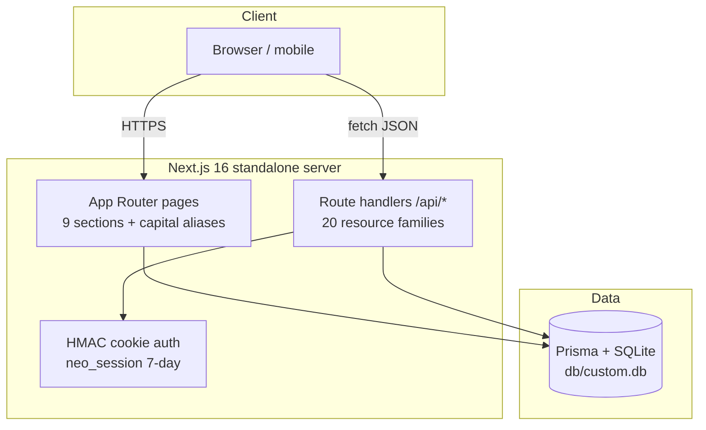

# WealthOS

[](https://nextjs.org/)
[](https://react.dev/)
[](https://www.typescriptlang.org/)
[](https://tailwindcss.com/)
[](https://www.prisma.io/)
[](#testing)
[](#license)

A self-hostable **premium personal-finance workspace** — income, expenses,
accounts, investments, budgets, goals, CSV import, analytics, and an
AI-powered financial coach in one polished dashboard. Functionally a
superset of the reference app, visually at parity with it.

## Overview

WealthOS answers one question: *where is my money actually going?* It
unifies scattered bank statements, subscription renewals, investment
holdings, and savings targets into a single dashboard with month-over-month
deltas, 50/30/20 budget shares, and cashflow trends — then adds an AI coach
that turns those numbers into concrete recommendations. It runs entirely on
your own infrastructure (SQLite by default, PostgreSQL optional) with
cookie-based auth, rate limiting, and a hardened production boot — no
third-party accounts required.

The demo corpus ships deterministic seed data (six months of realistic
transactions, three accounts, six holdings, five goals) so every chart is
alive from the first login.

## Key Features

| Feature | What it does |
|---|---|
| 📊 Financial Dashboard | Net balance, monthly income/expenses, savings-rate KPI cards with MoM deltas; cashflow area chart; category donut |
| 💰 Income & 💸 Expenses | Full CRUD on transactions and income sources; Needs/Wants/Savings tabs; search; recurring flags with next-date |
| 🏦 Accounts | Connected bank accounts with balances, institutions, and account types |
| 📈 Investments | Holdings table with cost basis, current value, and gain/loss per position |
| 📥 CSV Import | 3-step wizard (upload → smart column detection → review & commit), 10 MB cap, CSV/XLS/XLSX |
| 📊 Analytics | Overview / Expenses / Income / Investments tabs with client-side aggregations over the dashboard payload |
| 🎯 Savings Goals | Named targets with progress bars and contribution round-trips |
| 🏷️ Budgets | Budget-vs-actual by category with the 50/30/20 framework |
| 🤖 AI Coach | Deterministic local financial-intelligence engine (optional LLM provider via env) — no API key needed |
| 🌓 Theme System | Light + dark themes (DARK default on app routes — the reference's fresh-visitor posture), persisted, SSR-safe |
| 📱 Mobile Navigation | Non-modal drawer verified at 390×844 in the e2e battery |
| 📄 Export | Data export (GDPR-style "Export All Data" — JSON via `/api/export`) |
| ⌨️ Accessibility | WCAG 2.2 AA: axe-clean pages, labeled controls, focus-visible rings, heading-order normalization |

## Architecture

| Layer | Technology | Version | Purpose |
|---|---|---|---|
| Web framework | Next.js (App Router) | 16.4.5 | Server components, route handlers, standalone output |
| UI runtime | React | 19.3.1 | No `forwardRef`, function components everywhere |
| Language | TypeScript (strict) | 5.9.3 | `tsc --noEmit` gate; no `any` |
| Styling | Tailwind CSS (CSS-first `@theme`) | 4.3.5 | v3-re-pinned palette; no `tailwind.config.js` |
| UI primitives | Radix UI + lucide-react | 1.3–2.4 / 0.525 | Dialog, Select, Tabs, Dropdown, Popover, Label |
| Charts | recharts | 3.10.1 | Cashflow area, category donut, budget bars |
| State | Zustand | 5.1.0 | `src/stores/wealthos-store.ts` (UI state) |
| ORM | Prisma 7 + SQLite (PrismaLibSql adapter) | 7.10.1 | 8 models; `db/` at repo root, git-ignored; generated client in `src/generated/prisma` (postinstall) |
| Validation | Zod | 4.6.7 | Every API boundary parses before touching the db |
| Unit tests | Vitest + fast-check | 5.1.0 / 4.10.2 | 1254 checks incl. property tests |
| E2E tests | Playwright + axe-core | 1.65.0 / 4.14.0 | 139 checks; chromium; seeded `db/e2e.db` |
| Runtime | Bun (dev tooling) | ≥1.3 | `bun run` scripts; node-compatible build |



## File Hierarchy

```
wealth-os/
├── 📂 src/app/(app)/          # The 9 sections; each route has a capital + lowercase twin
│   └── 📂 dashboard/          # Financial Dashboard (the flagship page)
├── 📂 src/app/api/            # 20 route-handler families (transactions, ai, import, …)
├── 📂 src/components/
│   ├── 📂 layout/             # app-shell, sidebar, mobile-nav, mobile-header, theme
│   ├── 📂 shared/             # page-parts (shared page building blocks), ai-coach dialog
│   └── 📂 ui/                 # Radix-wrapped primitives (button, input, tabs, …)
├── 📂 src/lib/                # The seams: finance.ts, ai.ts, schemas.ts, api.ts, auth.ts,
│                              # db-path.ts, site.ts, page-layout.ts, rate-limit.ts
├── 📂 src/stores/             # wealthos-store.ts (Zustand)
├── 📂 prisma/                 # schema.prisma (8 models) + seed.ts (deterministic corpus)
├── 📂 db/                     # SQLite files (git-ignored; custom.db / e2e.db / smoke.db)
├── 📂 tests/                  # 79 unit suites + 📂 e2e/ 7 specs
├── 📂 scripts/                # smoke-test.sh, census.ts, sweep.ts, drift-probe.ts
├── 📂 skills/                 # The repo's skill library (skills-catalog.md)
├── 📂 docs/                   # Plans, validation reports, SSH push runbook, screenshots/
├── 📄 playwright.config.ts    # Port 3100; pinned e2e.db; authenticated storageState
├── 📄 vitest.config.ts        # Node environment, jsdom-free
└── 📄 AGENTS.md / CLAUDE.md / Project_Architecture_Document.md / wealth-os_SKILL.md / worklog.md
```

## Quick Start

Requires **Bun ≥ 1.3** (or Node ≥ 20 with npm — swap `bun run` for `npm run`).

1. **Clone and install**

   ```bash
   git clone https://github.com/nordeim/wealth-os.git
   cd wealth-os
   bun install        # also regenerates the prisma client into src/generated/prisma
   ```

2. **Configure environment**

   ```bash
   cp .env.example .env
   # .env ships ready for local dev:
   #   DATABASE_URL="file:../db/custom.db"   (db/ at the repo root)
   #   AUTH_SECRET=""                        (dev fallback; REQUIRED in production)
   ```

3. **Create the database + demo data**

   ```bash
   bun run db:push    # apply prisma/schema.prisma to db/custom.db
   bun run db:seed    # demo user + 6 months of deterministic finance data
   ```

4. **Start the dev server**

   ```bash
   bun run dev        # http://localhost:3000
   ```

**Verify setup:** log in with `sepnetflix2023@outlook.com` / `$Abcd1234`
(the seed's demo credentials) — the Financial Dashboard should render with
populated KPI cards and charts. Then `bun run db:census` should print
`census: MATCH`.

For production: `bun run build && bun run start` (standalone output on
`PORT`), with a real `AUTH_SECRET` (`openssl rand -hex 32`) — a missing or
short secret **fails the production boot by design**.

## Environment Variables

| Variable | Required | Purpose |
|---|---|---|
| `DATABASE_URL` | yes | `file:../db/custom.db` (SQLite, `db/` at repo root) or a PostgreSQL URL — resolved against `prisma/schema.prisma` in CLI, build, and runtime alike (`src/lib/db-path.ts`) |
| `AUTH_SECRET` | prod | HMAC key for the session cookie; ≥16 chars; the production boot refuses to serve without it |
| `NEXT_PUBLIC_SITE_URL` | build | Canonical origin for metadata, OG/Twitter cards, robots, sitemap, manifest — inlined at build time |
| `NEO_PROXY_HOPS` | no | Trusted proxy depth for rate-limit IP keying (default 1; fails closed) |
| `NEO_DISABLE_IN_APP_OTP` | no | `"1"` stops returning the signup verification code in the response (for real mail transports) |
| `NEO_DISABLE_IN_APP_RESET` | no | `"1"` stops returning the reset link in the forgot-password response |

## Testing

| Suite | Command | Count |
|---|---|---|
| Unit (Vitest) | `bun run test` | 1254 checks / 79 files |
| E2E (Playwright, chromium) | `CI=1 bun run test:e2e` | 139 checks / 7 specs — boots its own server on :3100 with `db/e2e.db` |
| Smoke ladder (standalone artifact) | `bun run smoke` | 15 assertions incl. boot-gate + artifact hygiene |
| Full gate | `bun run gate` | lint → typecheck → test → build → smoke → e2e |
| Parity sweeps | `bun run gate:full` | **active** (re-activated v2.8.0 / R-4.5): the standing gate + six WealthOS-native drift gates — the four sweep classes (1440×900 · 390×844 · 768×1024 · 1024×768, theme-matched zero-data baselines), the fullpage sweep (the 11-page below-the-fold axis with the zero-data sentinel), and the interior census (four-axis standing allowances at margin 0) — green end-to-end from cold at v2.8.0; run it when parity surfaces changed or per the standing cadence (the pre-push bar stays `bun run gate`; the sweep legs need the live reference, so `gate` remains the offline gate) |

Special prerequisites: none — the e2e suite pins its own `DATABASE_URL`
(`db/e2e.db`) and reseeds in global setup; the smoke ladder boots the
built standalone artifact on :3210 with a scratch `db/smoke.db`.

## API Reference

All handlers return the envelope `{ ok: true, data } | { ok: false, error: { code, message } }`
and require the session cookie unless marked public.

| Endpoint | Methods | Description |
|---|---|---|
| `/api/health` | GET | Public readiness probe (db round-trip) |
| `/api/auth/login` · `/logout` · `/me` | POST/GET | Session lifecycle; login rate-limited 10/IP/15min |
| `/api/auth/signup` · `/verify` · `/resend` | POST | Signup + OTP verification (in-app code by default) |
| `/api/auth/forgot-password` · `/reset-password` | POST | Reset funnel (rate-limited; no account enumeration) |
| `/api/transactions` · `/api/transactions/[id]` | GET/POST/PATCH/DELETE | Full CRUD; type + month filters |
| `/api/income-sources` · `/api/accounts` · `/api/investments` · `/api/goals` · `/api/budgets` | GET/POST/PATCH/DELETE | Resource CRUD (goals carry contribution round-trips) |
| `/api/dashboard` | GET | The dashboard's aggregate payload (KPIs, series, budgets, upcoming) |
| `/api/ai/coach` | POST | The coach: question → insights + answer |
| `/api/import` | POST | CSV commit (rows validated client-side through the 3-step wizard; GET returns the column-hint vocabulary) |
| `/api/export` · `/api/reset` · `/api/search` · `/api/settings` · `/api/users` | GET/POST | Data export, per-user demo reset, global search, per-user settings, own profile (session-scoped since session 214) |
| `/api/upload` · `/api/uploads/[name]` | POST/GET | Bounded file store (5 MB — the reference's own cap; path-traversal guarded) |

⚠️ `/api/reset` wipes the **calling user's** finance data — destructive
(session 214: every delete is owner-scoped; other accounts' rows survive).

## Design System

| Token | Value | Usage |
|---|---|---|
| `--color-primary` | `#f59e0b` (amber-500) | Primary buttons (amber→yellow gradient), brand |
| `--color-primary-hover` | `#d97706` (amber-600) | Hover state |
| `--color-background` | `#faf9f7` | Light page wash |
| `--color-foreground` / `--color-ink` | `#1c1917` (stone-900) | Headings, body |
| `--color-muted` | `#78716c` (stone-500) | Secondary text, inactive tabs |
| `--color-line` | `#e7e5e4` (stone-200) | Card borders, dividers |
| Emerald | `#059669` family | Positive deltas, income, success |
| Red | `#dc2626` family | Negative deltas, destructive |

Typography: Inter-first system stack (no runtime font fetch). Motion:
`tw-animate-css` for Radix open/close transitions; dark theme via a
`.dark` class toggle that re-maps the same token set.

## Project Status

| Phase | Status | Key Deliverables |
|---|---|---|
| WealthOS transformation (session 199) | ✅ Complete | Finance schema + seed, 20 API families, 9 sections + aliases, shell + drawer, theme, AI coach |
| Verification layer | ✅ Complete | 1254 unit · 139 e2e · 15 smoke · full gate green |
| Documentation set | ✅ Complete | README, AGENTS, CLAUDE, PAD, `wealth-os_SKILL.md` (the distilled engineering skill), worklog |
| Remediation program | 🔄 Active | `docs/remediation_plan_v2.md` — the versioned findings ledger + R-item program (session 232: **R-29 shipped — the dead-stock retirement, carrier-net repair, and dialog-focus round**: the fresh-eyes audit (three Mode-C passes over the R-28 cure surfaces, the API/auth/security layer, and the UI/a11y/shell layer — 0 Critical / 0 High / 0 Medium / 13 Low / 9 Informational raw, every material claim re-verified at file:line, R-28's twelve pinned cures verified holding, no adjudications — every claim confirmed as-found); the vendored dead-stock retirement (F-232a — card/table/label/input.tsx, four zero-consumer shadcn-stock files with no KEEP register entry, retired per the F-231h Avatar precedent with their page-layout riders; the surviving Event/Activity citation retired with its file); the carrier-net repair (F-232b — the tabs.tsx border-primary citation reworded AND the parity-229 PROSE_ALLOWLIST compound entry that hid the dead utility removed — the allowlist is not a carrier sanctuary; the globals.css danger-soft hover citation reworded); the expenses dialog step-swap focus (F-232c — the F-231b genus on the app's highest-traffic dialog: the prevStepRef value-guard lands focus on the description input (quick→form and the prefilled chip path) and the Quick Select heading (form→quick), e2e-proven RED→GREEN); the hamburger aria-controls (F-232d — the trigger↔drawer id pair, the expenses-filters precedent); the always-mounted loading live region (F-232e — the F-218h genus: the region pre-exists outside main, empty when idle, the label swaps in; LoadingBlock becomes the visual only); the stale amber arm retirement (F-232f — the bg-amber-500 axe sanction arm retires per F-220p: every live amber fill carries stone-900 ink since F-219a); the upload capacity post-write re-check (F-232g — the TOCTOU cure: re-read after the write, unlink + STORAGE_FULL on breach); the low tail (F-232h — the unused CURRENCIES import, the BrandMark collapse arm, the SHELL_LAYOUT.sidebar consumption + the icon/bare member retirements, the exportCsv revoke defer); the line-strong registration (F-232i — the token joins the F-224t reserved register with its citation). (session 231: **R-28 shipped — the a11y-tail, logging-grain, and dead-family round**: the fresh-eyes audit (three Mode-C passes over the R-27 cure surfaces, the API/auth/security layer, and the UI/a11y/shell layer — 0 Critical / 0 High / 0 Medium / 8 Low / 12 Informational raw, every material claim re-verified at file:line; ONE claim adjudicated by live probes + a bundle grep — the Analytics "Spending by Day of Week" card is OUR OWN SUPERSET (probe-231/b/c: no such card on any of the reference's four Analytics tabs at its standing zero demo data, and the reference bundle carries no such string — the amber fill was a palette mis-assignment, never parity); the two API-pass "Lows" adjudicated as AUDIT-BRIEF CONTRACT-TEXT ERRORS (the uploads GET public capability-URL posture and the forgot 10/15 bucket are the recorded contracts the code matches)); the Expenses dialog decorative-glyph hiding (F-231a — the amber "$" tile gains aria-hidden, the F-225k family complete); the auth-card view-swap focus management (F-231b — every transition lands focus on the new view's heading, the verify view's box-1 pattern generalized; the first boolean mount-guard design fell to the dev server's StrictMode double-invoke (live-caught by the captures face) and was cured to the value-comparison guard); the dead DropdownContent z-pin re-pinned to the menu layer (F-231c); the icons.tsx retirement (F-231d — the CRM-era FilterPolygon with its false "Used by" citation; the N-89c6 lucide-injection note relocated to the KpiCard); the day-of-week fill (F-231e — the spending rose per our own palette doctrine, drift-inert by construction); the upload multipart log (F-231f — the one F-226c-genus catch-site the retrofit missed); the uploads GET ENOENT gate (F-231g — a capability-URL miss is not an error-level event); the CRM-era dead-family retirement (F-231h — DialogFooterWide, the wide geometry arm, the wide footer constant, and the initials-avatar family; the Event/Activity citations reworded; the shadcn-stock arms stay per the F-227f register); the low tail (F-231i the TrendingDown symmetry, F-231j the expenses memo, F-231k the vestigial peer class, F-231l the trailing docblock rot). | Remediation program | 🔄 Active | `docs/remediation_plan_v2.md` — the versioned findings ledger + R-item program (session 230: **R-27 shipped — the register-and-hygiene round**: the fresh-eyes audit (three Mode-C passes over the R-26 cure surfaces, the API/auth/security layer, and the UI/a11y/shell layer — 0 Critical / 0 High / 2 Medium / 4 Low / 5 Informational raw, every material claim re-verified at file:line, TWO claims adjudicated by live reference probes — the StatCard genus CONFIRMED (probe-230c: the reference's own Avg Monthly tiles carry the identical saturated gradients, minus-100 labels, and white bold values at its standing zero demo data — the register entry is the cure, never a recolor) and the Cash Flow zero-data claim INVERTED (probe-230: the reference's own card renders four recharts surfaces unconditionally at zero data; our unconditional render IS the genus — the presence-predicate recommendation would have deviated from parity)); the StatCard register entry (F-230a Medium — the analytics Avg Monthly tiles' sub-AA ink arms join the F-224y WCAG exemption register at their own surface: measured emerald-100 on emerald-500 = 2.24:1, red-100 on red-500 = 3.08:1, blue-100 on blue-500 = 3.01:1, the white values 2.54:1 at the emerald-500 side passing on the 600 side); the lastSyncedAt toDate tidy (F-230c — the sole raw new Date() at a display seam routes through toDate, behavior-identical); the phantom-breakpoint comment rewords (F-230d — the two F-207a-history quotes retired to prose); the ai-coach message-id keys (F-230e — the model gains an id, a module-level counter mints at the three construction sites (a ref counter trips react-hooks/refs: the greeting consumes the mint DURING render), the list keys by message.id; the import preview + OTP boxes documented as index-identity); the CARD_TITLE_OVERRIDE docblock truth (F-230f). | Remediation program | 🔄 Active | `docs/remediation_plan_v2.md` — the versioned findings ledger + R-item program (session 229: **R-26 shipped — the empty-state repair and dead-carrier retirement round**: the fresh-eyes audit (three Mode-C passes over the R-25 cure surfaces, the API/auth/security layer, and the UI/a11y/shell layer — 0 Critical / 0 High / 1 Medium / 6 Low / 5 Informational raw, every material claim re-verified at file:line, two claims ADJUDICATED INVERTED by live reference probes — the dialog-title "centers below sm" claim FALSE (the reference's own title is left-aligned at 390) and the analytics-captions finding INVERTED (the reference's analytics cards carry no captions — our uncaptioned cards ARE the genus); the cold baseline GREEN at HEAD — the v2.25.0 ship state reproduced exactly); the Income-tab empty-state repair (F-229a Medium — the F-219r gate's birth defect: categoryTrend unconditionally returns one zero point per month, so the length===0 gate NEVER fired and a zero-income viewer saw a flat all-zero chart; the gate now rides an income-presence predicate, e2e-proven on a pre-corpus range); the budgets P2002 race arm (F-229b — the catch retries the upsert once on the concurrent-create unique-key race, the settings family's pattern); the seed UTC-midnight staging (F-229c — the seed was the sole writer of local-noon calendar instants; a viewer 12h+ ahead of the seeding server read every seeded date one day late); the dead-carrier retirement (F-229d — THIRTY comment-only class-shaped tokens emitted dead utilities across 16 files (the audit's fixed list found nine, the whole-tree built-CSS × live-code diff found thirty); ~28 comment sites reworded, a whole-tree carrier invariant joined the pins, the CSS sentinel probe proved all 30 selectors leave the built stylesheet (103,673 → 100,431 bytes) with every live form staying); the dialog docblock truth (F-229e); the dead-API retirement (F-229f — the unread presetCategory prop, two zero-consumer constant maps, five unused format helpers, the empty nav array, and the pill Tabs variant + cols + the GRID_COLS map (the driving session's own finding — zero consumers); the underline variant stays as the documented default); the low tail (F-229h the search Postgres case-folding note, F-229j the hygiene pass). `docs/remediation_plan_v2.md` — the versioned findings ledger + R-item program (session 228: **R-25 shipped — the second holdings surface and hygiene round**: the fresh-eyes audit (three parallel Mode-C passes over the R-24 cure surfaces, the API/auth/security layer, and the UI/a11y/shell layer — 0 Critical / 0 High / 0 Medium / 7 Low / 10 Informational raw, every material claim re-verified at file:line, the cold baseline GREEN at HEAD — the v2.24.0 ship state reproduced exactly); the second holdings surface (F-228a — the Analytics Holdings Performance chart still keyed by SYMBOL, the F-227b genus surviving in its last surface: two same-symbol lots duplicated React keys AND overlapped two bars at one category; a `gainBySymbol` per-symbol gain fold joins the finance seams and the chart renders one bar per symbol, e2e-verified: seeded 6 + the folded pair = 7 bars, pre-cure 8); the timing-equalizer family completion (F-228e — verify/resend leaked pending-verification state through scrypt latency on their miss branches; both now burn the equalizer, the login S72-C pattern, the DB-write residual documented); the upload capacity ceiling (F-228f — the write-only uploads surface (zero UI consumers, nothing ever deletes a file) grows unbounded over time: a 256 MB / 4096-file ceiling answers 507 STORAGE_FULL before the write, the repo-root anchor memoized, the owner-tag design recorded); the schema round (F-228g + F-227h — `@@index([accountId])` on Transaction backs the SetNull cascade's full-scan, `@@index([resetToken])` on User lands the recorded next-schema-round item); the low tail (F-228b the eight dead @theme tokens retire — brand, subtle, and six zero-consumer F-214e members kept alive ONLY by comment strings naming their utilities, the comments reworded, the built CSS proven to shrink by sentinel probe; F-228c the Analytics CSV Date column string-slices the stored form — the one place a raw parse was an identity and a toDate "tidy" would have corrupted every UTC+ export a day early; F-228d upcomingAlerts carries the id, the dashboard Upcoming keys by it; F-228h getSessionUser selects its eight consumed fields — no secret columns in scope; F-228j budgets DELETE answers NOT_FOUND on count===0, the [id] doctrine uniform; F-228k the Expenses filters trigger/panel id-link via aria-controls; F-228l the two stale docblocks corrected). `docs/remediation_plan_v2.md` — the versioned findings ledger + R-item program (session 227: **R-24 shipped — the build-gate repair and wrong-row identity round**: the fresh-eyes audit (three parallel Mode-C passes over the R-23 cure surfaces, the API/auth/security layer, and the UI/a11y/shell layer — 0 Critical / 1 High / 1 Medium / 6 Low / 8 Informational raw, every material claim re-verified at file:line — the High was the session's own cold-baseline discovery: the owner's post-226 session-log commit created `docs/worklog.md` as a symlink targeting `worklog.md`, which resolves relative to docs/ to ITSELF — an infinite loop, and `bun run build` FAILED at HEAD with Turbopack's DirAssetReference walking the loop; the Medium — the investments holdings table resolving rows by SYMBOL — was live-reproduced: two same-symbol lots got duplicate React keys and Edit/Delete acted on the WRONG row); the symlink-loop build repair (F-227a — repointed to `../worklog.md`, the alias intent preserved, pinned by a resolves-and-matches test); the holdings identity cure (F-227b — the id rides the portfolioStats seam; the table keys and resolves by row.id; an id-less row's buttons go inert instead of acting on the wrong record; e2e-verified: Edit on the second DUPL lot prefills the SECOND record); the conditional-mutation refactor (F-227c + F-227l — all 10 [id] PUT/DELETE sites across the 5 resource families move to the atomic updateMany/deleteMany form with ownerId in the WHERE (the reset-password precedent), and the transactions account-link FK race answers BAD_REQUEST via the new isForeignKeyViolation P2003 seam — never an anonymous 500); the low tail (F-227d `wealth-os_SKILL.md` joins the artifact excludes; F-227e the investments Edit row-context sr-only tail — the F-226k miss; F-227f the Button/Badge destructive variants gain measured-value contrast citations; F-227m the analytics range filter routes through toDate (doctrine-uniform, behavior-identical); F-227n the three dead radius tokens retire from @theme). `docs/remediation_plan_v2.md` — the versioned findings ledger + R-item program (session 226: **R-23 shipped — the escape-family completion and per-casing metadata round**: the fresh-eyes audit (three parallel Mode-C passes over the R-22 cure surfaces, the API/auth/security layer, and the UI/a11y/shell layer — 0 Critical / 0 High / 4 Medium / 8 Low / 8 Informational raw, every material claim re-verified at file:line — the csv escape claims live-probed across three zones, the dark menu surface live-probed on BOTH apps, the ring-offset claim ADJUDICATED INVERTED by live probe: the reference itself carries the class and our TABS_SEGMENTED lacked it, painting a WHITE focus halo on dark pages); the designated-tail escape completion (F-226a — seven regex-shape families the R-22 taxonomy missed still staged the VIEWER's calendar: case-insensitive utc/gmt, the RFC-822 weekday prefix ("Thu, 01 Jan 2026 00:00:00 GMT" staged 2025-12-31 in New York — wrong day AND year), separator lenience, the meridiem before the designator, V8's named zones (EST/EDT/CST/CDT/MST/MDT/PST/PDT/UT — "Dec 31, 2026 8:00 PM EST" staged 2027-01-01), the compound UTC+01:00/GMT+5 tails, and the month-year family WITH a tail ("Nov 2026 UTC" — the invented day AND the zone shift; "Nov 2026 15 UTC" staged Nov 14 where 15 was written); every designated tail now routes to the written-literal doctrine and the rejection family carries the designated NAMED tail — never the bare offset, which would null every ISO date via the "2026-11-01" hazard); the per-casing metadata (F-226b — the eight lowercase section routes served the ROOT head (title "WealthOS", canonical "/") while the reference serves per-casing canonicals at both casings; eight pass-through segment layouts now export pageMetadata at their own route, /Dashboard keeps the ROOT head per the reference's own posture); the API error logging (F-226c — 31 catch sites swallowed errors with zero server-side trace; the logApiError seam + every site logs the scope + error before the envelope); the Transaction compound index (F-226d — @@index([ownerId, date]), the heavy read family's sort is index-backed); the low tail (F-226e the uploads 429 joins the ERR.RATE_LIMITED family; F-226f captures-225 joins the pin family; F-226g the spawn-liveness check; F-226h the bucket-exhaustion record; F-226i the TABS_SEGMENTED ring-offset ADD — the inverted claim; F-226j the quick-adder group role; F-226k the row-context sr-only tail; F-226l MenuContent joins the token family — the reference's dark panel measures rgb(10,10,10); F-226m the gradient-contrast exemption register; F-226n the ±HH comment truth; F-226o the 24:00 edge pin; F-226p the bucket-window pin; F-226r the verify/resend email format). `docs/remediation_plan_v2.md` — the versioned findings ledger + R-item program (session 225: **R-22 shipped — the designated-tail completion and tooling-hygiene round**: the fresh-eyes audit (three parallel Mode-C passes over the R-21 cure surfaces, the API/auth/security layer, and the UI/a11y/shell layer — 0 Critical / 1 High standing re-confirmed (the F-217m owner-ask, NOT reopened) / 5 Medium / 8 Low / 9 Informational raw, every material claim re-verified at file:line — the two csv claims live-probed across three zones, the skip-link paint order live-reproduced against the real dev server at both width edges, the driving session's own finding (the capture tools' dev-db mutation) live-confirmed by the census MISMATCH it left behind); the numeric year-month partials (F-225a — "2026/11"/"2026.11"/"2026 11"/"2026/1" staged the invented day 1 while the hyphen partials nulled; the null-arm joins the partial family, `$`-anchored so the three-group forms keep staging, TZ-switching-pinned in three zones); the designated-tail completion (F-225b — the R-19 taxonomy missed " UTC"/" GMT" tails and a space before the offset: "Nov 1, 2026 UTC" staged the VIEWER's calendar in New York (Oct 31 — a wrong day; "Jan 1, 2026 UTC" read 2025-12-31, wrong day AND year) while Tokyo staged the written day — the identical file imported different books for different users; and the 4-digit numeric designated forms null-or-staged by zone; every designated tail now routes to the written-literal staging doctrine — the ISO arm tolerates the space and the named tails, the named/day-first/numeric locale-designated arms (4-digit years, round-trip-guarded, month-names mapped) stage the WRITTEN calendar, and the two-digit-year designated numerics SKIP (the remap boundary is engine-internal — a visible skip beats a silent wrong day)); the verify/resend per-account buckets (F-225c — the F-222n mirror this pair never received: verify 20/IP and resend 5/IP only, both voidable by the rotating-XFF decode; the email-keyed secondary buckets (verify-acct 60/15, resend-acct 10/15 — sized above the IP caps so single-IP flows are unchanged) fire after the Zod parse and before any account-existence check, with rotating-XFF e2e legs); the skip link's paint order (F-225d — the F-224s reveal painted UNDER the sticky mobile header below lg: both z-50 in the same stacking context, the header later in DOM won the paint order and the focused link was invisible at phone widths while 122/122 stayed green (the leg ran 1280-only and axe cannot model paint order); the focused link rises above the header layer (focus:z-[60]) and a 390 e2e leg asserts the revealed link is topmost by elementFromPoint); the capture-tool database doctrine (F-225e — the capture sets that sign up scratch accounts (captures-218/219/224) rode the DEV database: the scratch user survives the owner-scoped reseed and the census MISMATCHed at users=2 (live this session); the family now rides db/captures.db — recreated + seeded per run, the spawned server carries the override explicitly, a census tripwire guards the exit, and a server already on :3000 is a REFUSAL, not a reuse); the hygiene tail (F-225f the search docblock's delivered truth; F-225g the two-digit rolled residual pinned; F-225h the route-level search e2e leg (q="%" → every family empty); F-225i the uploads GET's 240/15 bucket (the health note true again); F-225j the global-error `<main>`; F-225k the six decorative icons aria-hidden; F-225l the destructive-ink measured-value citation + the consumer wording; F-225m the shell re-indent + the dead outline-none retirement). `docs/remediation_plan_v2.md` — the versioned findings ledger + R-item program (session 224: **R-21 shipped — the date-guard completion and resilience-surface round**: the fresh-eyes audit (three parallel Mode-C passes over the R-20 cure surfaces, the API/auth/security layer, and the UI/a11y/shell layer — 0 Critical / 0 High / 2 Medium / 11 Low / 14 Informational raw, every material claim re-verified at file:line, the two Mediums live-reproduced); the YMD-slash rollover bypass (F-224a — `localeRollover`'s year-length gate read the MDY year position only, so every rolled YMD date "2026/02/30" skipped the guard and staged Mar 2 — the shape-aware year gate resolves YMD-vs-MDY first); the month-year family completion (F-224c — the reversed twins "2026 Nov"/"Nov 2026 10:00" invented day 1; the rejection family became form-precise with a TIME tail so the day-carrying "Nov 2026 15" keeps staging); the verify oracle's numeric tell (F-224b — the no-pending branch answered "5 attempts remaining", a value the genuine post-increment ladder can never produce; it now answers the first rung 4, the single-probe reply byte-identical); the logout honesty pair (F-224d/e — the revocation's first behavioral pin: mint → logout → replay the pre-logout cookie → `data:null`; the store's `logout()` now checks the `call()` result and the signOut helpers gate navigation on it — a failed POST surfaces through the store-error banner instead of silently navigating; the leg rides a SCRATCH user: the F-223k bump is USER-level, a demo-account logout in any e2e leg evicts the shared storageState for every later spec — the order-poisoning lesson); the resilience surfaces (F-224p/aa — global-error takes the error.tsx dark genus, LoadingBlock gains `role="status" aria-live="polite"`, error.tsx regains its `<main>` landmark); the skip-to-content link (F-224s — the shell's first child, sr-only until the first Tab reveals it, `href="#main-content"` with the main scroller's `id` + `tabIndex -1`; placement outside `main` keeps every drift gate green); the password set-time bound (F-224h — `passwordSchema.max(200)`, the reset flow's own contract unified); the search LIKE strip (F-224j — a literal `%`/`_` in the query no longer acts as a wildcard); the `@source not` family (F-224v — prose carriers (skills/tests/docs/scripts) can no longer emit production CSS: the built CSS shrank 48%, verified by before/after sentinel probes); the nine phone×dark a11y legs (F-224r) + the smoke leg 15 (rounded-full's infinity-form radius `2147483647px`); the demo-seed register row + the production warning (F-224i — PAD §10 + DEPLOYMENT). Session 223: **R-20 shipped** — the dead-signout and dark-surface completion round: the desktop sidebar's Sign Out dead-ended on the infinite "Loading your workspace…" gate — the MenuItem called bare `logout()` while the navigating `signOut` helper sat dead beside it (the store cleared, nothing re-rendered the server layout; the mobile drawer's own signOut worked — the e2e battery covered the drawer path only); the R-19 round's own `dark:text-stone-50` painted 2.06:1 ink on the UNFLIPPED amber Try-again (the F-219a genus restored — stone-900 in both modes, the pin recalibrated to the negative form); the two missed donut Tooltips (dashboard Expense-Breakdown, investments Asset-Allocation — the only bare sites repo-wide) joined the isDark family with per-page site-count pins; the csv guard completion (the F-222d rollover guard's `$`-anchor missed time-suffixed numeric dates — "02/30/2026 10:00" staged the rolled Mar 2 while the date-only form nulls, live-reproduced TZ-independent — the `(?!\d)` anchor; month-only named forms "Nov 2026" invented day 1 — the MONTH_ONLY rejection joins the partial-ISO doctrine); the dark-surface family (the desktop synced pill's green-700 light arm rendered 3.49:1 on the ALWAYS-DARK sidebar gradient — the unconditional green-400 pairing, the mobile twin keeps its arms; the investments type chips' 600/700 inks computed 2.02:1 over dark cards — the `textDark` 400-level steps; the income/expenses pastel icon tiles rendered bright chips on dark cards — the isDark alpha-tint ternaries); the focus-ring tail (the sent view's Back, the AI-coach chips + Send, the reset-password Back-to-login); the low tail (the import alert's light ink 4.41:1 → red-700; **logout now revokes** — the tokenVersion bump makes "sign out" mean revoke, an exfiltrated cookie no longer survives it; the verify route's no-pending message unified — no pending-state enumeration oracle). Session 222: **R-19 shipped** — the zone-designator completion and focus-affordance round. Next: findings-led iterations (no open R-item by default) |
| Screenshots | ✅ Complete | `docs/screenshots/` |

## License

[MIT](LICENSE) © 2026 nordeim
