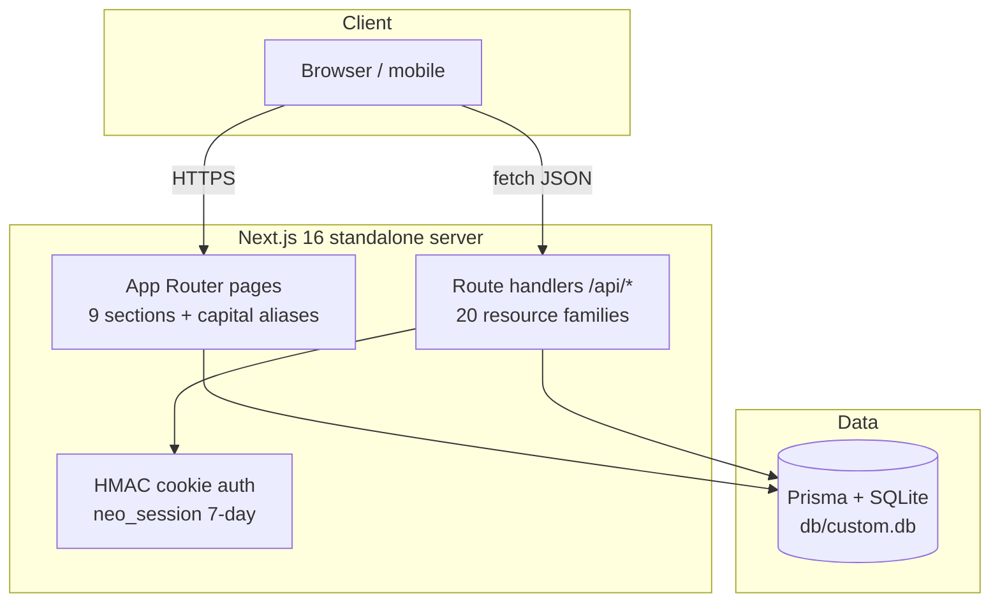

# WealthOS

[](https://nextjs.org/)
[](https://react.dev/)
[](https://www.typescriptlang.org/)
[](https://tailwindcss.com/)
[](https://www.prisma.io/)
[](#testing)
[](#license)

A self-hostable **premium personal-finance workspace** — income, expenses,
accounts, investments, budgets, goals, CSV import, analytics, and an
AI-powered financial coach in one polished dashboard. Functionally a
superset of the reference app, visually at parity with it.

## Overview

WealthOS answers one question: *where is my money actually going?* It
unifies scattered bank statements, subscription renewals, investment
holdings, and savings targets into a single dashboard with month-over-month
deltas, 50/30/20 budget shares, and cashflow trends — then adds an AI coach
that turns those numbers into concrete recommendations. It runs entirely on
your own infrastructure (SQLite by default, PostgreSQL optional) with
cookie-based auth, rate limiting, and a hardened production boot — no
third-party accounts required.

The demo corpus ships deterministic seed data (six months of realistic
transactions, three accounts, six holdings, five goals) so every chart is
alive from the first login.

## Key Features

| Feature | What it does |
|---|---|
| 📊 Financial Dashboard | Net balance, monthly income/expenses, savings-rate KPI cards with MoM deltas; cashflow area chart; category donut |
| 💰 Income & 💸 Expenses | Full CRUD on transactions and income sources; Needs/Wants/Savings tabs; search; recurring flags with next-date |
| 🏦 Accounts | Connected bank accounts with balances, institutions, and account types |
| 📈 Investments | Holdings table with cost basis, current value, and gain/loss per position |
| 📥 CSV Import | 3-step wizard (upload → smart column detection → review & commit), 10 MB cap, CSV/XLS/XLSX |
| 📊 Analytics | Overview / Expenses / Income / Investments tabs with client-side aggregations over the dashboard payload |
| 🎯 Savings Goals | Named targets with progress bars and contribution round-trips |
| 🏷️ Budgets | Budget-vs-actual by category with the 50/30/20 framework |
| 🤖 AI Coach | Deterministic local financial-intelligence engine (optional LLM provider via env) — no API key needed |
| 🌓 Theme System | Light + dark themes (DARK default on app routes — the reference's fresh-visitor posture), persisted, SSR-safe |
| 📱 Mobile Navigation | Non-modal drawer verified at 390×844 in the e2e battery |
| 📄 Export | Data export (GDPR-style "Export All Data" — JSON via `/api/export`) |
| ⌨️ Accessibility | WCAG 2.2 AA: axe-clean pages, labeled controls, focus-visible rings, heading-order normalization |

## Architecture

| Layer | Technology | Version | Purpose |
|---|---|---|---|
| Web framework | Next.js (App Router) | 16.4.5 | Server components, route handlers, standalone output |
| UI runtime | React | 19.3.1 | No `forwardRef`, function components everywhere |
| Language | TypeScript (strict) | 5.9.3 | `tsc --noEmit` gate; no `any` |
| Styling | Tailwind CSS (CSS-first `@theme`) | 4.3.5 | v3-re-pinned palette; no `tailwind.config.js` |
| UI primitives | Radix UI + lucide-react | 1.3–2.4 / 0.525 | Dialog, Select, Tabs, Dropdown, Popover, Label |
| Charts | recharts | 3.10.1 | Cashflow area, category donut, budget bars |
| State | Zustand | 5.1.0 | `src/stores/wealthos-store.ts` (UI state) |
| ORM | Prisma 7 + SQLite (PrismaLibSql adapter) | 7.10.1 | 8 models; `db/` at repo root, git-ignored; generated client in `src/generated/prisma` (postinstall) |
| Validation | Zod | 4.6.7 | Every API boundary parses before touching the db |
| Unit tests | Vitest + fast-check | 5.1.0 / 4.10.2 | 1712 checks incl. property tests |
| E2E tests | Playwright + axe-core | 1.65.0 / 4.14.0 | 152 checks; chromium; seeded `db/e2e.db` |
| Runtime | Bun (dev tooling) | ≥1.3 | `bun run` scripts; node-compatible build |



## File Hierarchy

```
wealth-os/
├── 📂 src/app/(app)/          # The 9 sections; each route has a capital + lowercase twin
│   └── 📂 dashboard/          # Financial Dashboard (the flagship page)
├── 📂 src/app/api/            # 20 route-handler families (transactions, ai, import, …)
├── 📂 src/components/
│   ├── 📂 layout/             # app-shell, sidebar, mobile-nav, mobile-header, theme
│   ├── 📂 shared/             # page-parts (shared page building blocks), ai-coach dialog
│   └── 📂 ui/                 # Radix-wrapped primitives (button, input, tabs, …)
├── 📂 src/lib/                # The seams: finance.ts, ai.ts, schemas.ts, api.ts, auth.ts,
│                              # db-path.ts, site.ts, page-layout.ts, rate-limit.ts
├── 📂 src/stores/             # wealthos-store.ts (Zustand)
├── 📂 prisma/                 # schema.prisma (8 models) + seed.ts (deterministic corpus)
├── 📂 db/                     # SQLite files (git-ignored; custom.db / e2e.db / smoke.db)
├── 📂 tests/                  # 105 unit suites + 📂 e2e/ 7 specs
├── 📂 scripts/                # smoke-test.sh, census.ts, sweep.ts, drift-probe.ts
├── 📂 skills/                 # The repo's skill library (skills-catalog.md)
├── 📂 docs/                   # Plans, validation reports, SSH push runbook, screenshots/
├── 📄 playwright.config.ts    # Port 3100; pinned e2e.db; authenticated storageState
├── 📄 vitest.config.ts        # Node environment, jsdom-free
└── 📄 AGENTS.md / CLAUDE.md / Project_Architecture_Document.md / wealth-os_SKILL.md / worklog.md
```

## Quick Start

Requires **Bun ≥ 1.3** (or Node ≥ 20 with npm — swap `bun run` for `npm run`).

1. **Clone and install**

   ```bash
   git clone https://github.com/nordeim/wealth-os.git
   cd wealth-os
   bun install        # also regenerates the prisma client into src/generated/prisma
   ```

2. **Configure environment**

   ```bash
   cp .env.example .env
   # .env ships ready for local dev:
   #   DATABASE_URL="file:../db/custom.db"   (db/ at the repo root)
   #   AUTH_SECRET=""                        (dev fallback; REQUIRED in production)
   ```

3. **Create the database + demo data**

   ```bash
   bun run db:push    # apply prisma/schema.prisma to db/custom.db
   bun run db:seed    # demo user + 6 months of deterministic finance data
   ```

4. **Start the dev server**

   ```bash
   bun run dev        # http://localhost:3000
   ```

**Verify setup:** log in with `sepnetflix2023@outlook.com` / `$Abcd1234`
(the seed's demo credentials) — the Financial Dashboard should render with
populated KPI cards and charts. Then `bun run db:census` should print
`census: MATCH`.

For production: `bun run build && bun run start` (standalone output on
`PORT`), with a real `AUTH_SECRET` (`openssl rand -hex 32`) — a missing or
short secret **fails the production boot by design**.

## Environment Variables

| Variable | Required | Purpose |
|---|---|---|
| `DATABASE_URL` | yes | `file:../db/custom.db` (SQLite, `db/` at repo root) or a PostgreSQL URL — resolved against `prisma/schema.prisma` in CLI, build, and runtime alike (`src/lib/db-path.ts`) |
| `AUTH_SECRET` | prod | HMAC key for the session cookie; ≥16 chars; the production boot refuses to serve without it |
| `NEXT_PUBLIC_SITE_URL` | build | Canonical origin for metadata, OG/Twitter cards, robots, sitemap, manifest — inlined at build time |
| `NEO_PROXY_HOPS` | no | Trusted proxy depth for rate-limit IP keying (default 1; fails closed) |
| `NEO_DISABLE_IN_APP_OTP` | no | `"1"` stops returning the signup verification code in the response (for real mail transports) |
| `NEO_DISABLE_IN_APP_RESET` | no | `"1"` stops returning the reset link in the forgot-password response |

## Testing

| Suite | Command | Count |
|---|---|---|
| Unit (Vitest) | `bun run test` | 1712 checks / 105 files |
| E2E (Playwright, chromium) | `CI=1 bun run test:e2e` | 152 checks / 7 specs — boots its own server on :3100 with `db/e2e.db` |
| Smoke ladder (standalone artifact) | `bun run smoke` | 15 assertions incl. boot-gate + artifact hygiene |
| Full gate | `bun run gate` | lint → typecheck → test → build → smoke → e2e |
| Parity sweeps | `bun run gate:full` | **active** (re-activated v2.8.0 / R-4.5): the standing gate + six WealthOS-native drift gates — the four sweep classes (1440×900 · 390×844 · 768×1024 · 1024×768, theme-matched zero-data baselines), the fullpage sweep (the 11-page below-the-fold axis with the zero-data sentinel), and the interior census (four-axis standing allowances at margin 0) — green end-to-end from cold at v2.8.0; run it when parity surfaces changed or per the standing cadence (the pre-push bar stays `bun run gate`; the sweep legs need the live reference, so `gate` remains the offline gate) |

Special prerequisites: none — the e2e suite pins its own `DATABASE_URL`
(`db/e2e.db`) and reseeds in global setup; the smoke ladder boots the
built standalone artifact on :3210 with a scratch `db/smoke.db`.

## API Reference

All handlers return the envelope `{ ok: true, data } | { ok: false, error: { code, message } }`
and require the session cookie unless marked public.

| Endpoint | Methods | Description |
|---|---|---|
| `/api/health` | GET | Public readiness probe (db round-trip) |
| `/api/auth/login` · `/logout` · `/me` | POST/GET | Session lifecycle; login rate-limited 10/IP/15min |
| `/api/auth/signup` · `/verify` · `/resend` | POST | Signup + OTP verification (in-app code by default) |
| `/api/auth/forgot-password` · `/reset-password` | POST | Reset funnel (rate-limited; no account enumeration) |
| `/api/transactions` · `/api/transactions/[id]` | GET/POST/PATCH/DELETE | Full CRUD; type + month filters |
| `/api/income-sources` · `/api/accounts` · `/api/investments` · `/api/goals` · `/api/budgets` | GET/POST/PATCH/DELETE | Resource CRUD (goals carry contribution round-trips) |
| `/api/dashboard` | GET | The dashboard's aggregate payload (KPIs, series, budgets, upcoming) |
| `/api/ai/coach` | POST | The coach: question → insights + answer |
| `/api/import` | POST | CSV commit (rows validated client-side through the 3-step wizard; GET returns the column-hint vocabulary) |
| `/api/export` · `/api/reset` · `/api/search` · `/api/settings` · `/api/users` | GET/POST | Data export, per-user demo reset, global search, per-user settings, own profile (session-scoped since session 214) |
| `/api/upload` · `/api/uploads/[name]` | POST/GET | Bounded file store (5 MB — the reference's own cap; path-traversal guarded) |

⚠️ `/api/reset` wipes the **calling user's** finance data — destructive
(session 214: every delete is owner-scoped; other accounts' rows survive).

## Design System

| Token | Value | Usage |
|---|---|---|
| `--color-primary` | `#f59e0b` (amber-500) | Primary buttons (amber→yellow gradient), brand |
| `--color-primary-hover` | `#d97706` (amber-600) | Hover state |
| `--color-background` | `#faf9f7` | Light page wash |
| `--color-foreground` / `--color-ink` | `#1c1917` (stone-900) | Headings, body |
| `--color-muted` | `#78716c` (stone-500) | Secondary text, inactive tabs |
| `--color-line` | `#e7e5e4` (stone-200) | Card borders, dividers |
| Emerald | `#059669` family | Positive deltas, income, success |
| Red | `#dc2626` family | Negative deltas, destructive |

Typography: Inter-first system stack (no runtime font fetch). Motion:
`tw-animate-css` for Radix open/close transitions; dark theme via a
`.dark` class toggle that re-maps the same token set.

## Project Status

| Phase | Status | Key Deliverables |
|---|---|---|
| WealthOS transformation (session 199) | ✅ Complete | Finance schema + seed, 20 API families, 9 sections + aliases, shell + drawer, theme, AI coach |
| Verification layer | ✅ Complete | 1712 unit · 152 e2e · 15 smoke · full gate green |
| Documentation set | ✅ Complete | README, AGENTS, CLAUDE, PAD, `wealth-os_SKILL.md` (the distilled engineering skill), worklog |
| Remediation program | 🔀 Active | `docs/remediation_plan_v2.md` — the versioned findings ledger + R-item program (session 253: **R-50 shipped — the order-dependence, burn-ledger, and fixed-email round**: the discovery at the cold baseline itself — the AGENTS-documented single-spec e2e invocation FAILS on wealthos.spec: the F-225c verify-bucket leg's setup signup rode the shared no-XFF signup bucket with its response ignored (denied in battery order → no account → the miss arm answers every probe; succeeding in isolation → the pending code's wrong-code ladder answers locked 429s from the fifth probe → the leg fails — live-probed 400,400,400,400,429,429); the fresh-eyes audit (three Mode-C passes — the R-49 cure surfaces · the API/auth/security layer · the UI/a11y/shell layer — 0 Critical / 0 High / 3 Medium / 3 Low cured after dedup, every material claim re-verified at file:line; all ten R-49 cure surfaces holding; the API layer's sixth consecutive clean bill; the UI source layer clean — the findings cluster in the e2e battery's own legs); the flagship **order-independent verify-bucket leg** (F-253a — the setup signup retires, the 61 probes ride an unknown timestamped email, the pure miss-arm contract, proven by the isolated-spec run RED at baseline and GREEN after); the **stale signup-budget ledger** (F-253b — auth.spec burns EIGHT no-XFF signups (three UI form submits + five API posts), the battery burned twelve against the ten cap with the last two denials silent; the census trued at all three carriers and the data-import/multi-user scratch signups move to dedicated XFF keys); the **fixed-email login-bucket leg** (F-253c — the timestamp mint, the N-69a class per-account edition); the **resend vanished-row arm** (F-253d — the third key joins the P2025 catch, every arm three-key); the **parity-252 pin's miss-arm-only slice** (F-253e — closed by the whole-route form); and the **stale CSRF-probe comment** (F-253f). Toolchain note: agent-browser's HeadlessChrome-157 does not hydrate the Turbopack dev build (production hydrates cleanly) — the clone-side mobile-nav comparison rode the production artifact. Gate: lint 0/0 · tsc 0 · **1712 unit / 105 files** · build · smoke 15/15 · 152 e2e + the isolated-spec proof · census MATCH · captures 212-215 + the two comparison captures at TRUE 390×844) — the prior rounds' summary follows: (session 253: **R-50 shipped — the order-dependence, burn-ledger, and fixed-email round**: the discovery at the cold baseline itself — the AGENTS-documented single-spec e2e invocation FAILS on wealthos.spec: the F-225c verify-bucket leg's setup signup rode the shared no-XFF signup bucket with its response ignored (denied in battery order → no account → the miss arm answers every probe; succeeding in isolation → the pending code's wrong-code ladder answers locked 429s from the fifth probe → the leg fails — live-probed 400,400,400,400,429,429); the fresh-eyes audit (three Mode-C passes — the R-49 cure surfaces · the API/auth/security layer · the UI/a11y/shell layer — 0 Critical / 0 High / 3 Medium / 3 Low cured after dedup, every material claim re-verified at file:line; all ten R-49 cure surfaces holding; the API layer's sixth consecutive clean bill; the UI source layer clean — the findings cluster in the e2e battery's own legs); the flagship **order-independent verify-bucket leg** (F-253a — the setup signup retires, the 61 probes ride an unknown timestamped email, the pure miss-arm contract, proven by the isolated-spec run RED at baseline and GREEN after); the **stale signup-budget ledger** (F-253b — auth.spec burns EIGHT no-XFF signups (three UI form submits + five API posts), the battery burned twelve against the ten cap with the last two denials silent; the census trued at all three carriers and the data-import/multi-user scratch signups move to dedicated XFF keys); the **fixed-email login-bucket leg** (F-253c — the timestamp mint, the N-69a class per-account edition); the **resend vanished-row arm** (F-253d — the third key joins the P2025 catch, every arm three-key); the **parity-252 pin's miss-arm-only slice** (F-253e — closed by the whole-route form); and the **stale CSRF-probe comment** (F-253f). Toolchain note: agent-browser's HeadlessChrome-157 does not hydrate the Turbopack dev build (production hydrates cleanly) — the clone-side mobile-nav comparison rode the production artifact. Gate: lint 0/0 · tsc 0 · **1712 unit / 105 files** · build · smoke 15/15 · 152 e2e + the isolated-spec proof · census MATCH · captures 212-215 + the two comparison captures at TRUE 390×844) — the prior rounds' summary follows: (session 253: **R-50 shipped — the order-dependence, burn-ledger, and fixed-email round**: the discovery at the cold baseline itself — the AGENTS-documented single-spec e2e invocation FAILS on wealthos.spec: the F-225c verify-bucket leg's setup signup rode the shared no-XFF signup bucket with its response ignored (denied in battery order → no account → the miss arm answers every probe; succeeding in isolation → the pending code's wrong-code ladder answers locked 429s from the fifth probe → the leg fails — live-probed 400,400,400,400,429,429); the fresh-eyes audit (three Mode-C passes — the R-49 cure surfaces · the API/auth/security layer · the UI/a11y/shell layer — 0 Critical / 0 High / 3 Medium / 3 Low cured after dedup, every material claim re-verified at file:line; all ten R-49 cure surfaces holding; the API layer's sixth consecutive clean bill; the UI source layer clean — the findings cluster in the e2e battery's own legs); the flagship **order-independent verify-bucket leg** (F-253a — the setup signup retires, the 61 probes ride an unknown timestamped email, the pure miss-arm contract, proven by the isolated-spec run RED at baseline and GREEN after); the **stale signup-budget ledger** (F-253b — auth.spec burns EIGHT no-XFF signups (three UI form submits + five API posts), the battery burned twelve against the ten cap with the last two denials silent; the census trued at all three carriers and the data-import/multi-user scratch signups move to dedicated XFF keys); the **fixed-email login-bucket leg** (F-253c — the timestamp mint, the N-69a class per-account edition); the **resend vanished-row arm** (F-253d — the third key joins the P2025 catch, every arm three-key); the **parity-252 pin's miss-arm-only slice** (F-253e — closed by the whole-route form); and the **stale CSRF-probe comment** (F-253f). Toolchain note: agent-browser's HeadlessChrome-157 does not hydrate the Turbopack dev build (production hydrates cleanly) — the clone-side mobile-nav comparison rode the production artifact. Gate: lint 0/0 · tsc 0 · **1712 unit / 105 files** · build · smoke 15/15 · 152 e2e + the isolated-spec proof · census MATCH · captures 212-215 + the two comparison captures at TRUE 390×844) — the prior rounds' summary follows: (session 252: **R-49 shipped — the list-focus-ring, resend-shape, and type-lag round**: the fresh-eyes audit (three Mode-C passes — the R-48 cure surfaces · the API/auth/security layer · the UI/a11y/shell layer — 0 Critical / 0 High / 1 Medium / 5 Low cured + 4 Informational cured-as-riders + 1 Informational registered after dedup, every material claim re-verified at file:line, the contrast math re-computed by code; all eight R-48 cure surfaces holding; the API layer's fifth consecutive clean bill; the Tailwind v4 token discipline clean on every audited axis); the flagship **list-item keyboard-focus ring** (F-252a — the sidebar user-menu items and every Select option indicated keyboard focus through a wash computing 1.09:1 light / 1.31:1 dark; the keyboard ring arm joins the wash at 17.49:1/18.15:1, proven live by capture 208's computed-style read + the e2e ring leg); the **resend shape oracle** (F-252b — the miss arm joins the known arm's three-key envelope, the key-set enumeration signal closed, proven live); the **dashboard user type lag** (F-252c — the wire type widens to User, the store's two upcasts retire); the **palette census trailing-comment arm** (F-252d — URL-colon exempt, completing the F-251f genus); the **theme-blind scrollbar dark arm** (F-252e — 3.91:1, proven live); the **latent ring-offset arms** (F-252f — the tabs underline variant + the badge); plus riders: the **vestigial dark-wash literal retirement** (F-252g — the token flip alone carries the wash, proven live), the **red over-budget meter register note** (F-252h — 3.0:1), the **e2e-pin prose truths** (F-252i), and the **un-messaged Zod fields** (F-252j). Registered: F-252k (the useTheme fallback divergence). Gate: lint 0/0 · tsc 0 · **1704 unit / 104 files** · build · smoke 15/15 · 152 e2e · the six parity drift gates CLEAN at 0.5pct · census MATCH · captures 207-211) — the prior rounds' summary follows: (session 251: **R-48 shipped — the focus-ring, cli-anchor, and settings-flag round**: the fresh-eyes audit (three Mode-C passes — 0 Critical / 0 High / 1 Medium / 6 Low cured + 2 Informational cured-as-riders + 3 Informational registered after dedup, every material claim re-verified at file:line, the prisma-config divergence live-probed under the repo's own bun; all seven R-47 cure surfaces holding; the Tailwind v4 token discipline clean on every audited axis); the flagship **auth-face focus-ring cure** (F-251a — nine constants carried the amber ring at 1.67:1 on the forced-light auth card, below the 3:1 non-text bar; they join the submits' F-218i ring-ring ink at 17.5:1, proven live by the computed-style capture); the **prisma.config CLI-anchor cure** (F-251b — the mirror-db trap's CLI half: a direct `bun x prisma …` under bun resolved to the parent-of-repo mirror db while the app served the repo db; the datasource re-routes through runtimeDatabaseUrl(), the signature-aware seam, verified live on all four invocation patterns); the **settings-settled rider** (F-251c — proven live: the held stale tail left EUR standing with the flag true); the **dashboard user projection** (F-251d); the **drift-probe /assets/ positive selection + exit hygiene** (F-251e); the **dead gray-500 pin retirement + the palette census comment-strip** (F-251f — the F-224v genus's structural cure); the **white ring-offset halo cure** (F-251g — four dark-capable surfaces, proven live by the computed rgb(14,19,16) offset band); and the **amber meter-fill register entry** (F-251h). Gate: lint 0/0 · tsc 0 · **1686 unit / 103 files** · build · smoke 15/15 · 151 e2e · the six parity drift gates CLEAN at 0.5pct · census MATCH · captures 202-206) — the prior rounds' summary follows: (session 250: **R-47 shipped — the settings-sequence, superseded-error, and select-completion round**: the fresh-eyes audit (three Mode-C passes — the R-46 cure surfaces · the API/auth/security layer · the UI/a11y/shell layer — 0 Critical / 0 High / 3 Medium / 3 Low cured + 10 Informational registered after dedup, every material claim re-verified at file:line; all four R-46 cure surfaces holding; F-249i re-adjudicated as already cured); the cold baseline GREEN at HEAD 043b998 (the v2.46.0 ship state reproduced; the chromium-1254 toolchain gap the round's one discovery); the reference STABLE on every probed layer incl. the TRUE-390 mobile menu with 9 destinations — re-verified twice, once through agent-browser with the open/close toggle census); the flagship **settings sequence** (F-250b — F-249h's dedicated round: a module-level sequence joining the hydrate tail's GET and updateSettings' PUT — the read mints at issue and guards on era + sequence, the write bumps at entry and re-keys its commit from the token to the era; **proven live**: the held stale tail read skipped, the PUT's EUR standing under its toast); the **superseded error commit** retirement (F-250a — the R-46 flagship's own failure arm; **proven live**: the held 500 landing left no banner over the fresh state); the **readBoundedJson stream guard** (F-250c); the **three select completions** (F-250d); the **sign-out busy riders** (F-250e); the **expenses bucket a11y cure** (F-250f — the screen reader bucket labels + the light mode savings icon step); and the **reference styling-event response** (F-250q — the verification-time discovery: the platform restyled the reference with the JS bundle byte-identical; the probe gains the app stylesheet's content hash and the eight affected sweep baselines re-derived). Registered, not cured: F-250h-p plus the standing families. Gate: lint 0/0 · tsc 0 · **1668 unit / 102 files** · build · smoke 15/15 · 151 e2e · the six parity drift gates CLEAN at the re-derived baselines · census MATCH · captures 197-201) |
| Screenshots | ✅ Complete | `docs/screenshots/` |

## License

[MIT](LICENSE) © 2026 nordeim
